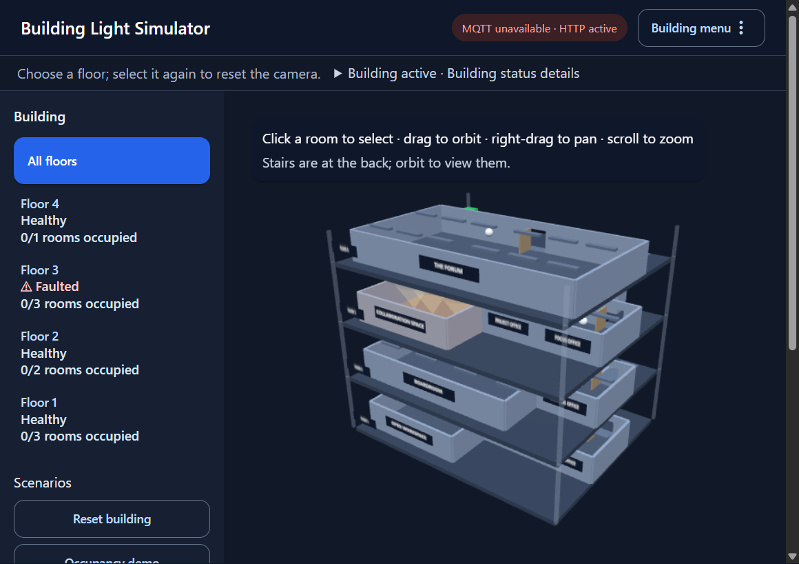
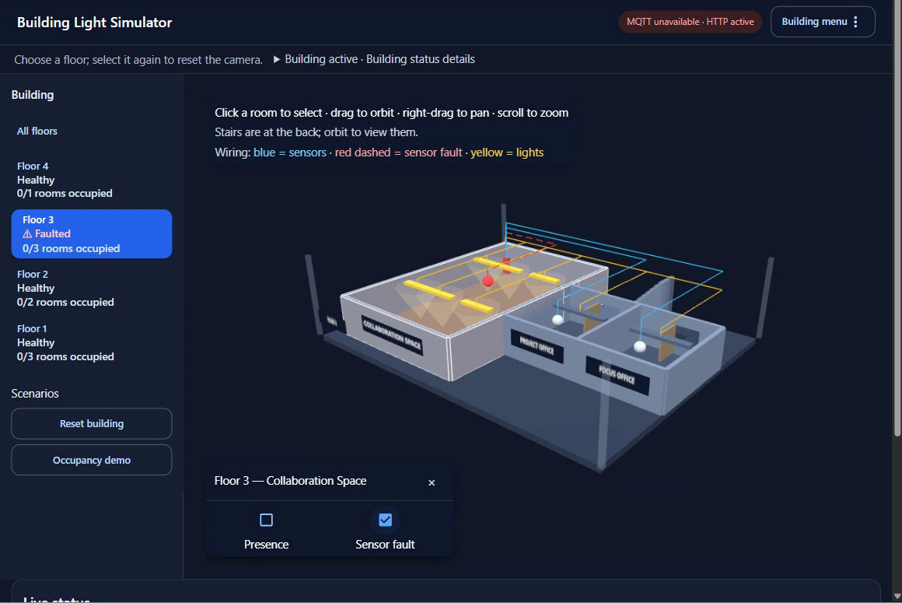
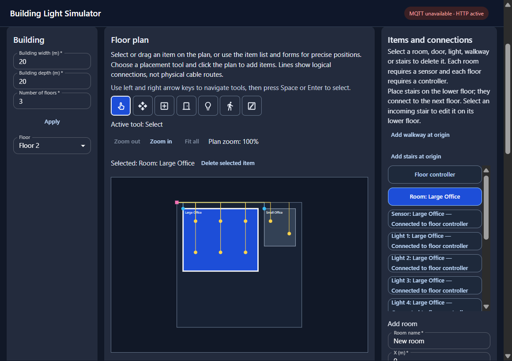

# Building Light Simulator

A .NET IoT demonstration combining an interactive 3D building lighting simulator and editor with a separate telemetry and instrumentation dashboard. A fresh installation starts with a four-floor office building; the editor can create other layouts.

## Agentic workflow

This repository uses an agentic build-review-rebuild workflow with staged changes and pull request review:


**Workflow process:**
1. Agent plans, implements, builds, and validates changes
2. Changes are staged (not auto-committed) and grouped by scope
3. Required reviewers (code, security if applicable, UX if applicable) independently evaluate the changes
4. Pull request is created or updated with implementation, build validation, test results, and review evidence
5. Actionable findings return to implementation; repeat validation and affected reviews after fixes
6. Report any review that could not be completed rather than treating it as passed
7. Human approves, requests changes, or merges when ready
8. Repository rules, when configured, enforce required checks and approvals before merge

Agent customization:

- [AGENTS.md](AGENTS.md) defines repository-wide clean-code, testing, documentation, review, and merge requirements.
- [Build/review/rebuild agent](.github/agents/build-review-rebuild.agent.md) coordinates implementation and validation.
- [Code reviewer](.github/agents/code-reviewer.agent.md) independently checks correctness, clean code, tests, documentation accuracy, and **code coverage impact** (new code is tested; overall coverage is not regressing below phase threshold).
- [Security reviewer](.github/agents/security-reviewer.agent.md) independently checks for OWASP Top 10 UI and API vulnerabilities (required for PRs that add external inputs, API endpoints, or authentication/authorization logic).
- [UX reviewer](.github/agents/ux-reviewer.agent.md) independently checks UI clarity, accessibility, responsive behavior, and state rendering.
- [Pull-request template](.github/PULL_REQUEST_TEMPLATE.md) records validation and reviewer evidence.
- [CI workflow](.github/workflows/ci.yml) builds and tests pull requests, checks the first collected coverage report against a 50% threshold, and runs Node.js and Docker Compose checks.

**Branch protection:** The intended workflow uses pull requests, CI, and human review. Enforcement depends on the repository's branch protection or rulesets; the workflow and agent instructions alone do not enforce approvals or prevent direct pushes.

## Overview

The project demonstrates:

- Device-style controller, room, sensor, light, fault, telemetry, and command state.
- HTTP APIs for inspecting and changing simulator state.
- Optional MQTT state publication, command handling, acknowledgements, retained state, and reconnect behavior.
- HTTP fallback telemetry for use without an MQTT broker.
- An interactive Three.js building with floor selection and room-level controls.
- A building editor with blank and default starting layouts, plan tools, drag-to-move, and save and activation.
- React and TypeScript frontends using Material UI and Vite.
- Live controller health, occupancy, lighting activity, faults, events, and SQLite persistence.
- Unit-tested state transitions, revision handling, stale/offline behavior, and event persistence.


The instrumentation service polls simulator state over HTTP and can also ingest MQTT telemetry; both inputs feed the telemetry store, which persists data in SQLite.

The applications currently use English localization resources. There is no language selector or automatic language switching.

## Applications

| Application | URL | Purpose |
|---|---|---|
| Building Light Simulator | `http://localhost:5080/` | 3D building view, room controls, faults, scenarios, and device state |
| Lighting Instrumentation | `http://localhost:5081/` | Controller health, occupancy, lighting activity, faults, and events |

## Screenshots and demo

The [demo page](docs/demo.html) contains two walkthroughs: building navigation and live instrumentation, and creating a three-floor building from a blank design. The screenshots are separate examples captured at different times.

### Building Light Simulator





[View the selected-floor screenshot at full size](docs/assets/screenshots/building-light-simulator-selected-floor.png)

### Building editor



### Lighting Instrumentation


[Watch both demos on GitHub Pages](https://wmorgan69.github.io/light-controller-simulator/demo.html) or download the [lighting walkthrough](docs/assets/videos/building-lighting-demo.webm) and [editor walkthrough](docs/assets/videos/building-editor-demo.webm).

## Quick start

Build both browser frontends once before running the .NET applications directly. This installs the locked Node dependencies, runs the strict TypeScript check, and creates the local bundles used by each web app:

```powershell
npm ci
npm run build
```

Run the simulator:

```powershell
dotnet run --project src/Devices.Simulator.Web/Devices.Simulator.Web.csproj --urls http://localhost:5080
```

Run the instrumentation dashboard:

```powershell
dotnet run --project src/Devices.Instrumentation.Web/Devices.Instrumentation.Web.csproj --urls http://localhost:5081
```

The default simulator startup view selects Floor 3 and its Collaboration Space. MQTT is optional; the instrumentation service polls the simulator over HTTP and can also ingest MQTT telemetry.

### Docker Compose

With Docker and Docker Compose available, start both applications from the repository root:

```powershell
docker compose up --build
```

Open `http://localhost:5080/` for the simulator and `http://localhost:5081/` for the dashboard. Compose publishes both ports on host loopback only and disables simulator HTTP mutations: the simulator is view-only and its editor and HTTP controls are unavailable. Use the direct loopback Development quick start for interactive editing and controls. These services do not authenticate local users or processes; do not expose them through proxies or non-loopback bindings. The dashboard polls `http://simulator:8080` over the Compose network and can also ingest MQTT telemetry; no MQTT broker is required. MQTT commands are separate; external brokers require access controls. Its SQLite database is stored in the `telemetry-data` named volume and persists when the containers are stopped or recreated. Stop the applications with `docker compose down`.

Remote or forwarded deployments are outside this local-only configuration.

## Documentation

- [Documentation home](docs/README.md)
- [Project plan](docs/plans/plan.md)
- [Building Light Simulator](docs/technical/building-light-simulator.md)
- [Lighting Instrumentation](docs/technical/lighting-instrumentation.md)

## Source layout

```text
Dockerfile                       Container build stages for both applications
compose.yaml                     Local two-service deployment
.dockerignore                    Container build exclusions
package.json                     Frontend scripts and pinned dependencies
package-lock.json                Reproducible npm dependency lock
tsconfig.json                    Strict TypeScript compiler settings
vite.config.js                   Two-app static asset bundler
src/
  Devices.Contracts/             Shared device and telemetry contracts
  Devices.Simulator.Web/
    frontend/                    React, TypeScript, simulator and editor UI
    wwwroot/                     Static entry point and assets
  Devices.Instrumentation.Web/
    frontend/                    React, TypeScript dashboard UI
    wwwroot/                     Static entry point and assets
tests/
  *.test.mjs                     Simulator view-logic and recording-helper tests
  Devices.Simulator.Tests/       Simulator state-transition tests
  Devices.Instrumentation.Tests/ Telemetry store tests
docs/                            Project and application documentation
  assets/                        Diagrams, screenshots, videos, and recording helper
.github/                         CI, agents, and pull-request workflow
AGENTS.md                        Repository-wide agent instructions
```

## Build and test

```powershell
dotnet build Devices.slnx
dotnet test Devices.slnx --no-build --no-restore
npm run test:components
node --import tsx --test tests\building-access.test.mjs tests\wiring-routes.test.mjs tests\floor-view.test.mjs tests\room-state.test.mjs tests\record-demo.test.mjs tests\building-design-view.test.mjs tests\building-editor.test.mjs tests\building-editor-ui.test.mjs tests\localization-en.test.mjs tests\simulator-react-model.test.mjs tests\instrumentation-localization.test.mjs tests\instrumentation-react-telemetry.test.mjs
```
