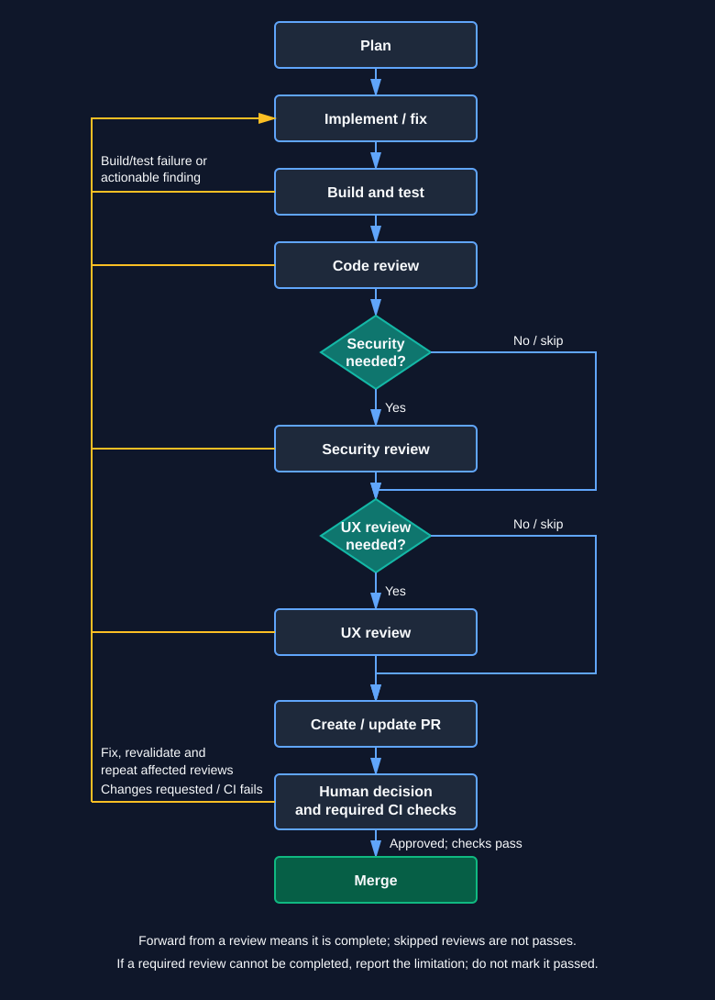
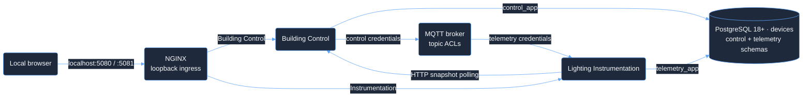
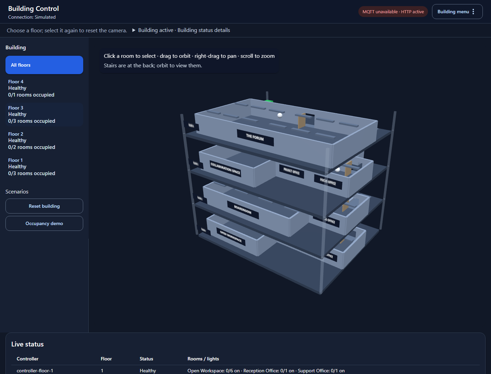
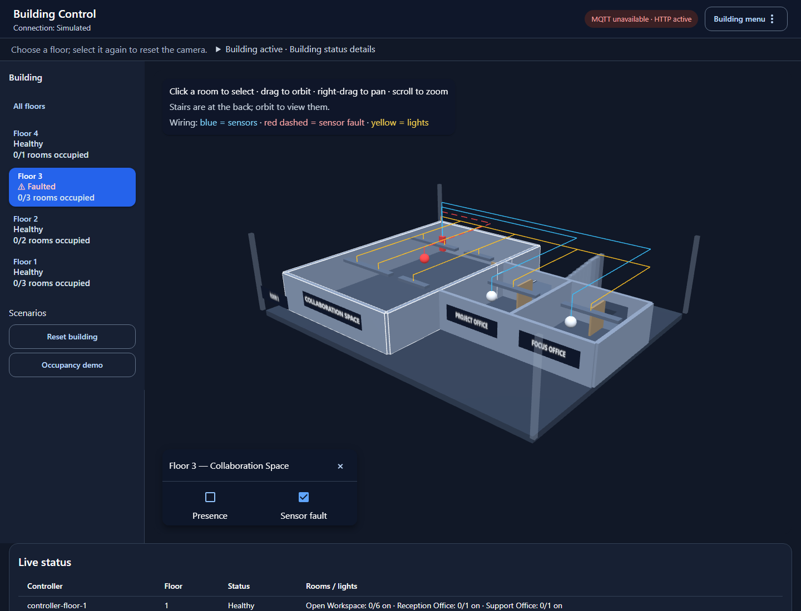

# Building Control

A .NET building control application with an interactive 3D lighting simulation and editor, plus a separate telemetry and instrumentation dashboard. A fresh installation starts with a four-floor office building; the editor can create other layouts. The current connector simulates devices; physical IoT integration is not implemented.

## Agentic workflow

This repository uses an agentic build-review-rebuild workflow with independent reviews and pull request checks:



**Workflow process:**
1. Agent plans, implements, and runs applicable validation, including lint, type-checking, formatting, builds, and tests where relevant
2. Changes remain available for review; staging and grouping by scope are optional
3. Required reviewers (code, security if applicable, UX if applicable) independently evaluate the changes
4. Pull request is created or updated with implementation, build validation, test results, and review evidence
5. Actionable findings return to implementation; repeat validation and affected reviews after fixes
6. Report any review that could not be completed rather than treating it as passed
7. Human approves, requests changes, or merges when ready
8. Repository rules, when configured, enforce required checks and approvals before merge

Agent customization:

- [AGENTS.md](AGENTS.md) defines repository-wide clean-code, testing, documentation, review, and merge requirements.
- [Build/review/rebuild agent](.github/agents/build-review-rebuild.agent.md) coordinates implementation and validation.
- [Code reviewer](.github/agents/code-reviewer.agent.md) independently checks correctness, clean code, tests, documentation accuracy, and applicable coverage evidence. The CI threshold alone does not establish overall coverage or non-regression.
- [Security reviewer](.github/agents/security-reviewer.agent.md) independently checks applicable OWASP and supply-chain risks. Review is required for changes to external inputs, APIs, authentication or authorization, sensitive data handling, security controls, dependencies, or security workflows.
- [UX reviewer](.github/agents/ux-reviewer.agent.md) independently checks UI clarity, accessibility, responsive behavior, and state rendering.
- [Pull-request template](.github/PULL_REQUEST_TEMPLATE.md) records validation and reviewer evidence.
- [CI workflow](.github/workflows/ci.yml) checks frontend lint and types, .NET formatting, GitHub Actions workflows, builds and tests, Node.js logic, and Docker Compose. Its 50% coverage gate checks the first collected .NET report, not combined coverage.
- [Security workflow](.github/workflows/security.yml) runs dependency audits, pull-request dependency review, and CodeQL scans. Whether these checks are required for merge depends on repository rules and feature availability.

**Branch protection:** The intended workflow uses pull requests, CI, and human review. Enforcement depends on the repository's branch protection or rulesets; the workflow and agent instructions alone do not enforce approvals or prevent direct pushes.

## Overview

The project demonstrates:

- Device-style controller, room, sensor, light, fault, telemetry, and command state.
- HTTP APIs for inspecting and changing simulator state.
- Optional MQTT state publication, command handling, acknowledgements, retained state, and reconnect behavior.
- HTTP fallback telemetry for use without an MQTT broker.
- An interactive Three.js building with floor selection and room-level controls.
- A building editor with blank and default starting layouts, plan tools, drag-to-move, and save and activation.
- React and TypeScript frontends using Material UI and Vite.
- Live controller health, occupancy, lighting activity, faults, events, and PostgreSQL persistence.
- Unit-tested state transitions, revision handling, stale/offline behavior, and event persistence.



The two applications share one PostgreSQL database with separate `control` and `telemetry` schemas and roles. PostgreSQL UUIDv7 primary keys are distinct from stable protocol IDs. Instrumentation polls Building Control over HTTP and can also ingest authenticated MQTT telemetry. Both schemas and the broker state use Compose volumes.

For a proposed production deployment connected to physical IoT devices, see the [production infrastructure proposal](docs/infrastructure/production-iot-architecture.md). It is not implemented. For end users, production also requires [user accounts, account management and login](docs/infrastructure/production-iot-architecture.md#user-accounts-and-sign-in), which the current applications do not have.

The applications currently use English localization resources. There is no language selector or automatic language switching.

## Applications

| Application | URL | Purpose |
|---|---|---|
| Building Control | `http://localhost:5080/` | 3D building view, room controls, faults, scenarios, and simulated device state |
| Lighting Instrumentation | `http://localhost:5081/` | Controller health, occupancy, lighting activity, faults, and events |

## Screenshots and demo

The demo page contains two walkthroughs: building navigation and live instrumentation, and creating a three-floor building from a blank design. The screenshots are separate examples captured at different times.

### Building Control





[View the selected-floor screenshot at full size](docs/assets/screenshots/building-control-selected-floor.png)

### Building editor


### Lighting Instrumentation


[Watch both demos on GitHub Pages](https://wmorgan69.github.io/light-controller-simulator/demo.html) or download the [lighting walkthrough](docs/assets/videos/building-lighting-demo.webm) and [editor walkthrough](docs/assets/videos/building-editor-demo.webm).

## Quick start

The local environment is configured as a Docker Compose project with PostgreSQL, MQTT and an NGINX localhost proxy. Kiri is the intended Windows Compose interface, but Kiri/Windows behavior is still being validated; command examples use Docker Compose CLI. The [development environment guide](docs/technical/development-environment.md) covers credential setup, release-build and live-development modes, port overrides, and recovery. This is a local development environment, not a production deployment.

From Linux or WSL at the repository root, provision credentials and start the release-build mode:

```bash
bash deploy/docker-dev-setup.sh
bash deploy/docker-dev-start.sh
```

If WSL only exposes the Windows CLI, use `docker.exe compose` with the same options from a repository path accessible to that CLI.

Open `http://localhost:5080/` for Building Control and `http://localhost:5081/` for Lighting Instrumentation. There is no browser login; local users and processes can access the sites and controls. The script creates fresh local secrets and does not overwrite an existing `.env`. The host ports are loopback-only; do not expose them remotely. Use the same Compose options with `down` to stop containers without deleting data. See the guide for local overrides, changing credentials, switching modes, resetting volumes, or connecting directly to host applications.

## Documentation

- [Documentation home](docs/README.md)
- Plans
  - [Project plan](docs/plans/plan.md)
  - [Building editor specification](docs/plans/building-editor-spec.md)
- [Building Control](docs/technical/building-control.md)
- [Simulated device connector](docs/technical/simulated-device-connector.md)
- [Building Instrumentation guide](docs/technical/building-instrumentation.md)
- [Development environment: setup and recovery](docs/technical/development-environment.md)
- [Production infrastructure proposal](docs/infrastructure/production-iot-architecture.md) - proposed AWS and Azure deployments, IoT integration and scaling

## Source layout

```text
Dockerfile                       Release-build, development, and proxy container stages
database/                        PostgreSQL control and telemetry schemas/migrations
deploy/docker/                   Compose stack, live-development overlay and local service setup
deploy/kubernetes/               Placeholder for a future Kubernetes deployment
deploy/docker-dev-setup.sh       Local development credential setup
deploy/docker-dev-start.sh       Build and start the local Compose stack
.dockerignore                    Container build exclusions
package.json                     Frontend scripts and pinned dependencies
package-lock.json                Reproducible npm dependency lock
tsconfig.json                    Strict TypeScript compiler settings
vite.config.js                   Two-app static asset bundler
src/
  Devices.Contracts/             Shared device and telemetry contracts
  Devices.Connectors.Simulation/
    BuildingSimulator.cs         Simulated state and mutations
    BuildingSimulator.Design.cs  Design activation and reconciliation
  Devices.BuildingControl.Web/
    frontend/                    React, TypeScript, simulator and editor UI
    wwwroot/                     Static entry point and assets
  Devices.Instrumentation.Web/
    frontend/                    React, TypeScript dashboard UI
    wwwroot/                     Static entry point and assets
tests/
  building-control/              Building Control browser and component tests
  instrumentation/              Instrumentation browser and component tests
  deployment/                   Docker setup and Compose tests
  shared/                       Shared tooling and recording-helper tests
  Devices.Simulator.Tests/       Simulator state-transition tests
  Devices.Instrumentation.Tests/ Telemetry store tests
docs/                            Project and application documentation
  assets/                        Diagrams, screenshots, videos, and recording helper
.github/                         CI, agents, and pull-request workflow
AGENTS.md                        Repository-wide agent instructions
```

## Build and test

```powershell
dotnet build Devices.slnx
dotnet test Devices.slnx --no-build --no-restore
npm run test:components
node --import tsx --test tests\building-control\building-access.test.mjs tests\building-control\placeable-access.test.mjs tests\building-control\wiring-routes.test.mjs tests\building-control\floor-view.test.mjs tests\building-control\room-state.test.mjs tests\shared\record-demo.test.mjs tests\building-control\building-design-view.test.mjs tests\building-control\building-editor.test.mjs tests\building-control\building-editor-ui.test.mjs tests\building-control\localization-en.test.mjs tests\building-control\simulator-react-model.test.mjs tests\instrumentation\instrumentation-localization.test.mjs tests\instrumentation\instrumentation-react-telemetry.test.mjs
```

The PostgreSQL persistence tests require isolated PostgreSQL 18 test databases and connection-string environment variables; never point them at development data. See the [contributor guide](docs/contributing/contributor-guide.md#working-on-code-changes) for the variable names and isolation requirements.
