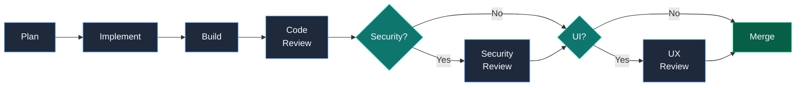
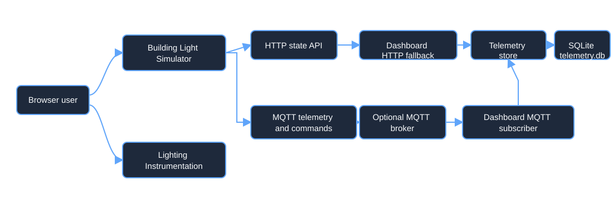
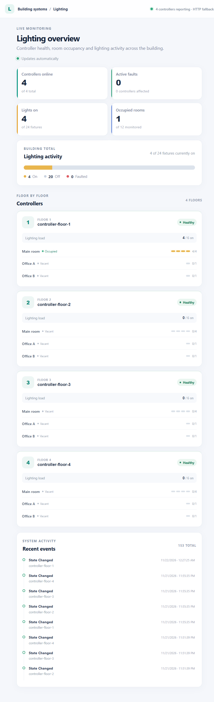

# Building Light Simulator

A .NET IoT demonstration for a four-floor office building. The solution combines an interactive 3D lighting simulator with a separate telemetry and instrumentation dashboard.

## Agentic workflow

This repository uses an agentic build-review-rebuild workflow:



Agent customization:

- [AGENTS.md](AGENTS.md) defines repository-wide clean-code, testing, documentation, review, and merge requirements.
- [Build/review/rebuild agent](.github/agents/build-review-rebuild.agent.md) coordinates implementation and validation.
- [Code reviewer](.github/agents/code-reviewer.agent.md) independently checks correctness, clean code, tests, documentation accuracy, and **code coverage impact** (new code is tested; overall coverage is not regressing below phase threshold).
- [Security reviewer](.github/agents/security-reviewer.agent.md) independently checks for OWASP Top 10 UI and API vulnerabilities (required for PRs that add external inputs, API endpoints, or authentication/authorization logic).
- [UX reviewer](.github/agents/ux-reviewer.agent.md) independently checks UI clarity, accessibility, responsive behavior, and state rendering.
- [Pull-request template](.github/PULL_REQUEST_TEMPLATE.md) records validation and reviewer evidence.
- [CI workflow](.github/workflows/ci.yml) builds, tests, enforces code coverage (≥50% Phase 1, phased to 90%), and validates pull requests.

The instructions guide agents and create an auditable workflow. Final enforcement comes from protected-branch settings requiring CI and reviewer approval. Custom agents cannot, by themselves, prove that every review stage ran or block a merge.

## Overview

The project demonstrates:

- Device-style controller, room, sensor, light, fault, telemetry, and command state.
- HTTP APIs for inspecting and changing simulator state.
- Optional MQTT state publication, command handling, acknowledgements, retained state, and reconnect behavior.
- HTTP fallback telemetry for use without an MQTT broker.
- An interactive Three.js building with floor selection and room-level controls.
- Live controller health, occupancy, lighting activity, faults, events, and SQLite persistence.
- Unit-tested state transitions, revision handling, stale/offline behavior, and event persistence.



## Applications

| Application | URL | Purpose |
|---|---|---|
| Building Light Simulator | `http://localhost:5080/` | 3D building view, room controls, faults, scenarios, and device state |
| Lighting Instrumentation | `http://localhost:5081/` | Controller health, occupancy, lighting activity, faults, and events |

## Screenshots and demo

The screenshots show the simulator and instrumentation dashboard. The video walks through camera pan and rotation, floor and room selection, presence and sensor-fault changes, and their live instrumentation updates, followed by the occupancy demo.

### Building Light Simulator


### Lighting Instrumentation



[Watch the building lighting demo](docs/assets/videos/building-lighting-demo.webm)

## Quick start

Run the simulator:

```powershell
dotnet run --project src/Devices.Simulator.Web/Devices.Simulator.Web.csproj --urls http://localhost:5080
```

Run the instrumentation dashboard:

```powershell
dotnet run --project src/Devices.Instrumentation.Web/Devices.Instrumentation.Web.csproj --urls http://localhost:5081
```

The default simulator startup view selects Floor 3 and its Main Room. MQTT is optional; the dashboard polls the simulator over HTTP when no broker is available.

### Docker Compose

With Docker and Docker Compose available, start both applications from the repository root:

```powershell
docker compose up --build
```

Open `http://localhost:5080/` for the simulator and `http://localhost:5081/` for the dashboard. The dashboard polls `http://simulator:8080` over the Compose network; no MQTT broker is required. Its SQLite database is stored in the `telemetry-data` named volume and persists when the containers are stopped or recreated. Stop the applications with `docker compose down`.

In CodeSandbox, this requires a server environment with a working Docker engine and Compose; forward ports 5080 and 5081 to access the applications.

## Documentation

- [Documentation home](docs/README.md)
- [Project plan](docs/plan.md)
- [Building Light Simulator](docs/building-light-simulator.md)
- [Lighting Instrumentation](docs/lighting-instrumentation.md)

## Source layout

```text
Dockerfile                       Container build stages for both applications
compose.yaml                     Local two-service deployment
.dockerignore                    Container build exclusions
src/
  Devices.Contracts/             Shared device and telemetry contracts
  Devices.Simulator.Web/         Simulator API and 3D browser UI
  Devices.Instrumentation.Web/   Telemetry subscriber and dashboard
tests/
  Devices.Simulator.Tests/       Simulator state-transition tests
  Devices.Instrumentation.Tests/ Telemetry store tests
docs/                            Project and application documentation
  assets/                        Diagrams, screenshots, videos, and recording helper
.github/                         CI, agents, and pull-request workflow
AGENTS.md                        Repository-wide agent instructions
```

## Build and test

```powershell
dotnet build Devices.slnx --no-restore
dotnet test Devices.slnx --no-build --no-restore
```
