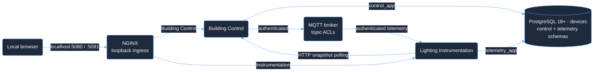
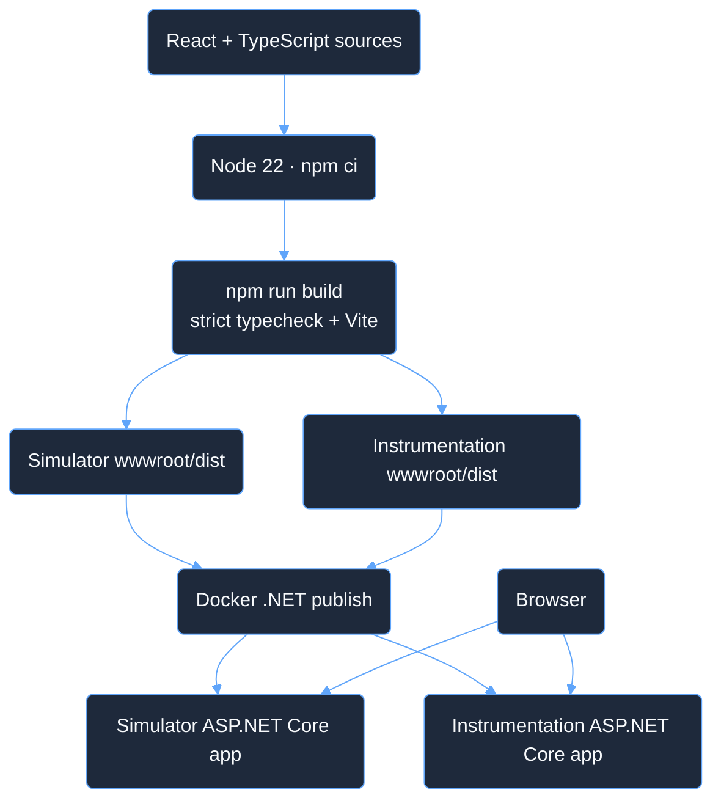
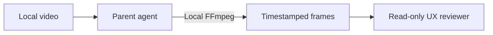

# Building Lighting Documentation

## Table of contents

- [Architecture overview](#architecture-overview)
- [Production IoT architecture proposal](infrastructure/production-iot-architecture.md)
- [Project plan](plans/plan.md)
- [Development environment specification](plans/development-environment-spec.md)
- [Building editor specification](plans/building-editor-spec.md)
- [Building editor technical guide](technical/building-editor.md)
- [Development environment: setup and recovery](technical/development-environment.md)
- [Simulated device connector](technical/simulated-device-connector.md)
- [Changelog](CHANGELOG.md)
- [Applications](#applications)
- [Directory structure](#directory-structure)
- [Running the system](#running-the-system)
- [Screenshots and demo](#screenshots-and-demo)
- [UX design references](ux/README.md)
- [Frontend build and tests](#frontend-build-and-tests)
- [Quality and security](#quality-and-security)
- [Cost-aware agent workflow](contributing/contributor-guide.md#bounded-agent-workflow)
- [Testing](#testing)
- [Documentation map](#documentation-map)

## Architecture overview

The solution has two web applications connected by shared contracts and optional MQTT telemetry. The Building Control uses a separate in-process simulator connector; it does not yet connect to physical devices.



Both web applications use shared contracts. They share one PostgreSQL database with separate `control` and `telemetry` schemas and roles. Application-owned primary keys use PostgreSQL UUIDv7; protocol IDs remain separate. Instrumentation polls Building Control over HTTP and can also ingest MQTT telemetry. PostgreSQL and broker data use persistent Compose volumes.

The browser frontends are React applications written in strict TypeScript and use Material UI. Vite builds both into local static bundles; ASP.NET Core serves the generated files from each application's `wwwroot/dist` directory. Docker runs this frontend build before publishing either .NET application.



## Applications

- [Building Control](technical/building-control.md) - Interactive 3D building model, local building editor, simulated device state, scenarios, and MQTT publication.
- [Simulated device connector](technical/simulated-device-connector.md) - In-process simulator boundary, state, activation, and limitations.
- [Building editor](technical/building-editor.md) - Local editing, validation, API, persistence and recovery.
- [Lighting Instrumentation](technical/building-instrumentation.md) - Live controller health, room/lighting state, events, PostgreSQL persistence, and MQTT/HTTP transport status.

## Directory structure

```text
.
|-- Dockerfile
|-- database/
|   |-- control/
|   `-- telemetry/
|-- deploy/
|   |-- docker-dev-setup.sh
|   |-- docker/
|   |   |-- compose.yaml
|   |   |-- compose.dev.yaml
|   |   `-- dev/
|   `-- kubernetes/
|-- package.json
|-- package-lock.json
|-- tsconfig.json
|-- vite.config.js
|-- src/
|   |-- Devices.Contracts/
|   |-- Devices.Connectors.Simulation/
|   |-- Devices.BuildingControl.Web/
|   |   |-- frontend/          React, TypeScript, and simulator styles
|   |   |-- Properties/
|   |   `-- wwwroot/
|   |       `-- dist/          generated by Vite before publish
|   |       `-- vendor/
|   `-- Devices.Instrumentation.Web/
|       |-- Properties/
|       |-- frontend/          React, TypeScript, and dashboard styles
|       `-- wwwroot/
|           `-- dist/          generated by Vite before publish
|-- tests/
|   |-- Devices.Simulator.Tests/
|   |-- Devices.Instrumentation.Tests/
|   |-- building-control/     Building Control browser and component tests
|   |-- instrumentation/     Instrumentation browser and component tests
|   |-- deployment/          Docker setup and Compose tests
|   `-- shared/              Shared tooling and recording-helper tests
`-- docs/
    |-- assets/
    |   |-- diagrams/
    |   |-- screenshots/
    |   `-- videos/
    |-- contributing/
    |-- plans/
    |-- technical/
    `-- ux/
        |-- building-control/
        |   |-- main/
        |   `-- editor/
        `-- instrumentation/
```

Generated `bin/`, `obj/`, database volume contents, and local secret files are runtime/development artifacts and are not source documentation.

## Running the system

Follow the [development environment guide](technical/development-environment.md) for credential provisioning, Compose commands and shutdown. The release-build mode uses `deploy/docker/compose.yaml`; the live-development overlay adds `compose.dev.yaml`. Both modes use PostgreSQL 18+, MQTT credentials, NGINX and the same persistent volumes. The default browser URLs are `http://localhost:5080/` and `http://localhost:5081/`; both ports can be overridden. The [Kubernetes directory](../deploy/kubernetes/README.md) is a placeholder, not a deployment.

The direct-host applications are not a self-contained alternative: each requires a configured PostgreSQL connection. Direct simulator mutations retain their enabled-by-default setting but require loopback TCP peer and local addresses plus same-origin checks; direct editor access additionally requires Development. Neither mode provides a browser login. Do not expose direct listeners, Compose ports, database or broker outside the local machine. Local users and processes share the environment's trust boundary; development credentials are not production secret storage.

## Screenshots and demo

The [root README](../README.md#screenshots-and-demo) includes screenshots of both applications and the editor. The [demo page](demo.html) and its [GitHub Pages version](https://wmorgan69.github.io/light-controller-simulator/demo.html) present two short videos with text summaries: orbit, pan and zoom in the default building and its floor views, presence, sensor fault, the occupancy demo and dashboard updates; and a blank-to-three-floor editor walkthrough. A recording-only address strip shows the actual local site URL in the lighting walkthrough. The editor example contains two offices on Floor 1, a large and a small office on Floor 2, and a meeting room on Floor 3, with 20 lights in total. Screenshots are in [`assets/screenshots/`](assets/screenshots/) and videos in [`assets/videos/`](assets/videos/). Diagrams are in [`assets/diagrams/`](assets/diagrams/).

The GitHub Pages deployment publishes this `docs/` directory when changes are pushed to `main`. Enable **Settings > Pages > Build and deployment > Source > GitHub Actions** in the repository to activate the deployment workflow.

An alternative main walkthrough and baseline screenshots can be captured with [record-demo.mjs](assets/record-demo.mjs). This helper records a different scenario from the published lighting video: it uses Floor 2's Meeting Office for presence and the sensor fault, with a baseline occupied room on Floor 1. Install the frontend dependencies with `npm ci` and use a Playwright environment supporting local module imports and `page.screencast`: import `captureBuildingLightingDemo` and call `await captureBuildingLightingDemo(page, outputDirectory)` with a visible page. The helper uses `tsx` to load TypeScript camera presets; the Integrated Browser's code runner may not support importing local modules directly. Both apps default to ports 5080 and 5081; pass `simulatorUrl` and `instrumentationUrl` in the optional third argument to use other instances. The output directory must contain writable `screenshots/` and `videos/` subdirectories. The helper resets the building and restores a baseline occupancy/fault state when it finishes; use isolated instances and databases to avoid changing other users' state. The checked-in walkthroughs, selected-floor screenshot and editor screenshot were captured separately, not by this helper.

If the process or browser is terminated, cleanup may not run: check the simulator state and reset it if needed. Verify that the recording completed before publishing it; an interrupted output may be incomplete.

For UX review of a local video when the reviewer cannot decode it, the parent agent can follow the [video-review skill](../.github/skills/video-review/SKILL.md) to extract timestamped frames with a locally installed FFmpeg. The reviewer remains read-only; sampled frames do not verify continuous motion, audio, or live interaction.



## Quality and security

The project combines automated checks with guidance for manual reviews:

- **Code coverage**: CI checks that the first collected coverage report meets the current 50% threshold. A 90% threshold is a future goal, not the current enforced threshold; this check does not calculate combined solution coverage.
- **Security review (OWASP Top 10)**: Repository instructions call for a `security-reviewer` agent review for changes to existing or new external inputs, API endpoints, authentication/authorization, sensitive data handling, security controls, dependencies, or security workflows; otherwise record not applicable with a reason. The CI workflow does not enforce that agent review.
- **Dependency updates**: Dependabot is configured for NuGet, npm, and GitHub Actions; it requires supported manifests and the relevant GitHub features to operate.
- **Automated security checks**: CI audits npm and NuGet dependencies, reviews dependency changes on pull requests, and runs CodeQL; GitHub security feature availability and branch protection must be configured separately.
- **Branch protection**: Required status checks and approvals depend on repository rules configured in GitHub; agent instructions alone do not enforce them.

See [Branch Protection Configuration](contributing/branch-protection.md) and [Quality & Security Implementation Guide](contributing/quality-and-security.md) for setup instructions, recommended approaches for reaching 90% coverage, and troubleshooting.

The [bounded agent workflow](contributing/contributor-guide.md#bounded-agent-workflow) documents scoped instructions, diff-first handoffs, shared validation/browser evidence, conditional specialist review, and incremental re-review. Local task scoping does not bypass full required PR CI.

## Frontend build and tests

Use Node.js 22.18 or later in the 22.x line, or Node.js 24.11 or later, and npm from the Node installation. CI uses Node.js 22. From the repository root, install the locked dependencies and build both applications:

```powershell
npm ci
npm run lint
npm run test:lint
npm run typecheck
npm run build
```

`npm run build` also runs `npm run typecheck` before bundling the simulator and instrumentation. TypeScript uses `strict: true` and emits no JavaScript; Vite writes `app.js` and `app.css` under each application's `wwwroot/dist`.

ESLint checks frontend JavaScript and TypeScript for selected correctness, React Hooks, and JSX accessibility issues. It uses Babel's TypeScript parser rather than type-aware ESLint rules; `npm run typecheck` remains the type checker. The lint configuration tests exercise representative rules and the pinned minimatch override used to address GHSA-g3hv-75wg-m249 in the accessibility plugin. Revisit the override when the plugin supports a patched version directly.

Run React component tests in jsdom, optionally collecting V8 coverage for frontend source (excluding entry points and type-only files):

```powershell
npm run test:components
npm run test:components:coverage
```

The simulator component tests replace the WebGL scene because jsdom cannot render it; coverage includes that untested scene, and is distinct from the .NET CI coverage threshold. These tests do not replace browser or visual verification. Run the existing browser-side logic tests with Node's built-in test runner:

```powershell
node --import tsx --test tests\building-control\building-access.test.mjs tests\building-control\placeable-access.test.mjs tests\building-control\wiring-routes.test.mjs tests\building-control\floor-view.test.mjs tests\building-control\room-state.test.mjs tests\shared\record-demo.test.mjs tests\building-control\localization-en.test.mjs tests\building-control\building-design-view.test.mjs tests\building-control\building-editor.test.mjs tests\building-control\building-editor-ui.test.mjs tests\building-control\simulator-react-model.test.mjs
node --import tsx --test tests\instrumentation\instrumentation-localization.test.mjs tests\instrumentation\instrumentation-react-telemetry.test.mjs
```

See the [simulator guide](technical/building-control.md#running-and-testing) and [instrumentation guide](technical/building-instrumentation.md#running-and-testing) for application-specific commands.

## Testing

```powershell
dotnet build Devices.slnx
dotnet format Devices.slnx --verify-no-changes --no-restore
dotnet test Devices.slnx --no-build --no-restore
```

The PostgreSQL persistence tests require isolated PostgreSQL 18 test databases and connection-string environment variables; never point them at development data. See the [contributor guide](contributing/contributor-guide.md#working-on-code-changes) for names and isolation requirements.

The CI workflow also checks GitHub Actions files with a checksum-verified, pinned actionlint release, runs frontend lint and tests, builds both container images (including the npm frontend build), and smoke-tests browser access without a login and PostgreSQL-backed HTTP telemetry with Docker Compose. Its service-recreation check leaves MQTT running, so it does not isolate database recovery from retained broker state. Actionlint's optional shellcheck and pyflakes integrations are not enabled.

## Documentation map

| Document | Covers |
|---|---|
| [Building Control](technical/building-control.md) | 3D model, controls, state model, APIs, MQTT commands, scenarios, source map |
| [Simulated device connector](technical/simulated-device-connector.md) | Connector contracts, in-process state, activation and limitations |
| [Building editor](technical/building-editor.md) | Editing, validation, editor API, persistence and recovery |
| [Building Instrumentation](technical/building-instrumentation.md) | Lighting dashboard design, telemetry flow, persistence, stale/offline behavior, source map |
| [Development environment](technical/development-environment.md) | Compose setup, local access, release-build and live-development modes, PostgreSQL backup and restore limitations |
| [Production IoT architecture proposal](infrastructure/production-iot-architecture.md) | Proposed AWS and Azure deployments, user accounts and sign-in, IoT integration, phased scaling approach and security |
| [UX design references](ux/README.md) | Shared design baseline, app-specific design guides, and desktop and mobile references |
| [Project plan](plans/plan.md) | Goals, delivery phases, implementation decisions, acceptance criteria |
| [Development environment specification](plans/development-environment-spec.md) | Requirements and remaining validation for the local Compose environment; see the [implementation guide](technical/development-environment.md) for current behavior |
| [Building editor specification](plans/building-editor-spec.md) | Current editor workflow, validation, storage, access limits, and remaining gaps |
| [Changelog](CHANGELOG.md) | Project history, recorded commits, and upcoming changes |
| [Contributor Guide](contributing/contributor-guide.md) | Cost-aware scoped agent workflow, diff-first review, shared evidence, code coverage, testing, and security review |
| [Branch Protection Configuration](contributing/branch-protection.md) | CI/CD enforcement, GitHub status checks, Codecov setup |
| [Quality & Security Implementation](contributing/quality-and-security.md) | Coverage threshold strategy, reaching 90%, security review workflow, Dependabot setup |
