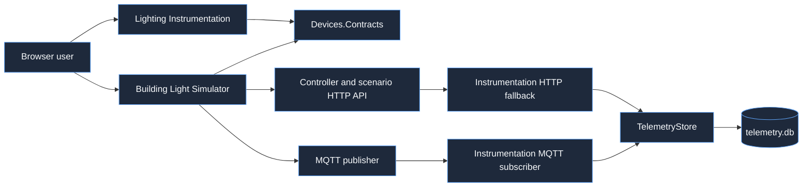
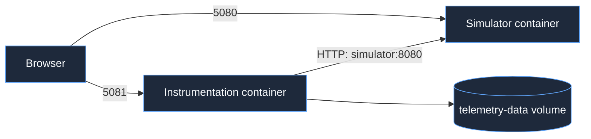
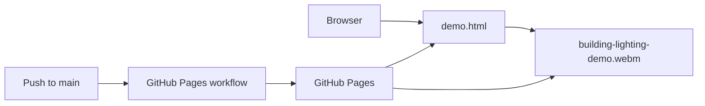

# Building Lighting Documentation

## Table of contents

- [Architecture overview](#architecture-overview)
- [Project plan](plan.md)
- [Applications](#applications)
- [Screenshots and demo](#screenshots-and-demo)
- [Quality and security](#quality-and-security)
- [Directory structure](#directory-structure)
- [Running the system](#running-the-system)
- [Testing](#testing)
- [Documentation map](#documentation-map)

## Architecture overview

The solution has two web applications connected by shared contracts and optional MQTT telemetry.



## Applications

- [Building Light Simulator](building-light-simulator.md) - Interactive 3D building model, HTTP device state, simulator scenarios, and MQTT publication.
- [Lighting Instrumentation](lighting-instrumentation.md) - Live controller health, room/lighting state, events, SQLite persistence, and MQTT/HTTP transport status.

## Directory structure

```text
.
|-- src/
|   |-- Devices.Contracts/
|   |-- Devices.Simulator.Web/
|   |   |-- Properties/
|   |   `-- wwwroot/
|   |       `-- vendor/
|   `-- Devices.Instrumentation.Web/
|       |-- Properties/
|       `-- wwwroot/
|-- tests/
|   |-- Devices.Simulator.Tests/
|   `-- Devices.Instrumentation.Tests/
`-- docs/
    `-- assets/
        |-- diagrams/
        |-- screenshots/
        `-- videos/
```

Generated `bin/`, `obj/`, and SQLite files are runtime/build artifacts and are not source documentation.

## Running the system

```powershell
dotnet run --project src/Devices.Simulator.Web/Devices.Simulator.Web.csproj --urls http://localhost:5080
dotnet run --project src/Devices.Instrumentation.Web/Devices.Instrumentation.Web.csproj --urls http://localhost:5081
```

Open the simulator at `http://localhost:5080/` and instrumentation at `http://localhost:5081/`.

Alternatively, run both applications with Docker and Docker Compose:

```powershell
docker compose up --build
```

The same host ports are used. The dashboard polls `http://simulator:8080` on the Compose network and stores SQLite data in the `telemetry-data` named volume. Stop the containers with `docker compose down`. A CodeSandbox server environment must provide a Docker engine and Compose; forward ports 5080 and 5081.



## Screenshots and demo

The [root README](../README.md#screenshots-and-demo) includes screenshots of both applications and links to the [playable walkthrough on GitHub Pages](https://wmorgan69.github.io/light-controller-simulator/demo.html). The video demonstrates camera pan and rotation, floor and room selection, presence and sensor-fault changes, live dashboard updates, and the occupancy demo. Screenshots are in [`assets/screenshots/`](assets/screenshots/) and the video is in [`assets/videos/`](assets/videos/). Diagrams are in [`assets/diagrams/`](assets/diagrams/).

The GitHub Pages deployment publishes this `docs/` directory when changes are pushed to `main`. Enable **Settings > Pages > Build and deployment > Source > GitHub Actions** in the repository to activate the deployment workflow.



To regenerate the main simulator and instrumentation screenshots and the walkthrough, import `captureBuildingLightingDemo` from [record-demo.mjs](assets/record-demo.mjs) and call `await captureBuildingLightingDemo(page, outputDirectory)` from a visible Integrated Browser Playwright page that supports `page.screencast`. Both apps must be running on ports 5080 and 5081, and the output directory must contain writable `screenshots/` and `videos/` subdirectories (use `docs/assets` from the repository root). The helper verifies the expected dashboard states and restores the baseline occupancy/fault state when it finishes. The [selected-floor screenshot](assets/screenshots/building-light-simulator-selected-floor.png) is a frame from the walkthrough and is not generated by the helper.

## Quality and security

The project enforces quality and security standards through automated and manual reviews:

- **Code coverage >= 90%**: CI workflow collects code coverage and fails the build if below threshold.
- **Security review (OWASP Top 10)**: For PRs with external inputs, API endpoints, or authentication logic, the `security-reviewer` agent audits UI and API vulnerabilities.
- **Dependency scanning**: Dependabot automatically scans NuGet and npm packages for vulnerabilities and opens PRs for security updates.
- **Branch protection**: The `main` branch requires passing CI status checks, code review approval, and security review (where applicable).

See [Branch Protection Configuration](branch-protection.md) and [Quality & Security Implementation Guide](quality-and-security.md) for setup instructions, recommended approaches for reaching 90% coverage, and troubleshooting.

## Testing

```powershell
dotnet build Devices.slnx --no-restore
dotnet test Devices.slnx --no-build --no-restore
```

The CI workflow also runs the simulator's Node.js view-logic tests, builds both container images, and smoke-tests HTTP telemetry and SQLite persistence with Docker Compose.

## Documentation map

| Document | Covers |
|---|---|
| [Building Light Simulator](building-light-simulator.md) | 3D model, controls, state model, APIs, MQTT commands, scenarios, source map |
| [Lighting Instrumentation](lighting-instrumentation.md) | Dashboard design, telemetry flow, persistence, stale/offline behavior, source map |
| [Project plan](plan.md) | Goals, delivery phases, implementation decisions, acceptance criteria |
| [Contributor Guide](contributor-guide.md) | Code coverage workflow, testing tips, security review process, common questions |
| [Branch Protection Configuration](branch-protection.md) | CI/CD enforcement, GitHub status checks, Codecov setup |
| [Quality & Security Implementation](quality-and-security.md) | Coverage threshold strategy, reaching 90%, security review workflow, Dependabot setup |
