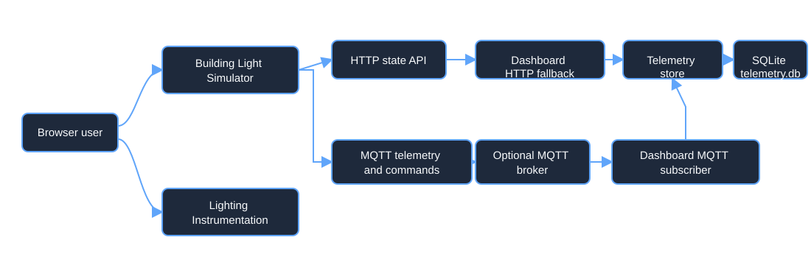
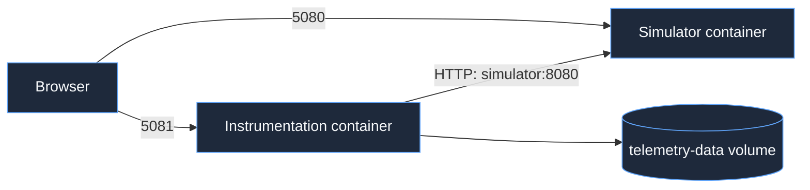
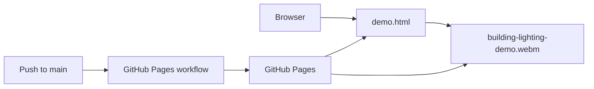
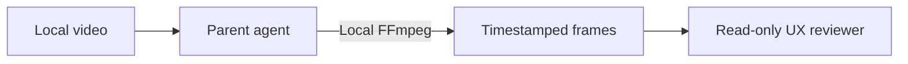

# Building Lighting Documentation

## Table of contents

- [Architecture overview](#architecture-overview)
- [Project plan](plans/plan.md)
- [Building editor specification (proposed)](plans/building-editor-spec.md)
- [Changelog](CHANGELOG.md)
- [Applications](#applications)
- [Directory structure](#directory-structure)
- [Running the system](#running-the-system)
- [Screenshots and demo](#screenshots-and-demo)
- [UX design references](ux/README.md)
- [Quality and security](#quality-and-security)
- [Testing](#testing)
- [Documentation map](#documentation-map)

## Architecture overview

The solution has two web applications connected by shared contracts and optional MQTT telemetry.



Both web applications use shared contracts. The instrumentation service polls the simulator over HTTP and can also ingest optional MQTT telemetry; both inputs feed the telemetry store, which persists it in SQLite.

## Applications

- [Building Light Simulator](technical/building-light-simulator.md) - Interactive 3D building model, HTTP device state, simulator scenarios, and MQTT publication.
- [Lighting Instrumentation](technical/lighting-instrumentation.md) - Live controller health, room/lighting state, events, SQLite persistence, and MQTT/HTTP transport status.

## Directory structure

```text
.
|-- src/
|   |-- Devices.Contracts/
|   |-- Devices.Simulator.Web/
|   |   |-- Properties/
|   |   `-- wwwroot/
|   |       `-- vendor/
|   `-- Devices.Instrumentation.Web/
|       |-- Properties/
|       `-- wwwroot/
|-- tests/
|   |-- Devices.Simulator.Tests/
|   `-- Devices.Instrumentation.Tests/
`-- docs/
    |-- assets/
    |   |-- diagrams/
    |   |-- screenshots/
    |   `-- videos/
    |-- contributing/
    |-- plans/
    |-- technical/
    `-- ux/
        |-- simulator/
        |   |-- main/
        |   `-- editor/
        `-- instrumentation/
```

Generated `bin/`, `obj/`, and SQLite files are runtime/build artifacts and are not source documentation.

## Running the system

```powershell
dotnet run --project src/Devices.Simulator.Web/Devices.Simulator.Web.csproj --urls http://localhost:5080
dotnet run --project src/Devices.Instrumentation.Web/Devices.Instrumentation.Web.csproj --urls http://localhost:5081
```

Open the simulator at `http://localhost:5080/` and instrumentation at `http://localhost:5081/`.

Alternatively, run both applications with Docker and Docker Compose:

```powershell
docker compose up --build
```

The same host ports are used. The dashboard polls `http://simulator:8080` on the Compose network and stores SQLite data in the `telemetry-data` named volume. Stop the containers with `docker compose down`. A CodeSandbox server environment must provide a Docker engine and Compose; forward ports 5080 and 5081.



## Screenshots and demo

The [root README](../README.md#screenshots-and-demo) includes screenshots of both applications and links to the [playable walkthrough on GitHub Pages](https://wmorgan69.github.io/light-controller-simulator/demo.html). The video cycles through Floors 1–4 and returns to Floor 3, and demonstrates pan, full 360-degree rotation, and zoom in both the all-floors and selected-floor views, room selection, presence and sensor-fault changes, live dashboard updates, and the occupancy demo. The dashboard remains visible for five seconds after each presence, fault, and occupancy update. A recording-only, browser-style address strip displays each actual local URL; the recording does not include browser chrome. Screenshots are in [`assets/screenshots/`](assets/screenshots/) and the video is in [`assets/videos/`](assets/videos/). Diagrams are in [`assets/diagrams/`](assets/diagrams/).

The GitHub Pages deployment publishes this `docs/` directory when changes are pushed to `main`. Enable **Settings > Pages > Build and deployment > Source > GitHub Actions** in the repository to activate the deployment workflow.



To regenerate the main simulator and instrumentation screenshots and the walkthrough, use a Playwright environment that supports both local module imports and `page.screencast`: import `captureBuildingLightingDemo` from [record-demo.mjs](assets/record-demo.mjs) and call `await captureBuildingLightingDemo(page, outputDirectory)` with a visible page. The Integrated Browser's code runner may not support importing local modules directly. Both apps must be running on ports 5080 and 5081 by default; pass `simulatorUrl` and `instrumentationUrl` in the optional third argument to use other instances. The output directory must contain writable `screenshots/` and `videos/` subdirectories (use `docs/assets` from the repository root). The helper resets the building and restores its baseline occupancy/fault state when it finishes; use isolated instances to avoid changing other users' state. Its dashboard screenshot shows the healthy baseline; the checked-in screenshot instead shows a sensor fault. The [selected-floor screenshot](assets/screenshots/building-light-simulator-selected-floor.png) is captured separately at desktop width and is not generated by the helper; it shows Floor 2's Boardroom with a sensor fault and all eight lights off.

If the process or browser is terminated, cleanup may not run: check the simulator state and reset it if needed. Verify that the recording completed before publishing it; an interrupted output may be incomplete.

For UX review of a local video when the reviewer cannot decode it, the parent agent can follow the [video-review skill](../.github/skills/video-review/SKILL.md) to extract timestamped frames with a locally installed FFmpeg. The reviewer remains read-only; sampled frames do not verify continuous motion, audio, or live interaction.



## Quality and security

The project combines automated checks with guidance for manual reviews:

- **Code coverage**: CI checks that the first collected coverage report meets the current 50% threshold. A 90% threshold is a future goal, not the current enforced threshold; this check does not calculate combined solution coverage.
- **Security review (OWASP Top 10)**: Repository instructions call for a `security-reviewer` agent review for changes to external inputs, API endpoints, or authentication logic; the CI workflow does not enforce that review.
- **Dependency updates**: Dependabot is configured for NuGet and npm; it requires supported manifests and the relevant GitHub features to operate.
- **Branch protection**: Required status checks and approvals depend on repository rules configured in GitHub; agent instructions alone do not enforce them.

See [Branch Protection Configuration](contributing/branch-protection.md) and [Quality & Security Implementation Guide](contributing/quality-and-security.md) for setup instructions, recommended approaches for reaching 90% coverage, and troubleshooting.

## Testing

```powershell
dotnet build Devices.slnx
dotnet test Devices.slnx --no-build --no-restore
```

The CI workflow also runs the Node.js view-logic, recording-helper, and localization tests, builds both container images, and smoke-tests HTTP telemetry and SQLite persistence with Docker Compose.

## Documentation map

| Document | Covers |
|---|---|
| [Building Light Simulator](technical/building-light-simulator.md) | 3D model, controls, state model, APIs, MQTT commands, scenarios, source map |
| [Lighting Instrumentation](technical/lighting-instrumentation.md) | Dashboard design, telemetry flow, persistence, stale/offline behavior, source map |
| [UX design references](ux/README.md) | Shared design baseline, app-specific design guides, and desktop and mobile references |
| [Project plan](plans/plan.md) | Goals, delivery phases, implementation decisions, acceptance criteria |
| [Building editor specification](plans/building-editor-spec.md) | Proposed building editor, storage, acceptance criteria, and open decisions |
| [Changelog](CHANGELOG.md) | Project history, recorded commits, and upcoming changes |
| [Contributor Guide](contributing/contributor-guide.md) | Code coverage workflow, testing tips, security review process, common questions |
| [Branch Protection Configuration](contributing/branch-protection.md) | CI/CD enforcement, GitHub status checks, Codecov setup |
| [Quality & Security Implementation](contributing/quality-and-security.md) | Coverage threshold strategy, reaching 90%, security review workflow, Dependabot setup |
