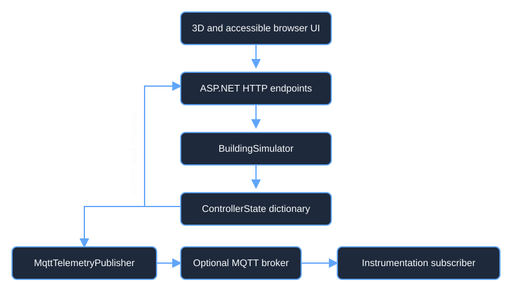
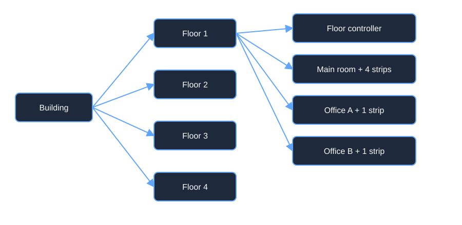
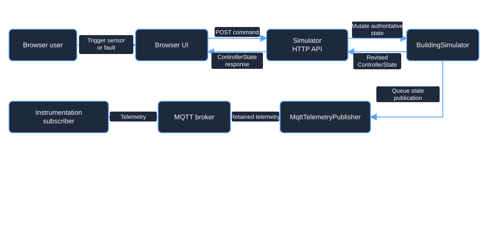
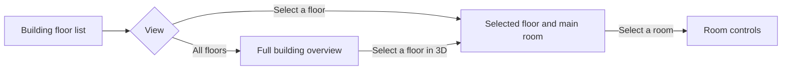
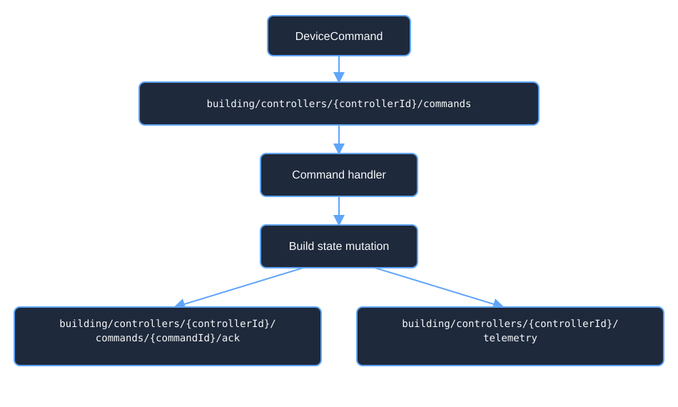

# Building Light Simulator

## Table of contents

- [Purpose](#purpose)
- [Design](#design)
- [Building model](#building-model)
- [Runtime architecture](#runtime-architecture)
- [User interactions](#user-interactions)
- [HTTP API](#http-api)
- [MQTT protocol](#mqtt-protocol)
- [Source tree](#source-tree)
- [Configuration](#configuration)
- [Running and testing](#running-and-testing)

## Purpose

The simulator presents a four-floor office building and provides deterministic device state that can be changed through HTTP or MQTT. It is intended for demonstrations, IoT protocol experiments, and testing the separate instrumentation dashboard.

## Design

The application separates:

- **Device state** - controllers, rooms, sensors, light strips, presence, faults, and revisions.
- **HTTP control** - browser-visible commands and state inspection.
- **MQTT telemetry** - retained state snapshots and command acknowledgements.
- **3D presentation** - local Three.js scene with floor and room selection.



## Building model



Each floor has one controller and three rooms. There are:

- 4 controllers
- 12 rooms
- 12 presence sensors
- 24 light strips
- 1 main room with 4 strips per floor
- 1 strip in each office

Stable IDs are created in [Ids.cs](../src/Devices.Contracts/Ids.cs):

- Controller: `controller-floor-{n}`
- Room: `floor-{n}-{room}`
- Sensor: `sensor-floor-{n}-{room}`
- Light: `light-floor-{n}-{room}-{index}`

## Runtime architecture



## User interactions

The Building list sits beside the 3D view on desktop and above it on narrow screens. It shows each floor's controller status, occupied-room count, and the current selection, with scenario controls below the floors. An icon marks faulted controllers, and the occupancy count reflects room presence. The list updates after simulator actions; changes made elsewhere require a page reload.
On narrow screens the camera widens its view to keep the floor visible; on wider screens the selected-floor view is slightly farther out. The preset updates across the breakpoint unless the camera has been moved manually.



- **Floor selection** displays only the chosen floor in the 3D view, opens its main room, and moves the camera to that floor. Selecting the same floor again resets its camera without changing the selected room; if no room is selected, it reopens the main room. The Building list and live status table retain the other floors' status.
- **Startup** selects Floor 3 and uses the selected-floor camera.
- **All floors** clears the floor selection, restores detailed floors and normal spacing, and restores the complete-building camera.
- **Corner pillars** provide a faint, non-interactive building frame in the overview; they are hidden when a floor is selected.
- **Sensors** sit at the illustrative ceiling height. Office sensors are offset from the light strips so both remain visible and selectable. A faulted sensor is shown in red even when its room is not selected.
- **Room selection** is available by clicking or tapping a room in the 3D view, as indicated in the view's interaction help.
- **Wiring** automatically connects the selected floor's controller to its sensors and light strips in an illustrative overlay. No wiring is shown in All floors view. A key below the 3D view's interaction instructions identifies blue wiring as sensors and amber wiring as lights; the routes are not actual cable layouts.
- **Room inspector** controls presence and sensor-fault state for the selected room only. A floor remains faulted while any fault on its controller remains active.
- **Reset building** clears presence, triggered state, lights, and faults.
- **Occupancy demo** randomly selects 1–2 rooms per floor and turns on their current strips. Scenario controls are disabled while a scenario is running. Errors are displayed below the controls, including when a scenario succeeds but its status refresh fails.
- **Accessible controls** and the keyboard-accessible Building list provide floor selection, room-trigger, and fault controls without 3D hit testing. Selecting a floor opens its main room; choosing All floors restores the overview.

The 3D view is built from local Three.js modules in `wwwroot/vendor`; it does not require a CDN at runtime.

## HTTP API

| Method | Endpoint | Purpose |
|---|---|---|
| `GET` | `/api/controllers` | List controller states |
| `GET` | `/api/controllers/{controllerId}` | Get one controller |
| `GET` | `/api/status` | MQTT and HTTP transport status |
| `POST` | `/api/rooms/{roomId}/sensor/trigger` | Trigger a room sensor |
| `POST` | `/api/rooms/{roomId}/sensor/reset` | Reset presence and room lights |
| `POST` | `/api/devices/{deviceId}/faults` | Add sensor, strip, or controller fault |
| `DELETE` | `/api/devices/{deviceId}/faults/{faultId}` | Clear a fault |
| `POST` | `/api/scenarios/reset` | Reset the full building |
| `POST` | `/api/scenarios/occupancy` | Randomize 1–2 occupied rooms per floor |

## MQTT protocol

The publisher uses `building/controllers/{controllerId}/telemetry` for retained state telemetry.



Supported actions:

- `trigger`
- `reset`
- `add-fault`
- `clear-fault`

The command contract includes stable command, controller, room, target, scope, description, and timestamp fields. A command is rejected unless the MQTT topic controller matches the payload controller and the target belongs to that controller.

## Source tree

```text
src/Devices.Simulator.Web/
  Devices.Simulator.Web.csproj
  Program.cs
  appsettings.json
  Properties/launchSettings.json
  wwwroot/
    app.js       3D scene, selection, controls, scenarios
    building-pillars.mjs  illustrative corner pillars
    floor-view.mjs  floor selection and camera framing
    room-fixtures.mjs  room sensor and light positions
    room-state.mjs  sensor fault lookup and light visual state
    wiring-routes.mjs  illustrative wiring routes
    index.html   semantic page structure
    styles.css   scene, inspector, status, responsive layout
    vendor/      local Three.js and OrbitControls modules
```

Shared contracts and IDs are in [Devices.Contracts](../src/Devices.Contracts/).

## Configuration

`appsettings.json`:

```json
{
  "Mqtt": {
    "Host": "localhost",
    "Port": 1883
  },
  "Urls": "http://localhost:5080"
}
```

An unavailable broker does not block HTTP simulation. MQTT status is exposed through `/api/status`.

## Running and testing

```powershell
dotnet run --project src/Devices.Simulator.Web/Devices.Simulator.Web.csproj --urls http://localhost:5080
dotnet test tests/Devices.Simulator.Tests/Devices.Simulator.Tests.csproj
node --test tests/wiring-routes.test.mjs tests/floor-view.test.mjs tests/room-state.test.mjs
```

The simulator view-logic tests require Node.js.
