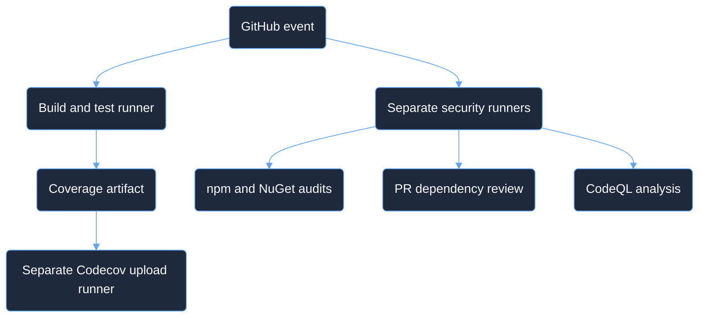

# Implementation Summary: Code Coverage, Security Review, and Dependency Updates

## Overview

The repository currently provides these quality and security mechanisms:

1. **Code Coverage Phase 1 Enforcement (≥50%)**
2. **Security Review Agent Guidance (OWASP Top 10 UI & API)**
3. **Dependency Updates and Security Scanning**

## Files Created/Modified

### Created

| File | Purpose |
|---|---|
| `.github/agents/security-reviewer.agent.md` | Security review agent definition (OWASP Top 10 checklist) |
| `.github/dependabot.yml` | Dependabot configuration for NuGet, npm, and GitHub Actions |
| `docs/contributing/branch-protection.md` | Setup guide for GitHub branch protection and CI status checks |

### Modified

| File | Changes |
|---|---|
| `.github/workflows/ci.yml` | Collects coverage, enforces the current ≥50% Phase 1 threshold, and attempts a Codecov upload |
| `.github/workflows/security.yml` | Audits dependencies, reviews dependency changes, and runs CodeQL |
| `.github/PULL_REQUEST_TEMPLATE.md` | Added security review, coverage, and Dependabot checklists |
| `AGENTS.md` | Updated workflow to include security-reviewer agent for security-sensitive changes |
| `docs/README.md` | Added Quality and security section; linked branch protection guide |

## Current State

### Coverage Enforcement
- **Enforced threshold**: 50% line coverage
- **Current phase**: 1
- **Future target**: 90%, with 60% and 75% intermediate phases proposed
- **Measurement**: CI reads the first discovered `coverage.cobertura.xml`, not combined solution coverage

Raising the threshold is a proposed repository change until the workflow is updated.

## Recommended Approach to Reach 90%

### Option 1: Phased Enforcement (Recommended)

Gradually increase the coverage threshold as the team adds tests:

1. **Phase 1 (current)**: Set threshold to **50%**
   - Establishes coverage-collection habit
   - Does not check combined solution coverage or detect every regression
   - No immediate pressure to add tests

2. **Phase 2 (proposed)**: Increase to **60%**
   - Add focused tests for critical paths (API validation, state mutations, faults)

3. **Phase 3 (proposed)**: Increase to **75%**
   - More comprehensive coverage of business logic

4. **Phase 4 (proposed)**: Reach **90%**
   - Full coverage of business logic
   - May exclude complex 3D rendering or animation code with documented reasons

**Implementation**: Modify `.github/workflows/ci.yml` to change the threshold:
```bash
# Change this line
if (( $(echo "$line_coverage_pct < 50" | bc -l) )); then
# to (when the threshold is raised)
if (( $(echo "$line_coverage_pct < 60" | bc -l) )); then
```

### Option 2: Exclude Hard-to-Test Code

Consider narrowly scoped, documented C# exclusions only when justified, and verify any configuration against the Coverlet collector used by CI. The .NET coverage report does not measure the JavaScript 3D renderer.

### Option 3: Incremental PR-by-PR Coverage Visibility

This is an alternative proposal, not the current CI behavior. CI currently enforces the 50% threshold. If the team prefers Codecov-only PR visibility instead, configure and verify the Codecov upload and status checks before deliberately removing or replacing the CI coverage gate.

## Security Review (OWASP Top 10)

### How It Works

**When to request security review:**
- Adding new API endpoints or external inputs
- Changing authentication/authorization logic
- Handling sensitive data (tokens, passwords, PII)
- Adding CORS, CSRF, or input validation
- Any change touching `Devices.*.Web/Controllers/` or authentication

**How to request:**
1. After implementation and code review
2. Select the `security-reviewer` agent in an environment that supports repository custom agents
3. Record its findings in the PR; a GitHub comment alone does not guarantee that the agent runs
4. Address any reported vulnerabilities
5. Request re-review

**Coverage areas:**
- **API Security**: Input validation, auth/authz, SQL injection, XSS, CSRF, rate limiting
- **UI Security**: DOM-based XSS, sensitive data in localStorage/sessionStorage, CORS misconfig
- **Dependencies**: Vulnerable NuGet/npm packages

### Example Security Review Checklist (Already in PR Template)

```markdown
## Security & Dependencies

- [ ] Security review completed (OWASP Top 10 UI & API); findings fixed or explicitly documented.
- [ ] Dependabot alerts addressed (if any).
- [ ] No secrets, credentials, or sensitive data committed.
- [ ] New external inputs are validated and sanitized.
- [ ] Authentication/authorization checks are present where required.
```

## Dependency Updates and Security Scanning

### Configuration

**File**: `.github/dependabot.yml`

**What it does**:
- Configures NuGet update PRs for the repository root
- Configures npm update PRs for the repository root
- Configures GitHub Actions update PRs for pinned workflow actions
- Opens update PRs automatically; GitHub security alerts are a separate feature
- Runs on the configured weekly Monday 4 AM UTC schedules

**To activate**:
1. The `.github/dependabot.yml` file is already created
2. GitHub must read and enable the configuration for the repository
3. Enable Dependabot alerts and security updates separately if the repository should receive vulnerability alerts

**To monitor**:
- Go to your GitHub repo → Security → Dependabot alerts
- Review and merge Dependabot PRs like normal PRs (they'll run full CI)

### CI Security Checks

The security workflow runs on pull requests, pushes to `main`, weekly on Monday at 05:00 UTC, and on manual dispatch. The npm and NuGet audits include direct and transitive dependencies and fail on moderate or higher advisories; NuGet audit-source errors also fail the audit. Dependency review runs on pull requests and checks runtime, development, and unknown dependency scopes. CodeQL analyzes C# and JavaScript/TypeScript without building the repository. A clean result does not prove a package or code is safe.

Dependency review requires GitHub's dependency graph and is available for public repositories or private repositories with the required GitHub security license. CodeQL requires code scanning to be available and enabled; use advanced setup rather than an overlapping default setup. Verify these settings and the first workflow run in GitHub. The workflow does not silently skip unavailable checks. Configure branch protection separately if these jobs must block merges.

The build and security jobs run on separate GitHub-hosted runners. Checkout does not persist Git credentials, the build job does not receive the Codecov token, and the optional upload runs on a separate runner only after a successful build, using the generated coverage artifact. Pull-request uploads are tokenless and may fail if Codecov requires a token; the token is supplied only for manual runs on `main`. The artifact and checked-out PR contents remain untrusted; this separation is not a guarantee against malicious inputs. Hosted runners have runtime credentials and network access, and the build and Docker smoke test execute dependency scripts. For an unfamiliar or untrusted package, separately inspect install scripts and test in a disposable, unprivileged VM without secrets or host mounts and with restricted network access. Docker containers alone are not a complete security boundary.



## GitHub Branch Protection Setup

### Quick Setup (5 minutes)

1. Go to **Settings** → **Branches** → **Add rule**
2. Enter `main` as the branch pattern
3. Enable these checkboxes:
   - [x] Require a pull request before merging
   - [x] Require status checks to pass before merging
   - [x] Require code reviews (1+ reviewer)
   - [x] Require conversation resolution

4. Select required status check: `Build and test`
   - This is the job name in the `.NET validation` workflow
   - It includes build, test, coverage enforcement, Node.js tests, and Docker Compose smoke tests

5. Click **Create**

**See [docs/contributing/branch-protection.md](branch-protection.md) for detailed instructions.**

## Codecov Integration (Optional but Recommended)

### Setup

1. Visit https://codecov.io
2. Sign up with GitHub
3. Add your repository (`light-controller-simulator`)
4. Copy the **repository token** (Settings → Repositories → Your Repo)
5. Add to GitHub: Settings → Secrets and variables → Repository secrets
6. Create secret: `CODECOV_TOKEN` = (paste token)

The build uploads reports from `tests/**/TestResults/*/coverage.cobertura.xml` as a GitHub Actions artifact. After a successful build, a separate job downloads the artifact and attempts a non-blocking Codecov upload. Pull-request uploads are tokenless; only manual runs on `main` receive the configured token. Verify the upload in a real run before relying on Codecov results.

### Benefits

- **Coverage dashboard**: Track coverage trends over time
- **PR comments**: See coverage impact before merge
- **Status checks**: Optionally require Codecov checks to pass
- **Coverage reports**: By file, by branch, historical trends

### Why It's Useful

- See which files need more tests
- Track if coverage is improving or regressing
- Developers get immediate feedback on PR impact
- Visualize coverage gaps in a web dashboard

## Next Steps

### Immediate (Today)

1. **Decide on coverage threshold approach**:
   - Option 1 (Future phase): Raise from 50% to 60%, then 75%, then 90%
   - Option 2: Exclude hard-to-test code with `[ExcludeFromCodeCoverage]`
   - Option 3: Use Codecov for visibility, no hard threshold yet

2. **If you choose Option 1 or 3**: Modify `.github/workflows/ci.yml` coverage threshold (or disable it)

3. **Request security review for security-sensitive PRs** (use the new template checklist)

### This Week

1. **Set up GitHub branch protection** (see [branch-protection.md](branch-protection.md))
   - Enable `Build and test` as the required status check
   - Require code reviews
   
2. **Monitor Dependabot PRs**
   - NuGet updates will follow the Monday 4 AM UTC schedule once GitHub accepts the configuration
   - npm updates use the root `package.json` and lockfile
   - Merge security updates promptly

3. **Plan coverage improvement**
   - Identify critical code paths in Controllers and state models
   - Add focused tests incrementally (don't try to reach 90% at once)

### Next Month

1. **Review coverage dashboard** (if using Codecov)
   - Identify coverage gaps by file
   - Plan next batch of tests

2. **Increase coverage threshold** (if using phased approach)
   - Move from the current 50% to the next agreed threshold

3. **Train team on security review**
   - Share the OWASP checklist
   - Review sample findings from security-reviewer agent

## Troubleshooting

### "Coverage enforcement is too strict"

If your CI is failing due to coverage:

1. **Temporarily reduce threshold** in `.github/workflows/ci.yml`
2. **Add focused tests** for critical code paths
3. **Mark untestable code** with `[ExcludeFromCodeCoverage]` and document why
4. **Re-raise threshold** when coverage improves

### "I need help interpreting security findings"

The `security-reviewer` agent provides:
- OWASP category mapping
- File and line reference
- Clear explanation of the vulnerability
- Suggested fixes

If you disagree with a finding:
1. Document your reasoning in a PR comment
2. Code review can approve overrides if justified
3. Add a code comment explaining why the code is safe

### "Dependabot PRs are too frequent"

Adjust `.github/dependabot.yml`:
- Change `interval` from `"weekly"` to `"monthly"`
- Change `open-pull-requests-limit` from `10` to `3`
- Use Dependabot `groups` rules to group similar updates

### "Coverage is below 50%"

This is normal for UI-heavy code. Consider:

1. **Focus on business logic first** (state mutations, API validation)
   - These are easiest to test and highest impact
   - Aim for 90% coverage of *logic* code
   - 30-40% coverage of UI/rendering code is acceptable

2. **Add integration tests** for critical paths
   - Room selection, presence/fault injection, telemetry flow
   - These are more realistic than unit tests for simulation code

3. **Test UI rendering separately**
   - The .NET coverage report does not measure the JavaScript renderer

## References

- **Coverage**: [.NET Code Coverage Guide](https://learn.microsoft.com/en-us/dotnet/core/testing/unit-testing-code-coverage)
- **Security**: [OWASP Top 10 (2021)](https://owasp.org/Top10/)
- **GitHub**: [Branch Protection Rules](https://docs.github.com/en/repositories/configuring-branches-and-merges-in-your-repository/managing-protected-branches/about-protected-branches)
- **Codecov**: [Getting Started](https://docs.codecov.io/)
- **Dependabot**: [Configuration](https://docs.github.com/en/code-security/dependabot/dependabot-version-updates/configuration-options-for-dependency-updates)

## Questions?

Refer to [docs/contributing/branch-protection.md](branch-protection.md) for step-by-step setup and FAQ.
