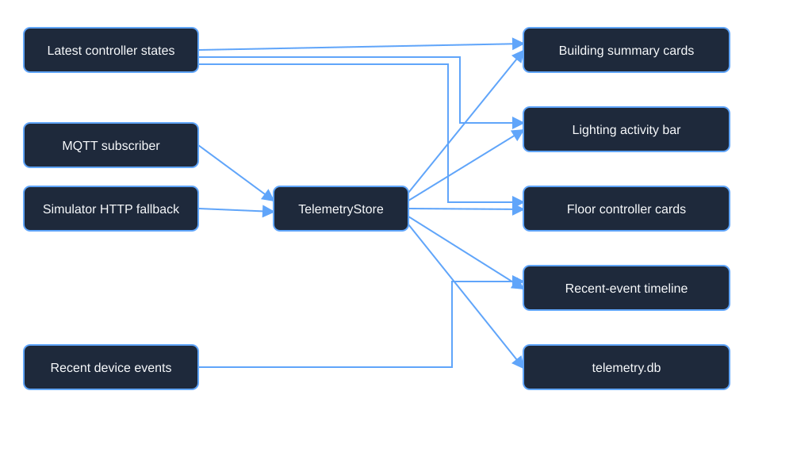
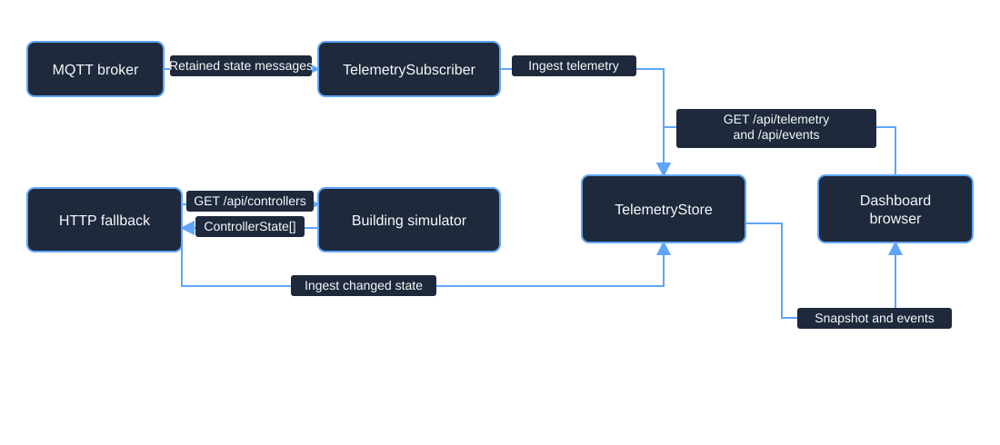
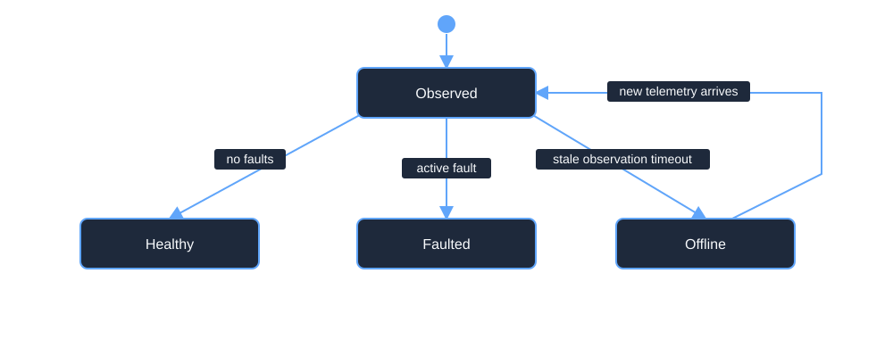

# Lighting Instrumentation

## Table of contents

- [Purpose](#purpose)
- [Design](#design)
- [Telemetry architecture](#telemetry-architecture)
- [Dashboard information hierarchy](#dashboard-information-hierarchy)
- [State and offline semantics](#state-and-offline-semantics)
- [MQTT and HTTP inputs](#mqtt-and-http-inputs)
- [Persistence](#persistence)
- [API](#api)
- [Source tree](#source-tree)
- [Configuration](#configuration)
- [Running and testing](#running-and-testing)

## Purpose

The instrumentation application presents the latest building state and recent device events. It is a telemetry consumer: it should not depend on in-process simulator internals.

## Design



The UI prioritizes building-wide health and lighting activity, then floor details, then recent events.

## Telemetry architecture



The service runs an HTTP poller alongside the MQTT subscriber. The dashboard reports MQTT when connected and reports HTTP fallback otherwise; it remains usable without a broker.

## Dashboard information hierarchy

1. Connection/transport status
2. Controllers online
3. Active faults
4. Lights on
5. Occupied rooms
6. Aggregate on/off/fault fixture activity
7. Floor and room details
8. Recent events

Status is conveyed with text and color. The dashboard does not infer unsupported energy, cost, or historical utilization metrics.

Room names and fixture markers wrap when a controller card is too narrow to show them side by side.

The **Active faults** summary counts active device faults, including sensor faults. The **Lighting activity** legend's **Faulted** count includes only faulted light fixtures. Therefore, a sensor fault can produce 1 active fault while the fixture legend reports 0 faulted lights.

## State and offline semantics



- A controller is online unless its status is `Offline`.
- `Faulted` controllers remain online.
- Fixtures count as on only if `IsOn` is true and `IsFaulted` is false.
- Faulted fixtures are shown separately from off fixtures.
- `Telemetry:StaleAfterSeconds` controls when an unobserved controller becomes offline.
- Older revisioned telemetry does not replace a newer state in the store.

## MQTT and HTTP inputs

The subscriber listens to:

```text
building/controllers/+/telemetry
```

The HTTP poller requests:

```text
GET http://localhost:5080/api/controllers
```

The poller runs once per second, ingests changed HTTP states as events, and uses the same `TelemetryStore` as MQTT ingestion. It continues polling while MQTT is connected.

## Persistence

SQLite stores:

- `telemetry_events` - recent event history
- `controller_latest` - last controller state
- `controller_observed` - last successful observation timestamp

The in-memory store keeps the latest controller snapshot and at most 500 recent events.

## API

| Method | Endpoint | Purpose |
|---|---|---|
| `GET` | `/api/telemetry` | Latest controller states |
| `GET` | `/api/telemetry/{controllerId}` | One controller state |
| `GET` | `/api/events` | Recent telemetry events |
| `GET` | `/api/status` | MQTT and HTTP transport status |

## Source tree

```text
src/Devices.Instrumentation.Web/
  Devices.Instrumentation.Web.csproj
  Program.cs
  appsettings.json
  Properties/launchSettings.json
  wwwroot/
    app.js       polling, formatting, live dashboard rendering
    index.html   dashboard structure
    styles.css   summary cards, controller cards, event feed
```

Shared contracts are in [Devices.Contracts](../src/Devices.Contracts/).

## Configuration

```json
{
  "Mqtt": {
    "Host": "localhost",
    "Port": 1883
  },
  "Telemetry": {
    "SqlitePath": "telemetry.db",
    "SimulatorBaseUrl": "http://localhost:5080",
    "StaleAfterSeconds": 30
  },
  "Urls": "http://localhost:5081"
}
```

Relative `Telemetry:SqlitePath` values are resolved against the instrumentation web project's content root. The default database is therefore `src/Devices.Instrumentation.Web/telemetry.db`, regardless of the process working directory.

## Running and testing

```powershell
dotnet run --project src/Devices.Instrumentation.Web/Devices.Instrumentation.Web.csproj --urls http://localhost:5081
dotnet test tests/Devices.Instrumentation.Tests/Devices.Instrumentation.Tests.csproj
```
