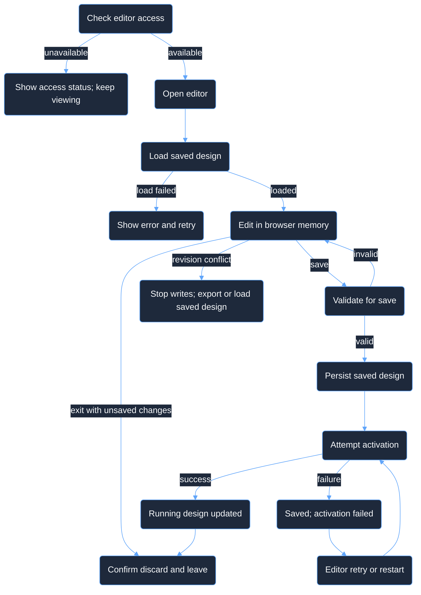
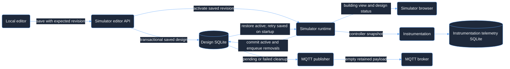

# Building editor specification

**Status: implemented, with limitations below.** This describes current behavior rather than a claim that every original acceptance goal is complete.

## Table of contents

- [Purpose and scope](#purpose-and-scope)
- [Current workflow](#current-workflow)
- [Building design and validation](#building-design-and-validation)
- [Persistence and runtime integration](#persistence-and-runtime-integration)
- [Access and API](#access-and-api)
- [Failure and conflict handling](#failure-and-conflict-handling)
- [Remaining gaps](#remaining-gaps)
- [Related designs](#related-designs)

## Purpose and scope

The simulator supports editing one building's dimensions, floors, rooms, doors, lights, sensors and controller connections, with a saved design in SQLite. This is a local-development simulator, not an electrical engineering or code-compliance tool. Instrumentation has a separate telemetry database. See the [editor technical guide](../technical/building-editor.md), [simulator guide](../technical/building-light-simulator.md) and [instrumentation guide](../technical/lighting-instrumentation.md).

## Current workflow

When editing is available, open **Edit building** to load the saved design. Multiple editors may work concurrently. The editor offers an SVG plan, item list and forms, session undo/redo, save, JSON export and exit. Edits remain in browser memory and do not change the running simulation until saved. Floor and item deletion and leaving with changes prompt for confirmation. Save validates, persists and attempts activation; the UI reports saved and running revisions separately, with activation and cleanup status and retry controls.

The browser refreshes status every 20 seconds. Unsaved changes and undo/redo history are held only in the open browser session; undo after a save creates unsaved changes. Save compares the observed revision with the current saved revision. On conflict, editing and saving stop; users can export local edits or explicitly discard them and load the current saved design.

## Building design and validation

The JSON design contains `revision`, `width`, `depth` and `floors`. Each floor has an ID, number, controller ID and X/Z position, and rooms. Each room has ID, name, X/Z top-left, width, depth, one sensor, and door and light arrays. Doors have IDs and positions; sensors and lights also carry their controller ID. Coordinates are absolute metres in the building footprint. Names are display text, not identifiers.

The initial design is 20 × 20 m with four floors, nine rooms, nine sensors and 37 strips. It preserves the IDs and English names from `DeviceIds.CreateBuilding()`, including `DeviceIds.Sensor` for each room. Its room rectangles, door and fixture positions approximate the baseline 3D arrangement on the 0.5 m grid; generated door IDs are stable. New rooms and floors receive new IDs, a sensor or controller respectively, and logical connections can be edited. Room state exposes `sensorId`; legacy state without it uses the original floor/room-derived ID.

For save, server validation requires:

- 1–10 floors, numbered contiguously from 1, and building width/depth each 2–100 m on the 0.5 m grid.
- Non-overlapping rectangular rooms, at least 1 × 1 m, on the grid and within the footprint; room names must not be blank.
- Controllers within the footprint; doors on a room boundary; sensors and lights within or on their room boundary. All positions are on the grid.
- One sensor per room and every sensor and light connected to that floor's controller. Doors and light lists may be empty.
- Globally unique, nonempty IDs of at most 128 ASCII letters, digits, hyphens or underscores; removed saved IDs cannot be reused or changed to another entity type.

Unsaved in-memory edits may temporarily be invalid. A save request must be structurally well formed, with required arrays, objects and safe unique IDs; references are safe IDs or null, names are at most 256 characters, and payloads are bounded to 100 floors and 10,000 entities. The browser also validates before save; server validation is authoritative and reports paths and messages.

## Persistence and runtime integration

`BuildingDesign:SqlitePath` defaults to `building-design.db` relative to the simulator content root. Compose sets `BuildingDesign__SqlitePath=/data/building-design.db` and mounts `building-design-data` at `/data`; instrumentation uses its own `telemetry-data` volume. Fresh databases receive the seed only once. Schema version 4 migrates versions 1–3 while retaining saved and active designs and revision. An unsupported version or nonempty unversioned database is rejected. Migration cannot recover IDs deleted before version 1, except IDs still visible in the old active design. See [backup and restore](../technical/building-light-simulator.md#persistence-and-backup).

The database stores saved and last active designs, edit revision, retired IDs and cleanup status. Save compares the client's observed edit revision and atomically replaces the saved design, then separately attempts activation. Activation retains compatible live state for retained device IDs and drops removed devices; state itself is not restored across process restart. Removed controllers are enqueued for cleanup only as part of successful activation. Older active work is fenced by saved or active revision and retired IDs cannot be reused.

On startup the service restores the last active design and retries a different saved revision. If it fails, the restored active design remains running. Activation failure is represented in the current process and recomputed by startup retry, not stored as a separate durable failure record. After a runtime failure, an editor can retry, or restart can retry; no periodic activation retry is implemented.

The publisher tries pending and failed cleanup while MQTT is connected, normally every five seconds; a retry request accelerates the next check. Successful broker publication marks the item completed; failures remain durable and retryable. Cleanup completion and failure updates are fenced by active revision. Activation and cleanup are separate from MQTT publication; HTTP mutation responses do not wait for MQTT. This does not constitute end-to-end subscriber confirmation.

Instrumentation polls `/api/controller-snapshot`, containing the active design revision and controllers. It persists membership, removes absent controllers' current state and observation timestamps, preserves historical events, and tombstones removed IDs to reject late telemetry. Equal revisions must have equal membership; stale revisions and reused tombstones are rejected. Only a `404` falls back to legacy `/api/controllers`, which cannot establish removals.

## Access and API

Editor access has no authentication and is limited to a directly connected loopback host in the Development environment. The client and local connection addresses, request host and every server listener must be loopback; the request scheme and port must match a listener. Forwarding headers are rejected. Mutations require an exact same-origin `Origin`; GET/HEAD may omit it. Compose publishes its ports on host loopback, but the container listener binds `0.0.0.0`, so editor endpoints are disabled there.

Other simulator API mutations reject forwarding headers, non-loopback Host values, cross-origin or malformed `Origin` headers, and `Sec-Fetch-Site` values other than `same-origin`. Originless local command-line requests remain supported. These checks do not authenticate callers or check the TCP peer; they rely on a loopback-bound deployment. Compose sets `Simulator:AllowHttpMutations` to `false` so HTTP mutations are disabled even from its internal network; the default is `true` for direct local development. Compose therefore supports viewing and telemetry polling, but not simulator HTTP controls or editor mutations. MQTT commands are separate and require a trusted broker with its own access controls. Instrumentation APIs are unauthenticated. The Compose ports are bound to `127.0.0.1`; do not expose them through proxies or non-loopback bindings. Local processes and users share access.

The browser periodically reads `GET /api/capabilities`, which returns non-cached `mutationsAllowed` and `editorAllowed` flags for the current request. Until access is confirmed, or if the check fails, mutation controls are disabled and access status is shown. These flags guide the UI; server policies still enforce each request.

The API uses camelCase JSON and exposes:

| Method | Path | Purpose |
|---|---|---|
| `GET` | `/api/building-editor` | Saved `design`, `activeDesign`, `editRevision`, `activationStatus`, cleanup |
| `POST` | `/api/building-editor/save` | Save `{ "expectedRevision": n, "design": {...} }`, then attempt activation |
| `POST` | `/api/building-editor/retry` | Retry activation |
| `POST` | `/api/building-editor/retry-cleanup` | Request cleanup retry; returns `202` |

Use the returned `editRevision` as `expectedRevision` for save. Invalid input returns `400` with validation errors; a stale revision returns `409`; disallowed editor requests return `403`. Save success does not imply activation success: inspect `activationStatus`, `design.revision`, `activeDesign.revision` and cleanup entries. Ordinary `GET /api/building-view` returns active design and current controllers together.

The read-only `GET /api/building-design-status` is not editor-restricted. It returns `savedRevision`, `runningRevision`, `activationStatus`, `pendingCleanup`, `failedCleanup`, and `completedCleanup`. The simulator header polls it every five seconds after a response and displays an unavailable state on failure. A changed running revision refreshes the building view and controls; if that fails, the header reports the error and retries on a later poll.

## Failure and conflict handling

- Loading errors are shown with retry. Invalid saves preserve the prior saved design and local edits.
- Concurrent editors can open independently; stale saves return a conflict rather than overwriting newer designs.
- A persistence failure leaves local edits in memory; closing or reloading the browser loses unsaved edits.
- A saved revision can remain pending or failed while the previous active design runs. Cleanup remains pending or failed until a successful broker publish; retry and status are separate from activation.
- SQLite failures do not replace the database with an empty design. Online backup or a stopped-server copy is required for a consistent backup.

## Remaining gaps

- Edited-design 3D views add illustrative perimeter walkways, exterior stairs, landings and pillars outside the editable footprint. These are not editable and do not guarantee an accessible route from each interior door. The seed is an approximation of the baseline room geometry.
- Authentication, authorization and safe editor access for non-loopback, proxy or Compose deployments are not implemented.
- Automatic backups and a periodic activation retry are not implemented.
- Cleanup indicates broker publication, not acknowledgement by every subscriber. A [broker-backed test](../technical/building-light-simulator.md#running-and-testing) covers ingestion, direct snapshot reconciliation and retained-message cleanup; it does not cover HTTP polling, disconnects or process restarts. Accessibility and desktop/mobile verification remain broader than this test.
- Legacy UX and design documents remain design references and may describe proposed behavior beyond the current implementation.

## Related designs

- [Editor UX](../ux/simulator/editor/ux.md)
- [Editor UI](../ux/simulator/editor/ui.md)
- [Shared design language](../ux/design-language.md)
- [Main simulator design](../ux/simulator/main/design-language.md)
- [Original project plan](plan.md)
