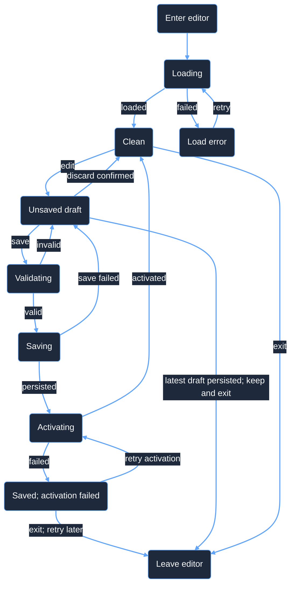
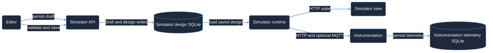

# Building editor specification

**Status: proposed.** This is a design for future work, not a description of implemented functionality. Decisions listed as open must be resolved before implementation.

## Table of contents

- [Purpose and scope](#purpose-and-scope)
- [Current baseline](#current-baseline)
- [Proposed workflow](#proposed-workflow)
- [Building design and validation](#building-design-and-validation)
- [Persistence and runtime integration](#persistence-and-runtime-integration)
- [Failure and conflict handling](#failure-and-conflict-handling)
- [Acceptance criteria](#acceptance-criteria)
- [Open decisions](#open-decisions)
- [Related designs](#related-designs)

## Purpose and scope

Allow a user to edit the simulator's building: choose its floor count, add or change office spaces and doors, place lights, and connect lights to a controller. A menu in the simulator provides an entry point. The saved building design is stored in SQLite and restored when the simulator restarts.

This specification covers one simulator building and its editor. It does not propose a real electrical engineering or code-compliance tool, a multi-building service, or changes to instrumentation's visual design.

## Current baseline

The [simulator guide](../technical/building-light-simulator.md#building-model) describes today's fixed four-floor model, one controller per floor, one sensor per room, in-memory simulator state, and illustrative wiring. The [instrumentation guide](../technical/lighting-instrumentation.md#persistence) describes a separate SQLite store for telemetry; it does not persist the simulator building design. The editor, building-design database, and editable wiring do not exist yet.

## Proposed workflow

1. Open a labelled menu in the simulator and choose **Edit building**.
2. Acquire the single-editor session and load the saved design, or offer to resume its persisted draft, without changing the running simulation.
3. Set the floor count, select a floor, and use a toolbar to add and edit rooms, doors, lights, and controller connections. Provide equivalent form-based controls for users who cannot use a canvas.
4. Undo or redo edits as needed. Review validation and the effects of destructive changes. Save explicitly, keep the draft for later, or discard it. Leaving with unsaved changes requires confirmation.
5. After a successful save, activate the saved design immediately and return the resulting authoritative design to the editor. Do not present an unpersisted draft as running state.

The [UX design](../ux/simulator/editor/ux.md) develops this flow and the [UI design](../ux/simulator/editor/ui.md) proposes responsive layouts.

## Building design and validation

The design needs stable identities for floors, rooms, doors, controllers, sensors, light strips, and connections. Renaming or repositioning an entity must not silently change its identity. A deleted stateful entity must not reuse its retired ID, or must have a distinct generation tracked across restarts; recreating a room or device in the same position must not inherit the deleted entity's presence or faults. Display names are not IDs. The data must represent floor order, room boundaries and dimensions, door placement, fixture positions, and controller-to-device associations sufficiently for both editing and simulator rendering.

The first version uses these agreed design rules:

- A building has 1–10 floors and editable width and depth in metres, initially 20 × 20 m.
- Rooms are non-overlapping rectangles; placement snaps to a 0.5 m grid. Doors are placed on room boundaries.
- Each floor has one automatically created controller. Each room has one automatically created, movable presence sensor. Users place individual light strips and can change their positions.
- Wiring represents logical associations to the controller on the same floor; routes are generated automatically for illustration and are not physical cable layouts. Every light and sensor must be connected before saving.

Proposed minimum validation:

- Require the agreed floor count, valid dimensions and geometry, valid door placement, and meaningful names. Validate grid placement and require all lights and sensors to connect to their own floor's controller.
- Reject references to missing entities, incompatible connections, and invalid or duplicate IDs; identify the affected item and how to fix it.
- Before removing a floor, room, controller, or device with dependants, show the affected items and require confirmation to delete them together. Cancel preserves the draft; never silently leave dangling references.
- Validate on the server as well as in the editor. Do not rely on the client to enforce correctness.

## Persistence and runtime integration

The simulator owns a separate SQLite file for building designs and persisted drafts. Proposed configuration is `BuildingDesign:SqlitePath`, defaulting to `building-design.db` relative to the simulator content root. For Compose, configure `BuildingDesign__SqlitePath=/data/building-design.db` and mount a separate `building-design-data` volume at `/data`; this storage is not yet configured. The existing instrumentation telemetry database remains separate. On first run, seed the current building without overwriting an existing design; version and migrate the schema.

Document manual backup and restore; automatic backups are not part of the first version. Use SQLite's online backup facility for a consistent live backup, or stop the simulator before copying the database and any required journal files. Restore only while the simulator is stopped, validate the backup's integrity and schema before replacing data, and retain a recovery copy until the restored design has been verified.

Only one editor may edit at a time. Use a renewable editor lease; automatically release it after expiry and preserve the persisted draft for recovery. Reject writes from expired or superseded sessions so recovery cannot create two active editors. If renewal fails or the lease is lost, notify the current editor, stop saving and draft persistence from that session, and retain its local edits in memory. Offer a local export of those edits. After reacquiring the lease, compare the local edits' base revision with the current persisted design and draft; when they differ, let the user export the local edits, explicitly discard them, or manually reapply them to the current draft. Never silently overwrite newer work or claim local-only edits were stored. The exact lease duration and heartbeat are open.

Persist drafts and support undo/redo while the editor session is open, including after saving. History is not restored after editor exit or restart; undoing a saved edit changes the draft and requires another save to affect the running building. If draft persistence fails, keep the current edits in the session and report that they are not safely stored. Do not offer **keep draft and leave** until persistence succeeds; retry persistence or explicitly confirm discarding the unsaved changes. An unexpected browser or process termination may still lose edits that were not persisted.

This is a proposed boundary, not a chosen API shape or a claim that the editor is implemented. Design writes must be atomic, and the simulator must not expose a partially written design. Activate immediately after a successful save; if activation fails, show which design is saved and which is running. Persist both the last successfully activated design and the pending activation. On restart, restore the last active design and retry the pending activation; if it still fails, keep the restored design active. Show persistent pending or failed activation status in the simulator and editor, with a retry control where local editor access is enabled. Allow the user to leave and retry later. Associate activation and cleanup work with design revisions; recheck current authority before dispatch or retry and cancel or no-op superseded work. Coordinate in-flight effects and reconcile state so stale work cannot activate an older design or remove a controller required by the current design. Keep simulation mutation responses authoritative and MQTT publication off the HTTP mutation critical path.

Preserve presence and faults for retained device IDs when activating a design, and remove live state for deleted devices. For removed controllers, clear retained MQTT state and remove them from the current instrumentation dashboard while retaining historical events. Enqueue removal cleanup only after the design that removes the controller successfully activates; a failed activation must not clean up controllers in the still-active design. Fence cleanup against the active design revision and a non-reused controller identity or generation, including when a floor number is reused. Reconcile authoritative removals across HTTP and MQTT, remove current controller state and observation timestamps from memory and persistent storage, and prevent stale messages or restart from restoring deleted controllers. Cleanup must be idempotent and recoverable after failure or restart. Publication and removal must remain asynchronous rather than delaying the save response. Persist cleanup progress and show pending, failed, and complete states separately from activation in the simulator and editor; retry automatically and offer a retry control where local editor access is enabled. Do not report unconfirmed cleanup as complete. Define revision, selected-floor, active-command, and restart reconciliation before implementation; do not assume old snapshots automatically disappear.

The first version is for local development only and has no authentication. Enable editor endpoints only for a verified loopback-only local development host, with browser-origin and host protections; do not trust a client-supplied host header alone. Disable editor access in the existing Compose deployment, non-loopback bindings, and proxy deployments until a protected access model is implemented. These restrictions apply to editor access, not the existing simulator endpoints. Define and test the enforcement before implementation; authentication and authorization are required before expanding access beyond that scope.

## Failure and conflict handling

- A failed load shows an error and retry; it must not replace the saved design with an empty one.
- A failed validation or save preserves the draft and explains the problem. A second editor cannot modify the design while the first holds a valid session; explain when it can retry and that the persisted draft is preserved on expiry.
- A lost editor lease disables writes and exposes an explicit local-edit recovery path without overwriting another session's draft.
- A successful save must be distinguishable from activation or publication failure. Explain which design is saved and which is running; allow exit and later activation retry.
- Destructive operations and navigation away from a dirty draft require confirmation. Cancel keeps the editor open; a safely persisted draft can be resumed later, while explicitly confirmed discard removes its changes. Never claim an unpersisted draft was retained.

## Acceptance criteria

- A user can enter and leave the editor, create 1–10 floors, adjust building dimensions, and create and edit rectangular rooms, doors, lights, and same-floor controller connections.
- Pointer and keyboard/form workflows can complete the same essential design tasks; desktop and narrow-mobile layouts remain usable.
- Invalid designs, unconnected lights or sensors, and dangling relationships cannot be saved; errors identify the affected fields or entities.
- Saving a valid design persists it across simulator restarts, while a failed save leaves the previously saved design intact.
- A default installation retains the existing building until a design change is saved; saved designs are not replaced on restart.
- The running simulator, HTTP state, and instrumentation reflect an activated design, including controller removals and retained MQTT cleanup; historical events are preserved.
- Only one editor can modify a design at a time; expired sessions cannot write, persisted drafts can be recovered, and edits can be undone and redone during the editor session.
- Local-only editor access, abandoned or lost sessions, destructive changes, storage failures, pending activation across restart, and asynchronous cleanup failures have explicit, tested outcomes. Tests cover failed activation followed by restart, floor removal and recreation while cleanup is pending, recreating a room or device in the same floor/name/slot without inheriting deleted state, superseded work, and conflict recovery without overwriting newer edits.
- Focused tests cover validation, persistence and restart, state reconciliation, controller removal, and accessible editor workflows. Document configuration, migration, API and protocol changes when implemented.

## Open decisions

Resolve these with stakeholders before treating the proposal as implementation-ready:

1. Minimum and maximum width and depth; room size constraints, floor footprint rules, and which room-boundary door placements are valid.
2. Controller placement, default sensor and light placement, and light-strip properties beyond editable position.
3. Draft retention duration and cleanup, including how to handle expired drafts.
4. Single-editor lease duration and heartbeat; activation retry cadence and coordination with simultaneous simulator commands.
5. Revision and selected-floor reconciliation, cleanup retry cadence and backoff, and the mechanism for authoritative instrumentation removal across HTTP, MQTT, and restart.
6. Exact local-only access enforcement, browser-origin protections, backup tooling, and migration details.

## Related designs

- [Editor UX](../ux/simulator/editor/ux.md)
- [Editor UI](../ux/simulator/editor/ui.md)
- [Shared design language](../ux/design-language.md)
- [Main simulator design](../ux/simulator/main/design-language.md)
- [Original project plan](plan.md)
