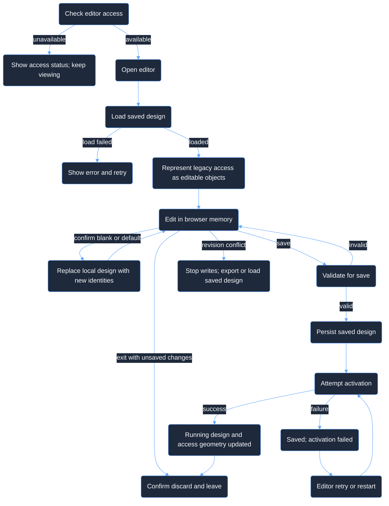
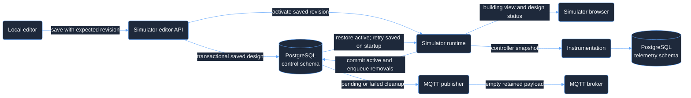

# Building editor specification

**Status: implemented, with limitations below.** This describes current behavior.

## Table of contents

- [Purpose and scope](#purpose-and-scope)
- [Current workflow](#current-workflow)
- [Building design and validation](#building-design-and-validation)
- [Persistence and runtime integration](#persistence-and-runtime-integration)
  - [Control schema version 1](#control-schema-version-1)
- [Access and API](#access-and-api)
- [Failure and conflict handling](#failure-and-conflict-handling)
- [Remaining gaps](#remaining-gaps)
- [Related designs](#related-designs)

## Purpose and scope

The simulator supports editing one building's dimensions, floors, rooms, doors, lights, sensors and controller connections, with saved design state in PostgreSQL. This is a local-development simulator, not an electrical engineering or code-compliance tool. Instrumentation uses a separate PostgreSQL schema. See the [editor technical guide](../technical/building-editor.md), [simulator guide](../technical/building-control.md) and [instrumentation guide](../technical/building-instrumentation.md).

## Current workflow

When editing is available, choose **Building menu**, then **Edit building** to load the saved design. Multiple editors may work concurrently. The editor offers an SVG plan, item list and forms, session undo/redo, save, JSON export and exit. Edits remain in browser memory and do not change the running simulation until saved. Floor and item deletion and leaving with changes prompt for confirmation. Save validates, persists and attempts activation; the UI reports saved and running revisions separately, with activation and cleanup status and retry controls.

The editor can replace its local design with a one-floor blank building or the original four-floor template after confirmation. The replacement is undoable, but unapplied form values are discarded. New IDs prevent reuse of retired entities; saving replaces previous devices and initiates controller cleanup.

Existing plan items can be dragged in select or move mode. The preview snaps to the grid, Escape cancels, and moving a room translates its fixtures. A completed move is undoable; invalid intermediate positions remain in the editor with validation feedback. Click-to-place and labelled item-list and form alternatives remain available.

The browser refreshes status every 20 seconds. Unsaved changes and undo/redo history are held only in the open browser session; undo after a save creates unsaved changes. Save compares the observed revision with the current saved revision. On conflict, editing and saving stop; users can export local edits or explicitly discard them and load the current saved design.

## Building design and validation

The JSON design contains `revision`, `width`, `depth` and `floors`. Each floor has an ID, number, controller ID and X/Z position, rooms, and optional `walkways` and `stairs` arrays. Each room has ID, name, X/Z top-left, width, depth, one sensor, and door and light arrays. Doors have IDs and positions; sensors and lights also carry their controller ID. Walkways and stairs have IDs, X/Z top-left and width/depth; stairs also specify `east` or `west` as the direction of ascent. A stair belongs to its lower floor and connects it to the next numbered floor. Coordinates are absolute metres. Names are display text, not identifiers.

Fresh databases and the default template use a 10 × 8 m design with four floors, nine rooms, nine sensors and 37 strips. The seed preserves the IDs and English names from `DeviceIds.CreateBuilding()`, including `DeviceIds.Sensor` for each room, and has stable generated door IDs. When the editor starts from the default template, it replaces the template's IDs with new ones to avoid reusing retired identities. Room rectangles, door and fixture positions approximate the original 3D arrangement on the 0.5 m grid. Existing saved and active designs retain their dimensions and coordinates. The editor shows its local design, while the 3D view uses the active design geometry; legacy access is generated relative to its footprint without modifying stored data. New rooms and floors receive new IDs, a sensor or controller respectively, and logical connections can be edited. Room state exposes `sensorId`; legacy state without it uses the original floor/room-derived ID.

For save, server validation requires:

- 1–10 floors, numbered contiguously from 1, and building width/depth each 2–100 m on the 0.5 m grid.
- Non-overlapping rectangular rooms, at least 1 × 1 m, on the grid and within the footprint; room names must not be blank.
- Controllers within the footprint; doors on a room boundary; sensors and lights within or on their room boundary. All positions are on the grid.
- Walkway and stair rectangles have positive dimensions and fit within four metres of the footprint; their coordinates need not be on the grid. Each floor has at most 256 walkways and 32 stairs. Stairs cannot start on the top floor, and ascent direction must be `east` or `west`.
- One sensor per room and every sensor and light connected to that floor's controller. Doors and light lists may be empty.
- Globally unique, nonempty IDs of at most 128 ASCII letters, digits, hyphens or underscores; removed saved IDs cannot be reused or changed to another entity type.

Unsaved in-memory edits may temporarily be invalid. A save request must be structurally well formed, with required arrays, objects and safe unique IDs; references are safe IDs or null, names are at most 256 characters, and payloads are bounded to 100 floors and 10,000 entities. The browser also validates before save; server validation is authoritative and reports paths and messages.

## Persistence and runtime integration

Building Control stores saved and active designs, edit revision, retired IDs and cleanup work in PostgreSQL's `control` schema. Instrumentation stores telemetry in the `telemetry` schema of the same `devices` database. Each application uses its own database role. PostgreSQL 18 or later supplies UUIDv7 primary-key defaults; externally meaningful design, controller and event IDs remain separate. The Compose database volume is shared across the container/release and live-development modes. A fresh schema is initialized and seeded once; this environment does not import or migrate prior SQLite files. See the [development environment guide](../technical/development-environment.md) for setup, data retention and recovery notes.

The database stores saved and last active designs, edit revision, retired IDs and cleanup status. Save compares the client's observed edit revision and atomically creates a new design version and advances the saved pointer, then separately attempts activation. Activation retains compatible live state for retained device IDs and drops removed devices; state itself is not restored across process restart. Removed controllers are enqueued for cleanup only as part of successful activation. Older active work is fenced by saved or active revision and retired IDs cannot be reused.

Older designs with absent or null access arrays retain their legacy generated geometry. Opening one in the editor creates editable access objects in the browser; saving persists those objects with stable IDs. Empty arrays explicitly remove that floor's corresponding generated objects. Session undo includes changes to access objects.

On startup the service restores the last active design and retries a different saved revision. If it fails, the restored active design remains running. Activation failure is represented in the current process and recomputed by startup retry, not stored as a separate durable failure record. After a runtime failure, an editor can retry, or restart can retry; no periodic activation retry is implemented.

The publisher tries pending and failed cleanup while MQTT is connected, normally every five seconds; a retry request accelerates the next check. Successful broker publication marks the item completed; failures remain durable and retryable. Cleanup completion and failure updates are fenced by active revision. Activation and cleanup are separate from MQTT publication; HTTP mutation responses do not wait for MQTT. This does not constitute end-to-end subscriber confirmation.

Instrumentation polls `/api/controller-snapshot`, containing the active design revision and controllers. It persists membership, removes absent controllers' current state and observation timestamps, preserves historical events, and tombstones removed IDs to reject late telemetry. Equal revisions must have equal membership; stale revisions and reused tombstones are rejected. Only a `404` falls back to legacy `/api/controllers`, which cannot establish removals.

### Control schema version 1

Control schema version 1 initializes only fresh schemas. See its [ERD](../../database/control/erd.mmd) and [initial SQL](../../database/control/001_initial.sql). Runtime remains single-building; this redesign introduces no UI or API.

| Table | Fields and constraints |
| --- | --- |
| `building` | UUIDv7 `id`; unique `singleton_key` constrained to 1; `name`, `saved_design_id`, `active_design_id`, `edit_revision`, `created_at`, `updated_at`. |
| `building_design` | UUIDv7 `id`; `building_id`, JSONB `design`, `revision`, `created_at`, `updated_at`. Revisions are unique within a building. |
| `retired_design_entity_id` | UUIDv7 `id`; `building_id`, globally unique `external_id`, `entity_type`, `retired_at`, `created_at`, `updated_at`. |
| `controller_mqtt_retained_cleanup` | UUIDv7 `id`; `building_id`, globally unique `controller_id`, `active_design_revision`, `status`, `created_at`, `updated_at`. |
| `schema_version` | Retains UUIDv7 `id`, singleton key, `version`, `seeded` and `applied_at`; adds `created_at` and `updated_at`. |

Design, retired-ID and cleanup rows belong to a building. Both required design pointers must reference design rows owned by that same building, even if they point to the same row. The store treats saved design content and revision as immutable: saving edits creates a new version row and moves the saved pointer; successful activation moves the active pointer separately. All tables automatically set creation and update timestamps and automatically update `updated_at` on changes; `applied_at` remains the schema application time. External IDs and controller IDs retain global uniqueness, independently of building ownership.

Version 1 initializes only a fresh control schema and does not automatically migrate earlier development schemas. The previous version 2 and the older, differently shaped version 1 schemas are rejected without changing their data. See [reset and version behavior](../technical/development-environment.md#postgresql-and-fresh-data) before discarding data.

## Access and API

In direct-host Development, editor access has no authentication and is limited to a directly connected loopback client and listener; both the TCP peer and local socket address must be loopback, the request host/scheme/port must match, forwarding headers are rejected, and mutations require an exact same-origin `Origin` (GET/HEAD may omit it). Simulator mutations retain their enabled-by-default setting but also require loopback peer/local addresses plus same-origin and fetch-metadata checks. The local Compose stack instead routes browser access through NGINX on `localhost`, without a browser login, using a private development proxy credential; the proxy enables editor and simulator HTTP mutations only in the Development environment. This is a local development boundary, not application user authentication or production authorization. See the [development environment guide](../technical/development-environment.md#local-access-and-limitations).

Other simulator API mutations reject forwarding headers, non-loopback Host values, cross-origin or malformed `Origin` headers, and `Sec-Fetch-Site` values other than `same-origin`. Originless local command-line requests remain supported on direct-host Development. The Compose proxy sets a separate internal credential and only accepts the configured `localhost` host and public port. Compose binds NGINX ports to `127.0.0.1`; applications, PostgreSQL and MQTT are not host-published. MQTT control and telemetry clients use separate credentials and topic ACLs. The proxy does not authenticate browser requests or protect the sites from local users or processes. Do not expose the ports remotely or through another proxy.

The browser periodically reads `GET /api/capabilities`, which returns non-cached `mutationsAllowed` and `editorAllowed` flags for the current request. Until access is confirmed, or if the check fails, mutation controls are disabled and access status is shown. These flags guide the UI; server policies still enforce each request.

The API uses camelCase JSON and exposes:

| Method | Path | Purpose |
|---|---|---|
| `GET` | `/api/building-editor` | Saved `design`, `activeDesign`, `editRevision`, `activationStatus`, cleanup |
| `GET` | `/api/building-editor/default-design` | Original seed design used by the editor's default template |
| `POST` | `/api/building-editor/save` | Save `{ "expectedRevision": n, "design": {...} }`, then attempt activation |
| `POST` | `/api/building-editor/retry` | Retry activation |
| `POST` | `/api/building-editor/retry-cleanup` | Request cleanup retry; returns `202` |

Use the returned `editRevision` as `expectedRevision` for save. Invalid input returns `400` with validation errors; a stale revision returns `409`; disallowed editor requests return `403`. Save success does not imply activation success: inspect `activationStatus`, `design.revision`, `activeDesign.revision` and cleanup entries. Ordinary `GET /api/building-view` returns active design and current controllers together.

The read-only `GET /api/building-design-status` is not editor-restricted. It returns `savedRevision`, `runningRevision`, `activationStatus`, `pendingCleanup`, `failedCleanup`, and `completedCleanup`. The simulator header polls it every five seconds after a response and displays an unavailable state on failure. A changed running revision refreshes the building view and controls; if that fails, the header reports the error and retries on a later poll.

## Failure and conflict handling

- Loading errors are shown with retry. Invalid saves preserve the prior saved design and local edits.
- Concurrent editors can open independently; stale saves return a conflict rather than overwriting newer designs.
- A persistence failure leaves local edits in memory; closing or reloading the browser loses unsaved edits.
- A saved revision can remain pending or failed while the previous active design runs. Cleanup remains pending or failed until a successful broker publish; retry and status are separate from activation.
- PostgreSQL connection or schema failures prevent normal store initialization; the application does not fall back to SQLite or an empty design. Backups are not automatic; follow the [database recovery notes](../technical/development-environment.md#backup-and-restore).

## Remaining gaps

- Access objects and room geometry are illustrative and do not guarantee a connected or accessible route from each interior door. The seed approximates the baseline room geometry.
- Remote, non-development authentication and authorization are not implemented. Local Compose has no browser login; its service credentials are not production secret storage.
- Automatic backups and a periodic activation retry are not implemented.
- The PostgreSQL owner lease is fail-stop protection for a single Building Control process; it is not distributed fencing or high availability.
- Cleanup indicates broker publication, not acknowledgement by every subscriber. A [broker-backed test](../technical/building-control.md#running-and-testing) covers ingestion, direct snapshot reconciliation and retained-message cleanup; it does not cover HTTP polling, disconnects or process restarts. Accessibility and desktop/mobile verification remain broader than this test.
- Legacy UX and design documents remain design references and may describe proposed behavior beyond the current implementation.

## Related designs

- [Editor UX](../ux/building-control/editor/ux.md)
- [Editor UI](../ux/building-control/editor/ui.md)
- [Shared design language](../ux/design-language.md)
- [Building Control design](../ux/building-control/main/design-language.md)
- [Original project plan](plan.md)
