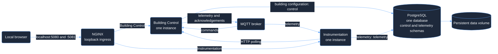

# Development environment specification

**Status: implementation in progress.** This document retains the agreed requirements and original baseline; consult the [development environment guide](../technical/development-environment.md) for implemented behavior and remaining validation.

## Table of contents

- [Purpose and scope](#purpose-and-scope)
- [Original baseline](#original-baseline)
- [Proposed architecture](#proposed-architecture)
- [Data and database](#data-and-database)
- [Local access and security](#local-access-and-security)
- [Development workflows](#development-workflows)
- [Operations and recovery](#operations-and-recovery)
- [Acceptance criteria](#acceptance-criteria)
- [Delivery sequence](#delivery-sequence)
- [Open decisions](#open-decisions)
- [Related documentation](#related-documentation)

## Purpose and scope

Provide a local Windows development environment closer to the intended production deployment while preserving the ability to use both websites, simulator controls and the building editor. The agreed direction is:

- Docker Compose using [Kiri](https://github.com/libracoder/kiri) on Windows.
- PostgreSQL community edition instead of SQLite, with one database and separate `control` and `telemetry` schemas.
- NGINX as the browser-facing reverse proxy, with separate localhost ports for Building Control and Lighting Instrumentation.
- An MQTT broker running by default.
- Both a production-like container build and a fast development workflow with frontend and application reload.
- A fresh PostgreSQL installation; importing existing SQLite data is not required for this initial environment.

This is a **single-machine development environment**, not a production deployment. Kubernetes, high availability, multiple replicas, physical device integration and network or internet access are out of scope. The local access design must not be presented as production authentication or authorization.

## Original baseline

The following describes the system before this specification was implemented, not the current deployment.

The earlier root Compose configuration built both websites from the [Dockerfile](../../Dockerfile), bound them to `127.0.0.1:5080` and `127.0.0.1:5081`, and used separate SQLite volumes. Instrumentation polled Building Control over the Compose network; MQTT was optional and a broker was not included. The [current Compose configuration](../../deploy/docker/compose.yaml) differs from this baseline.

Compose currently disables simulator HTTP mutations. The editor requires a direct loopback Development connection and rejects forwarding headers, so it cannot work through NGINX or the existing Compose setup. Instrumentation APIs are unauthenticated. Current restrictions must not simply be disabled to meet this proposal; see [local access and security](#local-access-and-security).

Building designs and telemetry are persisted in different SQLite stores using SQLite-specific code. Simulator presence, faults and light states are held in memory and do not survive a simulator restart. Moving the databases alone will not make the applications safe for multiple replicas.

## Proposed architecture

The following describes the intended architecture. Current operating instructions and limitations are in the [development environment guide](../technical/development-environment.md). Initially run one instance of each service:

- The suggested ports retain the existing `http://localhost:5080/` and `http://localhost:5081/` URLs; final ports and conflicts must be documented. Each is a separate browser origin. NGINX routes each port to its corresponding application, avoiding subpath changes to the existing root-relative assets and API URLs.
- NGINX is the only host-published web entry point. The application services, PostgreSQL and broker use private Compose networking; do not publish their ports by default. Instrumentation polls Building Control directly on the internal network.
- PostgreSQL hosts one database with separate `control` and `telemetry` schemas and separate least-privilege application identities. A persistent named volume survives ordinary container recreation.
- Configure both applications to connect to the broker over the internal network. HTTP polling remains active and provides the existing fallback if MQTT is unavailable. Decide broker persistence and command access before implementation.
- Check Kiri compatibility on Windows for Compose builds, networking, loopback-only port bindings, volumes and development file watching; the upstream project describes Docker CLI and Compose support, but this project's workflow has not yet been verified.

## Data and database

- Replace SQLite-specific persistence in **both** applications with PostgreSQL-backed persistence. Changing connection strings alone is insufficient. Preserve existing HTTP and MQTT contracts, stable IDs, revision checks, design activation and cleanup behavior, snapshot reconciliation, telemetry and event semantics.
- The `control` schema owns buildings and their configuration, including saved and active designs and related operational records. The `telemetry` schema owns instrumentation state and events. Each application identity receives only the schema and object permissions it needs; test that it cannot access the other application's data without an explicitly justified grant.
- In a future phase, `control` is also intended to hold users and their relationships to buildings. User accounts, their data model and authorization are not part of this initial environment and remain subject to the [production proposal](../infrastructure/production-iot-architecture.md#user-accounts-and-sign-in).
- Use UUIDv7 primary keys with PostgreSQL's `uuid` type for all application-owned tables in both stores, including singleton and relationship tables. Specify a UUIDv7 generator compatible with the selected PostgreSQL version for every insert path, including seeds and scripts; the `uuid` type alone does not generate IDs. Preserve existing external IDs and protocol values separately; enforce their required uniqueness and singleton constraints independently of the primary key. Use matching foreign-key types where relationships are stored.
- Provide versioned PostgreSQL schema migrations, a defined migration owner and a controlled startup/deployment sequence. An application must not silently use an incompatible or partially migrated schema. Fail visibly on migration, configuration or database errors; do not silently fall back to SQLite.
- [Control schema version 1](building-editor-spec.md#control-schema-version-1) is fresh-only: incompatible earlier development schemas are rejected without modification and require an explicit reset rather than automatic migration. It does not add a UI or API.
- Create a repository `database/` folder for database scripts and entity relationship diagrams (ERDs), organized by application. Keep the diagrams and scripts synchronized with each store's schema and migrations; document how to apply the scripts from the repository root.
- Seed a fresh design once without overwriting existing PostgreSQL data on restart. Preserve transactional updates and concurrency guarantees, including stale editor saves, retired IDs, activation and cleanup fencing, and atomic instrumentation membership/snapshot updates.
- Start with an empty PostgreSQL database and existing seed behavior; do not import, alter or delete existing SQLite files or volumes. Document their location and how to keep them for recovery. The [production proposal](../infrastructure/production-iot-architecture.md#data-and-scaling-prerequisites) still calls for data import and verification before a production migration.
- Define database startup readiness, reconnect and failure behavior, test isolation, backup and restore, and a deliberate reset procedure. A stopped or recreated application must not erase persisted data; resetting data must require an explicit action with a warning.
- Keep runtime simulator state in memory for this phase unless the scope is explicitly changed. A restart can reset presence, lights and faults even though designs and telemetry persist; persisted telemetry must not be mistaken for a fresh live observation.

The implementation migrates host-based workflows and tests to PostgreSQL; SQLite is not retained as a fallback.

## Local access and security

The current applications have no user accounts or authentication, and the simulator's direct-loopback checks are not a reverse-proxy authorization scheme. This proposal must explicitly design and test a local-only trust boundary before enabling mutations or the editor:

- Bind NGINX's host ports to loopback only; do not create a public tunnel or publish application, database or broker ports by default. Document that local users and processes may still reach published ports and that Docker networking alone is not user authentication.
- Protect editor and mutation endpoints against cross-origin browser requests, DNS rebinding and spoofed `Host`, `Origin` and forwarding headers. Preserve or strengthen existing direct-host protections. Specify behavior for requests without an `Origin` rather than assuming they are trusted.
- Define how the applications identify the actual proxy and establish the externally visible scheme, host and port. Accept forwarding information only from an explicitly trusted proxy; strip or replace client-supplied forwarding headers at the proxy. Reject direct or untrusted access to privileged endpoints; network placement alone is not an identity check.
- Local users and processes can access the sites and modify state without user authentication. Document this accepted limitation, service-to-service HTTP polling, credential handling, CSRF defenses and failure behavior; the private proxy credential is not user identity.
- Scope the new policy to the intended local Development deployment; do not silently enable editor access on non-development or remote deployments. Keep direct host-based development's existing protections unless an intentional, tested change is approved.
- Configure broker authentication and topic-level authorization appropriate to simulator and instrumentation roles, including command topics. Avoid anonymous command access. Define credentials for each application and broker, packet limits and recovery from broker loss; the current clients only configure host and port, so authentication requires application changes.
- Keep database, broker and any proxy credentials out of source control, images and logs. Specify local secret provisioning and rotation; do not rely on `.gitignore` alone. Treat local credentials as development-only.

Production use still requires a separate identity, authorization, TLS, device-security and operational design; see the [production security proposal](../infrastructure/production-iot-architecture.md#user-accounts-and-sign-in).

## Development workflows

Both workflows should use the same service boundaries and browser URLs, unless an explicitly documented difference is needed:

1. **Production-like:** build the two existing application images with frontend assets and run them behind NGINX alongside PostgreSQL and the broker. Changes require a rebuild. This exercises the deployable image structure, not production security or availability.
2. **Live development:** run the .NET applications and frontend build/watch processes so application and frontend changes become visible without a full image rebuild. Define which processes run in containers or on the Windows host, how NGINX reaches them, and how source mounts and file watching work with Kiri. Maintain the same access guarantees as the production-like workflow.

Document prerequisites, setup, startup, shutdown, reload behavior, logs, ports, service names, environment variables, secrets, and troubleshooting from the repository root. Do not prescribe commands until the implementation exists. Development and production-like modes must not accidentally run concurrent simulator owners against the same data.

## Operations and recovery

- Make startup dependencies and readiness explicit: a running container is not necessarily a ready application or migrated database. Surface database, application and broker failures in logs or health status; verify behavior when dependencies restart.
- Use a persistent database volume. Define a consistent, tested PostgreSQL backup and restore for the database and both schemas, including how related design revisions and instrumentation state are recovered together. Document what backup does and does not preserve, particularly in-memory simulator state and any broker retained messages.
- Define a safe reset of development data and a separate ordinary shutdown that preserves volumes. Never remove the existing SQLite volumes as a side effect of setup or reset.
- Choose supported image versions and document upgrade and rollback expectations. Record the PostgreSQL major version and plan its upgrade separately from routine container recreation.

## Acceptance criteria

Implementation is complete only when the following have been demonstrated, not merely configured:

1. On Windows with Kiri, both workflows start from a documented clean setup. Both sites load through loopback-bound NGINX ports, including assets and API calls; the application, database and broker ports are not host-published.
2. Simulator controls and the editor work through the proxy, including save, activation, stale-revision conflict and retry behavior. Untrusted direct, cross-origin, spoofed-host and spoofed-forwarding requests are rejected as specified; non-development access remains restricted.
3. Both PostgreSQL schemas initialize and migrate reliably. Each application identity has its required access and is denied unauthorized access to the other schema. Saved designs, revisions, cleanup state and telemetry survive ordinary service and database restarts. Fresh setup and an explicitly requested reset behave as documented without modifying existing SQLite data.
4. Concurrent saves and relevant database failure cases preserve existing transaction and revision guarantees. Instrumentation snapshot membership, removals and event behavior remain correct. PostgreSQL tests verify stored primary-key values are UUIDv7 and exercise relevant uniqueness, singleton and foreign-key constraints, not just mocks or SQLite.
5. MQTT connects with the intended credentials and permissions, delivers simulator telemetry to instrumentation, and rejects unauthorized command or topic access. With the broker stopped, HTTP fallback remains usable; reconnect and retained-message cleanup are verified.
6. Development-mode code and frontend changes reload as documented on Kiri; the production-like workflow serves the built assets. Changing modes does not create multiple active simulator owners.
7. Backup and restore of the database and both schemas, dependency failure/recovery, meaningful readiness reporting and preservation of volumes are verified. The documentation explains runtime state loss, local trust limitations and how to reset safely.
8. Existing API and UI behavior is protected by focused regression tests; solution build and tests, frontend checks, container integration/smoke tests and applicable independent code, security and UX reviews are completed. Record exact commands and results.

## Delivery sequence

1. Resolve the access-boundary, broker and workflow decisions below; validate Kiri's required capabilities before depending on them.
2. Design PostgreSQL schemas and migration/test strategy for both stores, then implement and test the persistence changes.
3. Implement and test the local proxy, access policy, broker security and service configuration without weakening existing deployment defaults.
4. Add the production-like and live-development workflows, then test startup, editing, telemetry, failure recovery and persistence on Kiri.
5. Complete operational documentation, backup/restore and reset exercises, independent reviews and end-to-end acceptance checks.

Implementation may be split into smaller changes as long as each remains secure and usable.

## Open decisions

- Decide on production identity, authorization, TLS and protection from untrusted local processes. Browser access has no login; service credentials are development-only.
- Complete the acceptance checks above, including both live-development watchers, dependency recovery and meaningful readiness reporting.
- Decide whether any simulator runtime state should become durable in a later phase; this specification does not require that change.

## Related documentation

- [Project plan](plan.md) - current architecture and remaining work.
- [Building Control](../technical/building-control.md) and [Building editor specification](building-editor-spec.md) - current simulator, persistence and access behavior.
- [Lighting Instrumentation](../technical/building-instrumentation.md) - current telemetry and storage behavior.
- [Production IoT architecture proposal](../infrastructure/production-iot-architecture.md) - production prerequisites and future deployment options.
