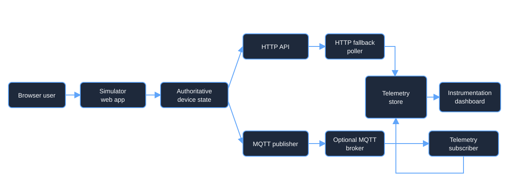

# Building Control — Project Plan

## Goal

Create a .NET solution that simulates a four-story building's lighting controllers, presents an interactive 3D view, and provides separate instrumentation that reads controller telemetry and reports status and faults.

## Solution layout

```text
devices/
  Devices.slnx
  src/
    Devices.Contracts/
    Devices.Connectors.Simulation/
    Devices.BuildingControl.Web/
    Devices.Instrumentation.Web/
  tests/
    Devices.Simulator.Tests/
    Devices.Instrumentation.Tests/
    building-control/
    instrumentation/
    deployment/
    shared/
  docs/
    README.md
    plans/
      plan.md
      building-editor-spec.md
    technical/
      building-control.md
      building-instrumentation.md
      simulated-device-connector.md
```

## Building model

- The initial design has four floors, with one logical controller assigned to each floor. The local editor can save 1–10 floors.
- Floor 1 has Open Workspace, Reception Office and Support Office; Floor 2 has Boardroom and Meeting Office; Floor 3 has Collaboration Space, Project Office and Focus Office; Floor 4 has The Forum.
- Main rooms have 6 strips on Floors 1 and 3, 8 on Floor 2, and 12 on Floor 4, arranged in two rows; each office has one strip.
- Each room has one presence sensor.
- The simulator UI defaults to Floor 3 and its Collaboration Space in the baseline design.

## Architecture and communication

- ASP.NET Core provides both web applications.
- Building Control uses a separate in-process simulated device connector through shared connector contracts; physical-device connectors are not implemented.
- `Devices.Contracts` supplies shared controller, room, sensor, light, fault, telemetry, command, and acknowledgement records.
- The simulator publishes retained MQTT state and accepts MQTT commands.
- The instrumentation application polls the simulator HTTP API and can also consume MQTT telemetry; both inputs feed the same telemetry store.
- PostgreSQL 18 or later stores both applications' data in one `devices` database, with separate `control` and `telemetry` schemas and application roles. Application-owned primary keys use PostgreSQL UUIDv7; protocol and stable entity IDs remain separate.
- Instrumentation polls the active design's revisioned controller snapshot to reconcile removals; MQTT cleanup is asynchronous.
- HTTP mutation responses return current authoritative controller state.



## Original delivery phases

These phases record the original implementation sequence, not outstanding work. The first five are implemented. Hardening is partially complete: revisioning, stale/offline detection, and broker status are implemented; MQTT command replay protection is not.

1. **Foundation:** create the solution, contracts, stable IDs, configuration, and focused tests.
2. **Simulation:** implement controllers, rooms, sensors, light strips, faults, and HTTP mutations.
3. **3D simulator UI:** render the building and provide floor, room, sensor, fault, scenario, and camera controls.
4. **Telemetry:** publish retained MQTT state and command acknowledgements.
5. **Instrumentation:** ingest MQTT and HTTP-polled telemetry, persist state, and render the latest view.
6. **Hardening:** complete replay protection and any remaining resilience work.

## Acceptance criteria

- The initial design's four controllers, 9 rooms, 9 sensors, and 37 light strips have stable IDs.
- Sensor mutations change only the selected room and publish observable state.
- Fault injection and clearing recompute controller and room state correctly.
- Instrumentation remains useful with or without MQTT.
- The baseline 3D view starts with Floor 3 selected and its Collaboration Space open.
- The UI provides a complete non-3D control path.
- English room names and UI text are maintained as localization resources; language selection and other translations are not implemented.
- Changes include focused tests and accurate documentation.

## Implementation decisions

1. **Lights-off behavior:** a working sensor trigger turns on the room's non-faulted lights; a faulted sensor cannot be triggered. Reset clears presence, triggered state, and lights.
2. **Fault scope:** sensor, light-strip, and controller fault targets are supported.
3. **MQTT:** an external broker is configurable; HTTP polling remains active and supports operation without a broker.
4. **3D:** Three.js is bundled locally for the building visualization.
5. **Persistence:** PostgreSQL stores simulator designs and instrumentation latest state and events in separate schemas of one database. The schemas are initialized from versioned SQL; this development setup starts fresh and does not import prior SQLite data.
6. **Startup:** The baseline selects Floor 3 and Collaboration Space; edited designs need not contain them.
7. **Occupancy demo:** 1–2 random rooms are occupied per floor, up to the number available.

## Building editor and remaining work

- The [building editor](building-editor-spec.md) is implemented for direct loopback Development hosts and the local Compose development proxy, with local unsaved edits, revision-checked saves, validation, activation and cleanup. Compose exposes the editor through NGINX on localhost without a browser login. Current editing interactions, including drag-to-move, are implemented; broader accessibility and desktop/mobile verification remain open.
- Walkways and stairs are editable access objects; legacy designs retain generated geometry until edited and saved. They do not guarantee routes from interior doors.
- Remote or non-development editor access, automatic backups and periodic activation retry remain unimplemented. The Compose proxy and its local service credentials are development-only, not production authentication or secret storage.
- Building Control holds a PostgreSQL advisory owner lease and stops if its lease connection fails. This is fail-stop single-instance protection, not distributed fencing or high availability.
- MQTT command replay protection is not implemented; duplicate command IDs and command timestamps are not tracked.
- Decide whether to add inactivity timers.
- Historical utilization charts are not implemented; decide whether to add them.
- The optional broker-backed MQTT integration test requires Docker and a cached Mosquitto image; provisioning it in CI and covering disconnects and restarts remain open.
- The local Compose broker uses separate control and telemetry credentials with topic ACLs. External broker deployments still require a separately designed authentication, authorization and TLS posture.

## Agent workflow

Feature work follows:

1. Plan and inspect existing behavior.
2. Implement and add focused tests.
3. Build and test.
4. Run independent code review.
5. Run UX review for user-visible UI changes or documentation describing changed UI behavior.
6. Run security review for security-sensitive changes; otherwise record not applicable with a reason.
7. Fix findings and repeat affected validation/review on the incremental fix diff and impacted dependencies.
8. Confirm documentation and run/test evidence.

Repository instructions live in [AGENTS.md](../../AGENTS.md). Agent profiles live under [.github/agents](../../.github/agents/).
Follow the [bounded agent workflow](../contributing/contributor-guide.md#bounded-agent-workflow) for scoped instruction loading, diff-first handoffs, shared evidence, and local validation exceptions for documentation/instruction-only changes. Full required PR CI remains unchanged.

## Documentation

- [Documentation home](../README.md)
- [Building Control](../technical/building-control.md)
- [Lighting Instrumentation](../technical/building-instrumentation.md)
- [Development environment: setup and recovery](../technical/development-environment.md)
