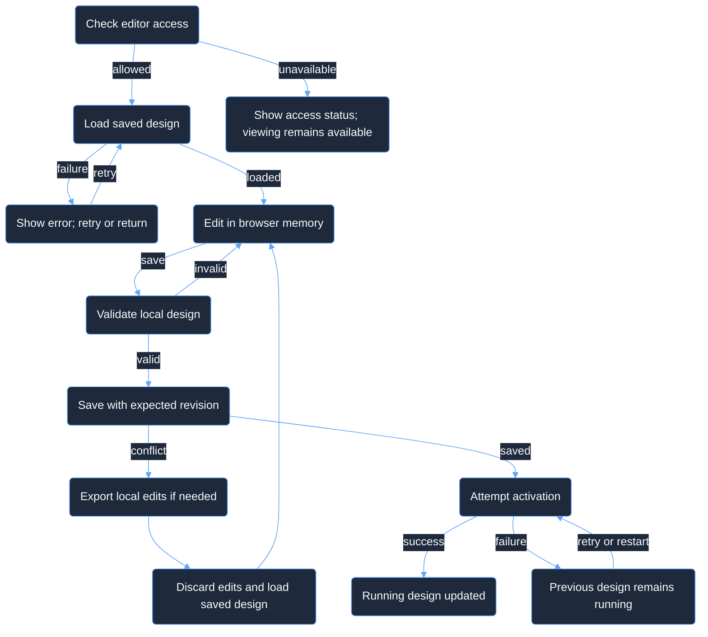
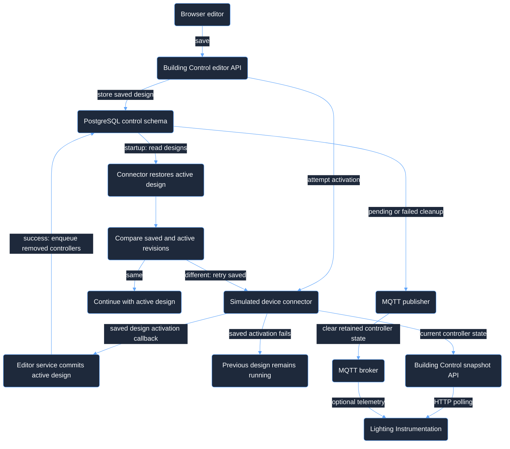

# Building editor

## Table of contents

- [Purpose](#purpose)
- [Running locally](#running-locally)
- [Editing and saving](#editing-and-saving)
- [Design and validation](#design-and-validation)
- [API and concurrency](#api-and-concurrency)
- [Persistence and activation](#persistence-and-activation)
- [Failure and recovery](#failure-and-recovery)
- [Implementation and tests](#implementation-and-tests)

## Purpose

The building editor is part of the [Building Control](building-control.md). It edits a building's dimensions, floors, rooms, doors, sensors, light strips, controllers, walkways, stairs and logical connections. The plan and wiring are illustrative, not an electrical or compliance design.

The [editor specification](../plans/building-editor-spec.md) describes the design contract, validation rules, state flow and remaining gaps. The [editor UX guide](../ux/building-control/editor/ux.md) describes the interface.

## Running locally

From the repository root in PowerShell:

```powershell
$env:ASPNETCORE_ENVIRONMENT = 'Development'
dotnet run --no-launch-profile --project src\Devices.BuildingControl.Web\Devices.BuildingControl.Web.csproj --urls http://localhost:5080
```

The direct-host command requires a configured `ConnectionStrings:Control` PostgreSQL connection. For this direct-host run, open `http://localhost:5080/` and choose **Building menu** then **Edit building**. The editor requires a Development environment, loopback client/listener, loopback remote TCP peer and local socket addresses, matching host/scheme/port, no forwarding headers and same-origin mutation requests. This process is not behind NGINX and has no application user accounts. To use the Compose environment instead, open `http://localhost:5080/`, then open the editor without a login. NGINX forwards editor requests with a private local proxy credential. See the [development environment guide](development-environment.md#local-access-and-limitations).

The browser checks `GET /api/capabilities`; `editorAllowed` must be `true`. Otherwise the menu's edit item is disabled and its access status explains the restriction. In Compose, NGINX adds `Content-Security-Policy: frame-ancestors 'none'` and `X-Frame-Options: DENY` to both websites; these headers prevent framing but do not replace authentication. Do not expose the simulator through a non-loopback listener or another proxy.

## Editing and saving

Opening the editor loads the saved design. Multiple editors may work concurrently. Applied design changes exist only in the open browser session until saved. Undo/redo history and unapplied form values are session-only and are not saved with the design. **Exit editor** confirms before discarding unsaved changes; closing or reloading also loses session-only state. JSON export can preserve local work, including a marked recovery export when pending form values cannot form a valid design.

**Start blank** replaces the editor design with one empty floor in a 20 × 20 m building. **Start with default building** uses the four-floor layout in a 10 × 8 m footprint. Both ask for confirmation, discard unapplied form values, and can be undone before or after saving. They do not affect the saved or running design until **Save and activate**. The replacement uses new identities, so saving it replaces the previous devices and schedules removed controllers for cleanup.

The plan's icon toolbar selects select, move, room, door, light, walkway and stairs tools. Tooltips identify the icons, and the active tool is shown in text. In select or move mode, drag an existing item to move it. The preview snaps to the 0.5 m grid; moving a room also translates its fixtures. Escape cancels the preview, and a completed move is one undoable edit. Pending form values require confirmation before they are replaced. An invalid drop remains in the session with a validation message and must be corrected before saving. Creation and move tools also support click-to-place; the item list and labelled forms remain available for selection and precise positioning without dragging. The item list offers buttons to add a walkway or stairs at the origin, then edit their properties. Stairs begin on the selected lower floor and connect to the next numbered floor; the upper floor shows the incoming stairs and links back to their properties. A walkway or stairs can be resized, moved, or deleted with confirmation and undo. Removing upper floors also removes stairs that would no longer connect to a floor. Each room requires a sensor and each floor requires a controller. Logical plan connections use right-angle routes and are not physical cable routes.

Doors appear as wall-aligned rectangles and controllers as boxes on the plan. Zoom and pan controls provide a closer view; **Fit all** restores the full plan and its exterior margin. Room labels are clipped to their boundaries, with full names available in **Items and connections** and the selection label. To delete an item, select it on the plan or in **Items and connections**, then choose **Delete selected item** above the plan and confirm. Controllers and sensors cannot be deleted independently.

**Save and activate** validates and persists the design, then attempts activation. The editor shows a brief status and highlights pending or failed controller cleanup; expandable details show saved and running revisions, activation status and cleanup counts. A successful save does not guarantee activation: if activation fails, the previous design remains running and the saved design can be retried. Undo after saving creates new unsaved changes.



## Design and validation

Design JSON contains `revision`, `width`, `depth` and `floors`. A floor contains its stable ID, number, controller ID and position, rooms, and optional walkway and stair arrays. Each room contains its stable ID, name, geometry, one sensor, doors and light strips; sensors and lights reference a controller. Each walkway and stair has an ID and rectangle in metres; each stair has an ascent direction. Stairs connect adjacent floors. Legacy null or absent arrays are represented as editable objects when opened and are persisted on save; empty arrays mean no corresponding objects. Existing saved and active designs retain their dimensions and coordinates. The 3D view uses the active design geometry at every revision and generates missing legacy access in memory; no stored design is rewritten merely by viewing it.

For save, the server requires 1–10 consecutively numbered floors, dimensions from 2–100 metres on a 0.5-metre grid, and non-overlapping rooms within the building footprint. Doors must lie on room boundaries; sensors and lights must lie within or on their rooms and connect to their floor's controller. IDs must be unique, safe and stable; retired IDs cannot be reused. Server validation is authoritative and returns field-path errors. See the [complete validation rules](../plans/building-editor-spec.md#building-design-and-validation).

## API and concurrency

The simulator exposes these editor endpoints using camelCase JSON:

| Method | Path | Purpose |
|---|---|---|
| `GET` | `/api/building-editor` | Read saved and active designs, edit revision, activation and cleanup status |
| `GET` | `/api/building-editor/default-design` | Read the original four-floor template without changing saved or running state |
| `POST` | `/api/building-editor/save` | Save `{ "expectedRevision": n, "design": {...} }` and attempt activation |
| `POST` | `/api/building-editor/retry` | Retry activation |
| `POST` | `/api/building-editor/retry-cleanup` | Request asynchronous controller cleanup retry |

Use the returned `editRevision` as the next save's `expectedRevision`. A stale revision returns `409`, invalid designs return `400`, and disallowed editor requests return `403`. On conflict, the browser keeps local changes for export and requires explicit reconciliation before saving.

`GET /api/building-design-status` is not editor-restricted; it reports saved and running revisions, activation status and cleanup counts. `GET /api/building-view` returns the active design and current controllers. The [HTTP examples](../../src/Devices.BuildingControl.Web/Editor/BuildingEditor.http) include save and retry requests. **The save example replaces the building**; use an isolated database.

## Persistence and activation

`BuildingDesignStore.cs` persists saved and active designs, edit revision, retired IDs and cleanup work in PostgreSQL's `control` schema. The application connects to the shared `devices` database as `control_app`; Instrumentation uses the separate `telemetry` schema and `telemetry_app`. PostgreSQL 18 or later supplies UUIDv7 primary-key defaults. Stable editor entity and controller IDs remain separate from database keys.

The control schema uses version 1, initialized from [`database/control/001_initial.sql`](../../database/control/001_initial.sql). Fresh control data is seeded once. Existing SQLite databases are neither imported nor deleted; this PostgreSQL-only setup does not migrate from SQLite. See the [telemetry schema](../../database/telemetry/erd.mmd), [persistence guide](building-control.md#persistence-and-backup), and the [development environment guide](development-environment.md#postgresql-and-fresh-data) for backup and restore limitations.

The [version 1 control schema](../plans/building-editor-spec.md#control-schema-version-1) uses immutable design version rows and same-building saved and active pointers; see its [ERD](../../database/control/erd.mmd). It remains single-building and changes no UI or API. Incompatible earlier development schemas are rejected without changing their data.

Save and activation are separate. Activation preserves compatible live state for retained device IDs and queues removed-controller MQTT cleanup only after activation succeeds. On startup, the last active design is restored and a different saved revision is retried. Cleanup is durable and asynchronous; its status represents broker publication, not acknowledgement by every subscriber. See the [runtime and persistence flow](../plans/building-editor-spec.md#persistence-and-runtime-integration).



## Failure and recovery

- **Save fails:** local edits remain in the open browser. Correct validation errors or retry; export before leaving if needed.
- **Revision conflict:** editing stops. Export local work, or explicitly discard it and load the current saved design.
- **Activation pending or failed:** the saved design may differ from the running design. Retry activation or restart the simulator to retry.
- **Cleanup pending or failed:** the publisher retries while MQTT is connected. The editor also offers a retry action.
- **Access unavailable:** viewing remains available, but editor controls are disabled. Check the Development and loopback requirements above.

## Implementation and tests

The editor interface is the React component [BuildingEditor.tsx](../../src/Devices.BuildingControl.Web/frontend/editor/BuildingEditor.tsx), with editor-specific types in [BuildingEditor.types.ts](../../src/Devices.BuildingControl.Web/frontend/editor/BuildingEditor.types.ts). Its TypeScript helpers [building-editor.ts](../../src/Devices.BuildingControl.Web/frontend/editor/building-editor.ts) and [building-editor-state.ts](../../src/Devices.BuildingControl.Web/frontend/editor/building-editor-state.ts) handle validation and session state. The server uses [BuildingEditorService.cs](../../src/Devices.BuildingControl.Web/Editor/BuildingEditorService.cs), [BuildingDesignStore.cs](../../src/Devices.BuildingControl.Web/Building/BuildingDesignStore.cs), and [BuildingDesign.cs](../../src/Devices.Contracts/BuildingDesign.cs). Access policy is enforced by [EditorAccessPolicy.cs](../../src/Devices.BuildingControl.Web/Editor/EditorAccessPolicy.cs).

From the repository root:

```powershell
dotnet test tests\Devices.Simulator.Tests\Devices.Simulator.Tests.csproj --filter "FullyQualifiedName~BuildingDesignTests|FullyQualifiedName~BuildingEditorServiceTests|FullyQualifiedName~EditorAccessPolicyTests"
node --import tsx --test tests\building-control\building-editor.test.mjs tests\building-control\building-editor-ui.test.mjs tests\building-control\localization-en.test.mjs
npm run test:components
```

These focused tests supplement the solution build and test commands in the [simulator guide](building-control.md#running-and-testing).
