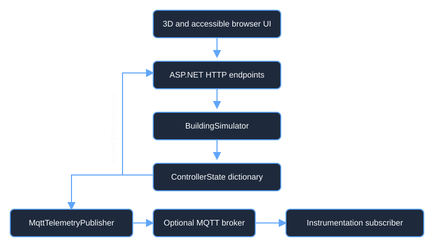
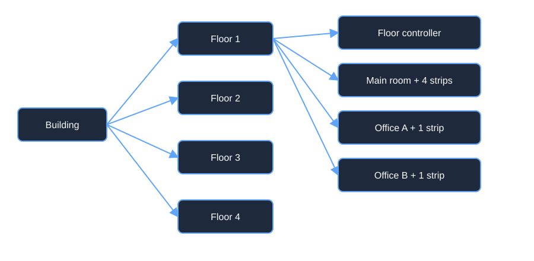
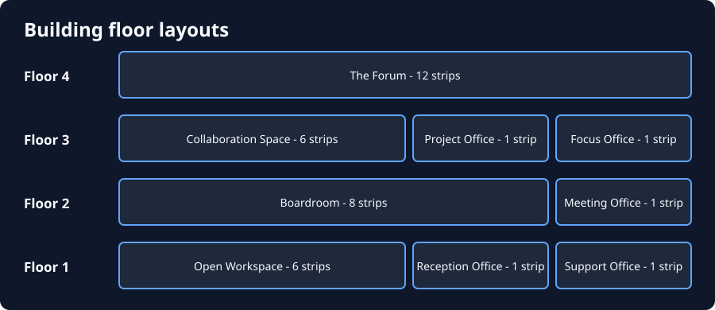
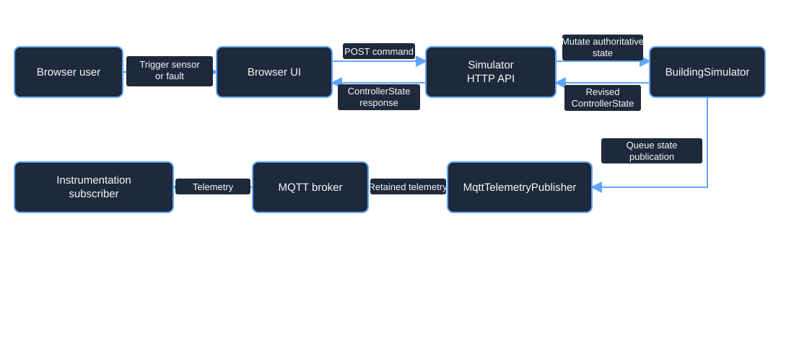
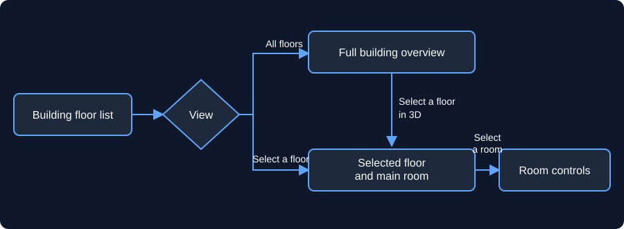

# Building Light Simulator

## Table of contents

- [Purpose](#purpose)
- [Design](#design)
- [Building model](#building-model)
- [Runtime architecture](#runtime-architecture)
- [User interactions](#user-interactions)
- [HTTP API](#http-api)
- [Building editor](#building-editor)
- [MQTT protocol](#mqtt-protocol)
- [Persistence and backup](#persistence-and-backup)
- [Source tree](#source-tree)
- [Configuration](#configuration)
- [Running and testing](#running-and-testing)

## Purpose

The simulator starts with a four-floor office building and provides device state that can be changed through HTTP or MQTT. A local editor can save a different building design. It is intended for demonstrations, IoT protocol experiments, and testing the separate instrumentation dashboard.

## Design

The application separates:

- **Device state** - controllers, rooms, sensors, light strips, presence, faults, and revisions.
- **HTTP control** - browser-visible commands and state inspection.
- **MQTT telemetry** - retained state snapshots and command acknowledgements.
- **3D presentation** - local Three.js scene with floor and room selection.

The [building editor technical guide](building-editor.md) covers operation and implementation; the [specification](../plans/building-editor-spec.md) describes the design and remaining gaps.



## Building model



The initial, seeded design has one controller and one sensor per room:

- 4 controllers
- 9 rooms and 9 presence sensors
- 37 light strips
- Floor 1: Open Workspace with 6 strips in two rows of three; Reception Office and Support Office with one strip each
- Floor 2: Boardroom with 8 strips in two rows of four; Meeting Office with one strip
- Floor 3: Collaboration Space with 6 strips in two rows of three; Project Office and Focus Office with one strip each
- Floor 4: The Forum with 12 strips in two rows of six



Stable IDs are created in [Ids.cs](../../src/Devices.Contracts/Ids.cs):

- Controller: `controller-floor-{n}`
- Room: `floor-{n}-{room}`
- Sensor: `sensor-floor-{n}-{room}`
- Light: `light-floor-{n}-{room}-{index}`

The seed preserves these existing IDs, names and strips. Room state carries an explicit `sensorId`; older state without it uses the legacy ID derived from floor and room key. Edited designs can use other stable IDs. IDs removed from a saved design are retired and cannot be reused. Runtime presence, faults and lights are in memory, not persisted across simulator restart.

Room names are display names in HTTP and MQTT state; seeded IDs retain their existing `main`, `office-a` and `office-b` keys. Stored telemetry history may show previous names.
The model's English room names are embedded from [RoomNames.resx](../../src/Devices.Contracts/RoomNames.resx). They are independent of the server's UI culture so the shared HTTP and MQTT state remains consistent.

## Runtime architecture



## User interactions

The Building list sits beside the 3D view on desktop and above it on narrow screens. It shows each floor's controller status, occupied-room count, and the current selection, with scenario controls below the floors. An icon marks faulted controllers, and the occupancy count reflects room presence. The list updates after simulator actions; changes made elsewhere require a page reload.
On narrow screens the camera widens its view to keep the floor visible; on wider screens the selected-floor view is slightly farther out. The preset updates across the breakpoint unless the camera has been moved manually.



- **Floor selection** displays only the chosen floor in the 3D view, opens its main room where present (otherwise the first room), and moves the camera to that floor. Selecting the same floor again resets its camera without changing the selected room. The Building list and live status table retain the other floors' status.
- **Startup** selects Floor 3's Collaboration Space and uses the selected-floor camera for the baseline design; an edited design may not have that floor or room.
- **All floors** clears the floor selection, restores detailed floors and normal spacing, and restores the complete-building camera.
- **Baseline architecture** includes corner pillars, rear stairs, landings, walkways and illustrative open doors. These are non-interactive. The initial design uses this baseline scene.
- **Edited designs** render their saved rooms, doors, fixtures and controller on a flat floor slab, with illustrative perimeter walkways, stairs, landings and pillars outside the editable footprint. These structures are not editable and do not guarantee routes from interior doors. Seed geometry approximates the baseline on the grid, rather than reproducing it exactly.
- **Sensors** sit just below the illustrative ceiling at the end of their wiring connection. Sensor routes are offset from light routes so both remain distinct; office sensors are also positioned apart from the light strips. Sensors without presence or a fault are white, sensors detecting presence are green, and faulted sensors are red and pulse even when their room is not selected; with reduced motion enabled they remain steadily red. A sensor fault does not turn the room's walls or floor red, and fault status is shown in text.
- **Room illumination** warms its floor and walls in proportion to its working lights and shows soft, illustrative rays beneath each working strip. These effects and the live-status light counts exclude faulted strips, rather than assuming presence always means lights are on; the effects are not ray tracing.
- **Room selection** is available by clicking or tapping a room in the 3D view, as indicated in the view's interaction help.
- **Wiring** automatically connects the selected floor's controller to its sensors and light strips in an illustrative overlay. Sensor routes are offset from light routes to keep them distinct. No wiring is shown in All floors view. A key in the 3D view identifies blue wiring as sensors and yellow wiring as lights; the routes are not actual cable layouts.
- **Room inspector** controls presence and sensor-fault state for the selected room only. A floor remains faulted while any fault on its controller remains active.
- **Reset building** clears presence, triggered state, lights, and faults.
- **Occupancy demo** randomly selects 1–2 rooms per floor, capped at the number of rooms on that floor, and turns on their current strips. Scenario controls are disabled while a scenario is running. Errors are displayed below the controls, including when a scenario succeeds but its status refresh fails.
- **Accessible controls** and the keyboard-accessible Building list provide floor selection, room-trigger, and fault controls without 3D hit testing. Choosing All floors restores the overview.

The 3D view is built from local Three.js modules in `wwwroot/vendor`; it does not require a CDN at runtime.
Browser interface text is in [localization.en.mjs](../../src/Devices.Simulator.Web/wwwroot/localization.en.mjs). Static markup retains matching English fallback text and labels; update both when changing them. Only English is provided; there is no language selector or automatic culture negotiation.


## HTTP API

| Method | Endpoint | Purpose |
|---|---|---|
| `GET` | `/api/controllers` | List controller states |
| `GET` | `/api/controller-snapshot` | Authoritative active design revision and controller membership |
| `GET` | `/api/building-view` | Active design and current controllers, returned together |
| `GET` | `/api/building-design-status` | Saved and running revisions, activation status, and cleanup counts |
| `GET` | `/api/capabilities` | Non-cached `mutationsAllowed` and `editorAllowed` flags for this request |
| `GET` | `/api/controllers/{controllerId}` | Get one controller |
| `GET` | `/api/status` | MQTT and HTTP transport status |
| `POST` | `/api/rooms/{roomId}/sensor/trigger` | Trigger a room sensor |
| `POST` | `/api/rooms/{roomId}/sensor/reset` | Reset presence and room lights |
| `POST` | `/api/devices/{deviceId}/faults` | Add sensor, strip, or controller fault |
| `DELETE` | `/api/devices/{deviceId}/faults/{faultId}` | Clear a fault |
| `POST` | `/api/scenarios/reset` | Reset the full building |
| `POST` | `/api/scenarios/occupancy` | Randomize 1–2 occupied rooms per floor, up to the number available |

The snapshot is `{ "revision": number, "controllers": [...] }`. Instrumentation polls it, rejects stale revisions or changed membership at the same revision, persists removed-controller tombstones, and retains event history. Only a `404` falls back to the legacy `/api/controllers` list. See [instrumentation persistence](lighting-instrumentation.md#persistence).

The read-only design status returns `savedRevision`, `runningRevision`, `activationStatus`, `pendingCleanup`, `failedCleanup`, and `completedCleanup`. The simulator header polls it every five seconds after each response and shows an unavailable state if the request fails. When the running revision changes, the simulator refreshes its building view and controls; a failed refresh is reported and retried on the next poll. This endpoint remains available when editor access is disabled.

The [manual HTTP examples](../../src/Devices.Simulator.Web/Editor/BuildingEditor.http) exercise these endpoints and the editor API. **The save example replaces design data**; use an isolated simulator database.

## Building editor

The editor offers an SVG plan and forms for building dimensions, floors, rooms, doors, controllers, sensors, lights and logical connections. Unsaved edits stay in the open browser session; the editor provides session undo/redo and JSON export, and can save, retry work or leave. Leaving with unsaved edits prompts for confirmation. A revision conflict stops writes; local edits can be exported or the current server state adopted.

Editor endpoints are available **only** in the Development environment on a directly connected loopback server and client. Every configured listening address and the request host must be loopback; the request scheme and port must match a listener. Forwarding headers are rejected. Mutations require a same-origin `Origin`; GET/HEAD may omit it. No authentication is provided. Non-loopback listeners, proxies, and the supplied Compose deployment cannot use the editor.

**Deployment warning:** other simulator API mutations reject forwarding headers, non-loopback Host values, cross-origin or malformed `Origin` headers, and `Sec-Fetch-Site` values other than `same-origin`. Originless command-line requests are allowed. These checks do not authenticate callers or verify the TCP peer; they rely on loopback-bound deployment. `Simulator:AllowHttpMutations` defaults to `true`; Compose sets it to `false`, disabling HTTP simulator controls as well as editor access while retaining read-only viewing and telemetry. This also blocks mutations from Compose-network peers. The browser checks `/api/capabilities` periodically, reports view-only or unavailable access, and disables mutation controls until access is confirmed. These UI flags are not authorization; the server checks every mutation. MQTT commands are separate and require a trusted broker with its own access controls. Compose publishes both application ports on `127.0.0.1`; instrumentation APIs remain unauthenticated. Do not expose these services through proxies or non-loopback bindings. Local users and processes share access.

| Method | Editor endpoint | Request / result |
|---|---|---|
| `GET` | `/api/building-editor` | Saved `design`, `activeDesign`, `editRevision`, `activationStatus`, and `cleanup` |
| `POST` | `/api/building-editor/save` | `{ "expectedRevision": n, "design": {...} }`; saves, attempts activation, returns state |
| `POST` | `/api/building-editor/retry` | Retries activation |
| `POST` | `/api/building-editor/retry-cleanup` | Requests cleanup retry, returns `202` |

JSON uses camelCase. Successful state responses include saved and active revisions separately. Save compares the client-observed `editRevision`; stale revisions return `409`. Invalid designs return `400` with `detail` and field-path `errors`. Access failures return `403`. Save can return success with `activationStatus` `failed` or `pending`; a saved design is not necessarily running. The editor refreshes status every 20 seconds. See the [editor specification](../plans/building-editor-spec.md#building-design-and-validation) for payload and geometry rules.

## MQTT protocol

The publisher uses `building/controllers/{controllerId}/telemetry` for retained state telemetry.
Commands are received on `building/controllers/{controllerId}/commands`; validly routed commands that are accepted or rejected return a non-retained acknowledgement on `building/controllers/{controllerId}/commands/{commandId}/ack`.


Supported actions:

- `trigger`
- `reset`
- `add-fault`
- `clear-fault`

The command contract includes stable command, controller, room, target, scope, description, and timestamp fields. The topic must have exactly the stated four levels, and its controller ID must match the payload controller ID. Controller and command IDs must be nonblank, at most 128 characters, and each must fit one MQTT topic level without `+`, `#`, `/` or control characters. Malformed or mismatched topics and invalid IDs are rejected without publishing an acknowledgement. Once routing is valid, an invalid target or other command rejection produces a negative acknowledgement. MQTT routing validation is not publisher authentication; broker access controls remain necessary.

After activation removes a controller, a persistent cleanup item causes an empty retained payload to be published to its telemetry topic. Pending and failed work is retried while MQTT is connected, normally every five seconds, and is revision-fenced. HTTP mutations and saves do not wait for MQTT. Broker failure leaves cleanup outstanding; completion reflects a successful broker publish, not confirmation by every subscriber.

## Persistence and backup

The simulator stores saved and active designs, the edit revision, retired IDs and controller cleanup work in its own SQLite database. `BuildingDesign:SqlitePath` defaults to `building-design.db` relative to the simulator content root (`src/Devices.Simulator.Web/building-design.db` with the normal project run). A fresh database is seeded once. Schema version 4 migrates versions 1–3, retaining saved and active designs and revisions; versions 1–2 stored drafts are discarded. Unknown versions and nonempty unversioned databases are rejected. A version 1 migration can retire IDs visible in its active design but cannot reconstruct earlier deleted IDs.

Save transactionally stores the saved design. Activation is separate: retained device IDs preserve compatible in-memory state, removed devices are dropped, and removed-controller cleanup is queued only when activation succeeds. On startup the last active design is restored, then a different saved revision is retried; a failed retry leaves the old active design. Activation failure status is recomputed by the startup attempt, rather than stored as a durable failure record. After a runtime activation failure, use the editor retry action or restart; there is no separate periodic activation retry. Cleanup state is durable and retried asynchronously.

For a consistent live backup, use SQLite's online backup API. From the repository root, with Python installed:

```powershell
python -c "import sqlite3; source=sqlite3.connect(r'src\Devices.Simulator.Web\building-design.db'); backup=sqlite3.connect('building-design-backup.db'); source.backup(backup); backup.close(); source.close()"
python -c "import sqlite3; db=sqlite3.connect('building-design-backup.db'); print(db.execute('PRAGMA integrity_check').fetchone(), db.execute('PRAGMA user_version').fetchone()); db.close()"
```

Confirm integrity is `ok` and schema version is supported before restoring. Stop the simulator, retain a recovery copy, replace the database with the validated backup, and restart. For Compose, stop the simulator before copying or restoring the file in the `building-design-data` volume; do not copy a live SQLite database without its online backup API. Design and telemetry databases are separate: restoring an older design alone can make instrumentation reject its older revision or retired IDs; plan a consistent recovery of both stores. Automatic backups are not implemented.

## Source tree

```text
src/Devices.Simulator.Web/
  Devices.Simulator.Web.csproj
  Program.cs                 application setup and HTTP endpoints
  Building/
    BuildingDesign.cs        design records, validation, baseline seed
    BuildingDesignStore.cs   SQLite persistence, revision checks and cleanup
    BuildingSimulator.cs     simulation state and mutations
    BuildingSimulator.Design.cs active design reconciliation
  Editor/
    BuildingEditorService.cs editor operations and activation
    BuildingEditor.http      manual HTTP examples (writes replace data)
    EditorAccessPolicy.cs    local editor access checks
  Mqtt/
    ControllerCleanupProcessor.cs revision-fenced cleanup processing
    MqttCommandRouting.cs    command topic and ID validation
    MqttTelemetryPublisher.cs telemetry publishing and commands
  Security/
    LocalMutationPolicy.cs   simulator mutation checks
    SimulatorCapabilities.cs browser capability endpoint
  appsettings.json
  Properties/launchSettings.json
  wwwroot/
    app.js       3D scene, selection, controls, scenarios
    building-access.mjs  room doorways and rear walkway
    building-design-view.mjs  edited-design scene geometry
    building-editor.mjs, building-editor-state.mjs  editor and session state
    building-pillars.mjs  illustrative corner pillars
    building-stairs.mjs  illustrative flights between floors
    floor-view.mjs  floor selection and camera framing
    localization.en.mjs  English browser interface strings
    room-fixtures.mjs  floor layouts and room sensor and light positions
    room-state.mjs  sensor fault lookup and light visual state
    wiring-routes.mjs  illustrative wiring routes
    index.html   semantic page structure
    styles.css   scene, inspector, status, responsive layout
    vendor/      local Three.js and OrbitControls modules
```

Shared contracts and IDs are in [Devices.Contracts](../../src/Devices.Contracts/).

## Configuration

`appsettings.json`:

```json
{
  "Mqtt": {
    "Host": "localhost",
    "Port": 1883
  },
  "Urls": "http://localhost:5080"
}
```

An unavailable broker does not block HTTP simulation. MQTT status is exposed through `/api/status`.

The default design path above may be overridden with `BuildingDesign:SqlitePath` or `BuildingDesign__SqlitePath`. Compose sets it to `/data/building-design.db` in the `building-design-data` volume; the container listens on `0.0.0.0:8080`, its host port is loopback-only, and editor access is disabled.

## Running and testing

```powershell
dotnet run --project src\Devices.Simulator.Web\Devices.Simulator.Web.csproj --urls http://localhost:5080
dotnet test tests\Devices.Simulator.Tests\Devices.Simulator.Tests.csproj
node --test tests\building-access.test.mjs tests\wiring-routes.test.mjs tests\floor-view.test.mjs tests\room-state.test.mjs tests\record-demo.test.mjs tests\localization-en.test.mjs tests\building-design-view.test.mjs tests\building-editor.test.mjs tests\building-editor-ui.test.mjs
```

The simulator view-logic tests require Node.js.

The simulator test suite includes a broker-backed integration test of simulator publication, instrumentation ingestion, snapshot reconciliation and retained-message cleanup. It uses an isolated, anonymous Mosquitto container bound to a dynamic loopback port and skips if Docker or a locally cached `eclipse-mosquitto:2` image is unavailable. To make the image available and run that test from the repository root:

```powershell
docker pull eclipse-mosquitto:2
dotnet test tests\Devices.Simulator.Tests\Devices.Simulator.Tests.csproj --filter "FullyQualifiedName~MqttEndToEndTests"
```

The test invokes the simulator and instrumentation components in-process and applies the snapshot directly; it does not exercise HTTP polling, broker disconnects or process restarts. The anonymous broker is only for the isolated test, not deployment.
