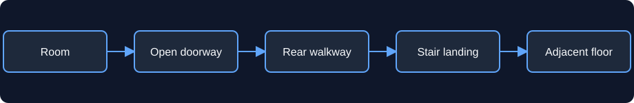
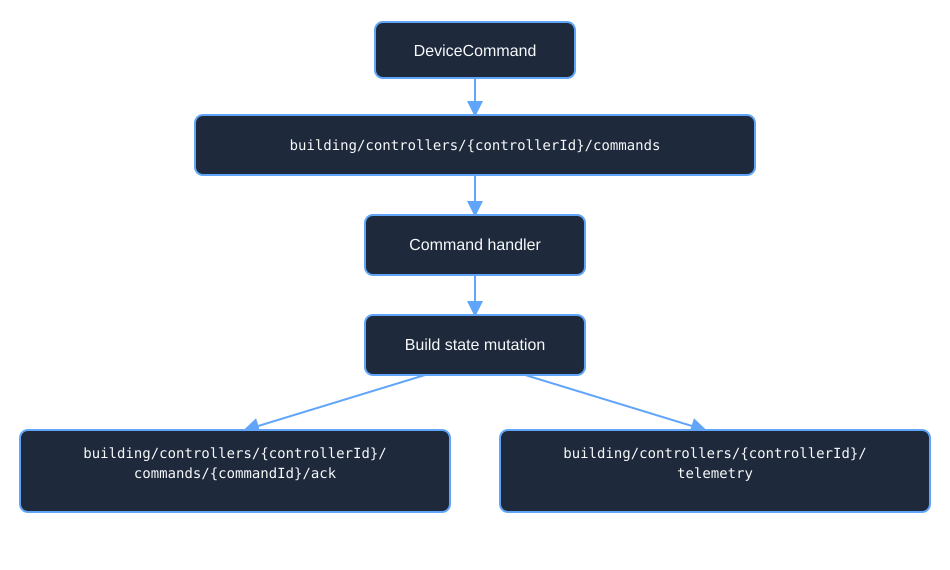

# Building Light Simulator

## Table of contents

- [Purpose](#purpose)
- [Design](#design)
- [Building model](#building-model)
- [Runtime architecture](#runtime-architecture)
- [User interactions](#user-interactions)
- [HTTP API](#http-api)
- [MQTT protocol](#mqtt-protocol)
- [Source tree](#source-tree)
- [Configuration](#configuration)
- [Running and testing](#running-and-testing)

## Purpose

The simulator presents a four-floor office building and provides deterministic device state that can be changed through HTTP or MQTT. It is intended for demonstrations, IoT protocol experiments, and testing the separate instrumentation dashboard.

## Design

The application separates:

- **Device state** - controllers, rooms, sensors, light strips, presence, faults, and revisions.
- **HTTP control** - browser-visible commands and state inspection.
- **MQTT telemetry** - retained state snapshots and command acknowledgements.
- **3D presentation** - local Three.js scene with floor and room selection.

A [building editor](../plans/building-editor-spec.md) is proposed separately; it is not implemented.


## Building model


Each floor has one controller and one sensor per room:

- 4 controllers
- 9 rooms and 9 presence sensors
- 37 light strips
- Floor 1: Open Workspace with 6 strips in two rows of three; Reception Office and Support Office with one strip each
- Floor 2: Boardroom with 8 strips in two rows of four; Meeting Office with one strip
- Floor 3: Collaboration Space with 6 strips in two rows of three; Project Office and Focus Office with one strip each
- Floor 4: The Forum with 12 strips in two rows of six


Stable IDs are created in [Ids.cs](../../src/Devices.Contracts/Ids.cs):

- Controller: `controller-floor-{n}`
- Room: `floor-{n}-{room}`
- Sensor: `sensor-floor-{n}-{room}`
- Light: `light-floor-{n}-{room}-{index}`

Existing IDs for retained rooms and strips are unchanged. Floor 2 Office B and Floor 4 offices no longer exist; clients using their IDs must select another room. Previously stored instrumentation snapshots or events may still show the old rooms until newer snapshots arrive or events expire. A running simulator must be restarted to load the new model, which resets its in-memory state.

Room names are display names in the HTTP and MQTT state; room, sensor and light IDs retain their existing `main`, `office-a` and `office-b` keys. Stored telemetry may show previous names until newer state arrives.
The model's English room names are embedded from [RoomNames.resx](../../src/Devices.Contracts/RoomNames.resx). They are independent of the server's UI culture so the shared HTTP and MQTT state remains consistent.

## Runtime architecture


## User interactions

The Building list sits beside the 3D view on desktop and above it on narrow screens. It shows each floor's controller status, occupied-room count, and the current selection, with scenario controls below the floors. An icon marks faulted controllers, and the occupancy count reflects room presence. The list updates after simulator actions; changes made elsewhere require a page reload.
On narrow screens the camera widens its view to keep the floor visible; on wider screens the selected-floor view is slightly farther out. The preset updates across the breakpoint unless the camera has been moved manually.


- **Floor selection** displays only the chosen floor in the 3D view, opens its main room, and moves the camera to that floor. Selecting the same floor again resets its camera without changing the selected room; if no room is selected, it reopens the main room. The Building list and live status table retain the other floors' status.
- **Startup** selects Floor 3's Collaboration Space and uses the selected-floor camera.
- **All floors** clears the floor selection, restores detailed floors and normal spacing, and restores the complete-building camera.
- **Corner pillars** provide a faint, non-interactive building frame in the overview; they are hidden when a floor is selected.
- **Stairs** sit at the back of the building. A hint in the view invites users to orbit to the back for a clear view, and the canvas description identifies the stairs for assistive technology. The overview shows alternating flights of 18 short steps on separate side-by-side lanes. A shared landing joins the incoming and outgoing flights on each floor, and each slab above a flight has an opening. A selected floor shows translucent sections of the stairs above and below, where those flights exist; the ground floor has no flight below, and the top floor has no flight above. In the top-floor view, the unused lane is filled while the opening for the stairs down remains. Stairs are illustrative and non-interactive.
- **Doors and walkways** connect each room to the rear stair landing. Doorways have an open, illustrative door; they do not open or close interactively. The walkway stays outside the stairwell opening. Office and larger main-room footprints leave space for the corridor.
- **Sensors** sit just below the illustrative ceiling at the end of their wiring connection. Sensor routes are offset from light routes so both remain distinct; office sensors are also positioned apart from the light strips. Sensors without presence or a fault are white, sensors detecting presence are green, and faulted sensors are red and pulse even when their room is not selected; with reduced motion enabled they remain steadily red. A sensor fault does not turn the room's walls or floor red, and fault status is shown in text.
- **Room illumination** warms its floor and walls in proportion to its working lights and shows soft, illustrative rays beneath each working strip. These effects and the live-status light counts exclude faulted strips, rather than assuming presence always means lights are on; the effects are not ray tracing.
- **Room selection** is available by clicking or tapping a room in the 3D view, as indicated in the view's interaction help.
- **Wiring** automatically connects the selected floor's controller to its sensors and light strips in an illustrative overlay. Sensor routes are offset from light routes to keep them distinct. No wiring is shown in All floors view. A key in the 3D view identifies blue wiring as sensors and yellow wiring as lights; the routes are not actual cable layouts.
- **Room inspector** controls presence and sensor-fault state for the selected room only. A floor remains faulted while any fault on its controller remains active.
- **Reset building** clears presence, triggered state, lights, and faults.
- **Occupancy demo** randomly selects 1–2 rooms per floor, capped at the number of rooms on that floor, and turns on their current strips. Scenario controls are disabled while a scenario is running. Errors are displayed below the controls, including when a scenario succeeds but its status refresh fails.
- **Accessible controls** and the keyboard-accessible Building list provide floor selection, room-trigger, and fault controls without 3D hit testing. Selecting a floor opens its main room; choosing All floors restores the overview.

The 3D view is built from local Three.js modules in `wwwroot/vendor`; it does not require a CDN at runtime.
Browser interface text is in [localization.en.mjs](../../src/Devices.Simulator.Web/wwwroot/localization.en.mjs). Static markup retains matching English fallback text and labels; update both when changing them. Only English is provided; there is no language selector or automatic culture negotiation.



## HTTP API

| Method | Endpoint | Purpose |
|---|---|---|
| `GET` | `/api/controllers` | List controller states |
| `GET` | `/api/controllers/{controllerId}` | Get one controller |
| `GET` | `/api/status` | MQTT and HTTP transport status |
| `POST` | `/api/rooms/{roomId}/sensor/trigger` | Trigger a room sensor |
| `POST` | `/api/rooms/{roomId}/sensor/reset` | Reset presence and room lights |
| `POST` | `/api/devices/{deviceId}/faults` | Add sensor, strip, or controller fault |
| `DELETE` | `/api/devices/{deviceId}/faults/{faultId}` | Clear a fault |
| `POST` | `/api/scenarios/reset` | Reset the full building |
| `POST` | `/api/scenarios/occupancy` | Randomize 1–2 occupied rooms per floor, up to the number available |

## MQTT protocol

The publisher uses `building/controllers/{controllerId}/telemetry` for retained state telemetry.
Commands are received on `building/controllers/{controllerId}/commands`; accepted or rejected commands return a non-retained acknowledgement on `building/controllers/{controllerId}/commands/{commandId}/ack`.



Supported actions:

- `trigger`
- `reset`
- `add-fault`
- `clear-fault`

The command contract includes stable command, controller, room, target, scope, description, and timestamp fields. A command is rejected unless the MQTT topic controller matches the payload controller and the target belongs to that controller.

## Source tree

```text
src/Devices.Simulator.Web/
  Devices.Simulator.Web.csproj
  Program.cs
  appsettings.json
  Properties/launchSettings.json
  wwwroot/
    app.js       3D scene, selection, controls, scenarios
    building-access.mjs  room doorways and rear walkway
    building-pillars.mjs  illustrative corner pillars
    building-stairs.mjs  illustrative flights between floors
    floor-view.mjs  floor selection and camera framing
    localization.en.mjs  English browser interface strings
    room-fixtures.mjs  floor layouts and room sensor and light positions
    room-state.mjs  sensor fault lookup and light visual state
    wiring-routes.mjs  illustrative wiring routes
    index.html   semantic page structure
    styles.css   scene, inspector, status, responsive layout
    vendor/      local Three.js and OrbitControls modules
```

Shared contracts and IDs are in [Devices.Contracts](../../src/Devices.Contracts/).

## Configuration

`appsettings.json`:

```json
{
  "Mqtt": {
    "Host": "localhost",
    "Port": 1883
  },
  "Urls": "http://localhost:5080"
}
```

An unavailable broker does not block HTTP simulation. MQTT status is exposed through `/api/status`.

## Running and testing

```powershell
dotnet run --project src/Devices.Simulator.Web/Devices.Simulator.Web.csproj --urls http://localhost:5080
dotnet test tests/Devices.Simulator.Tests/Devices.Simulator.Tests.csproj
node --test tests/building-access.test.mjs tests/wiring-routes.test.mjs tests/floor-view.test.mjs tests/room-state.test.mjs tests/record-demo.test.mjs tests/localization-en.test.mjs
```

The simulator view-logic tests require Node.js.
