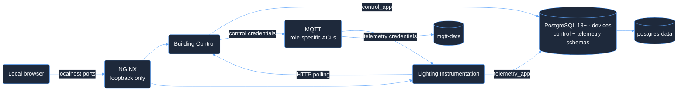

# Local development environment

## Table of contents

- [Purpose and boundaries](#purpose-and-boundaries)
- [Local access and limitations](#local-access-and-limitations)
- [Release-build and live-development modes](#release-build-and-live-development-modes)
- [PostgreSQL and fresh data](#postgresql-and-fresh-data)
- [Backup and restore](#backup-and-restore)
- [Direct-host limitations](#direct-host-limitations)

## Purpose and boundaries

The [Docker Compose project](../../deploy/docker/compose.yaml) configures Building Control, Lighting Instrumentation, PostgreSQL, MQTT and NGINX as one local development stack. Both modes and source watchers have been exercised with Kiri on Windows; command examples here use Docker Compose CLI. This is not a production deployment, and its shared development credentials are not production secret storage. The [Kubernetes directory](../../deploy/kubernetes/README.md) is a placeholder for future work.



Only the NGINX ports are published, bound to `127.0.0.1`. PostgreSQL and MQTT stay on the Compose network. Neither site requires a browser login; local users and processes can access and modify simulator state. NGINX adds `Content-Security-Policy: frame-ancestors 'none'` and `X-Frame-Options: DENY` to both sites, preventing them from being embedded in frames. These headers do not authenticate users.

## Local access and limitations

From Linux or WSL at the repository root, run:

```bash
bash deploy/docker-dev-setup.sh
```

The script requires Bash and OpenSSL. It writes `.env`, containing generated PostgreSQL, control/telemetry database-role, MQTT-role and proxy secrets. Docker and a running Docker-compatible engine are required to start the stack, not to generate the credentials.

The Compose examples below use `docker`. If WSL only exposes the Windows CLI, use `docker.exe compose` in place of `docker compose` for startup and shutdown, and use a repository path accessible to that Windows CLI.

Run the Compose commands from the repository root. `--project-directory .` keeps
build paths and the existing root `.env`; `-p devices` preserves the previous
project and its `devices_postgres-data` and `devices_mqtt-data` volumes. Since
the Compose files are passed explicitly, Compose does not automatically load
`compose.override.yaml`. To retain a local override such as a loopback-only
PostgreSQL port, move it to `deploy/docker/compose.override.yaml`. The start
script loads this file when present. For manual Compose commands, add
`-f deploy/docker/compose.override.yaml` after the base file in every command
that starts or recreates services. Keep local overrides out of source control.

The script refuses to overwrite an existing `.env`. It creates the file with `umask 077`; on WSL Windows-mounted filesystems, access permissions depend on the mount configuration and Windows ACLs. Keep it private and out of source control. Preserve the existing `.env` when reusing the database volume: PostgreSQL initializes its role passwords only on a fresh volume, so generating a new `.env` alone breaks database access. Rotate existing database role passwords deliberately, or back up the data and explicitly reset the database volume before provisioning a fresh credential set. Resetting the volume deletes its data. These credentials are development-only.

The default browser URLs are `http://localhost:5080/` for Building Control and `http://localhost:5081/` for Instrumentation. Use the `localhost` hostname, not a direct container address. Ports can be overridden in the shell before running Compose:

```bash
export DEV_CONTROL_PORT=5082
export DEV_INSTRUMENTATION_PORT=5083
```

Compose binds the selected ports on loopback. Keep them distinct and available. Clear or change these environment variables when returning to the defaults. The simulator accepts editor and HTTP mutations through the proxy only in the Development environment and only for the configured localhost public port. MQTT control and telemetry connections use different generated passwords and broker accounts with role-specific topic ACLs; do not share these credentials.

## Release-build and live-development modes

The release-build mode publishes the .NET applications in Release configuration with their built frontend assets:

```bash
bash deploy/docker-dev-start.sh
```

The start script requires the existing root `.env`, uses the `devices` Compose project and includes `deploy/docker/compose.override.yaml` when present. It uses `docker` or, if unavailable, `docker.exe` and propagates Compose failures. To invoke the equivalent manually, use `docker compose --project-directory . -p devices -f deploy/docker/compose.yaml up --build -d`, adding the override as described above.

Changing application or frontend source requires rebuilding the affected image(s). Despite the optimized Release build, the Compose applications run with `ASPNETCORE_ENVIRONMENT=Development` to support this local-only proxy/editor path. This mode is not production-ready.

The live-development mode overlays source mounts and .NET/ frontend watchers:

```powershell
docker compose --project-directory . -p devices -f deploy/docker/compose.yaml -f deploy/docker/compose.dev.yaml up --build -d
```

The .NET and Vite watchers poll mounted source files so changes are detected on Kiri. Vite rebuilds frontend assets into named volumes; reload the browser to see them. Backend changes are applied by `dotnet watch`, which may restart the application.

Both modes use the same Compose project, database and broker volumes. Stop one mode before starting the other; do not run two Building Control instances against the same database. Building Control holds a PostgreSQL advisory owner lease and stops if its lease connection fails. This is fail-stop single-instance protection, not distributed fencing or high availability. For ordinary shutdown, use the same Compose options as startup with `down`; it preserves named volumes. Adding `--volumes` deletes the database and broker data and must be treated as a destructive reset.

Compose waits for PostgreSQL connectivity and both schemas before starting applications; it does not wait for application migrations or expose a complete application readiness check. The applications' `/api/status` endpoints describe transport availability, not database health. Inspect `ps` and service logs using the same Compose options as startup, as well as the websites. If the database connection holding the control lease fails, Building Control stops; after PostgreSQL recovers, start the services again with the same options and `up -d`.

## PostgreSQL and fresh data

PostgreSQL 18 or later is required for database-generated UUIDv7 primary keys. One database named `devices` contains two schemas: `control` for building designs and controller cleanup records, and `telemetry` for controller state, membership and events. `control_app` and `telemetry_app` are separate application identities with schema-specific ownership/access. Stable controller, event and design entity IDs remain distinct from PostgreSQL UUID primary keys.

On a new PostgreSQL volume, Compose creates the database roles and schemas. Building Control applies its initial `control` schema script and seeds a fresh design once; Instrumentation applies its embedded initial telemetry migration. Both schemas use version 1 independently. This setup does not migrate or import existing SQLite files. Existing SQLite databases/volumes are left untouched and are not read by these applications. Reusing an existing PostgreSQL volume also does not rerun the container's one-time initialization script. The applications reject incompatible or incomplete schemas rather than falling back to SQLite.

The [control schema version 1](../plans/building-editor-spec.md#control-schema-version-1) is fresh-only. It rejects the preceding version 2 and the older, differently shaped development version 1 without changing their data; a fresh initialization requires an explicit reset.

Instrumentation also rejects an existing telemetry schema using the former `schema_migrations` table; the renamed `schema_version` table is initialized only on a fresh telemetry schema. It does not automatically alter or delete existing data.

For a complete local reset, first stop the applications and back up any data you want to keep. From the repository root, `docker compose --project-directory . -p devices -f deploy/docker/compose.yaml down --volumes` deliberately deletes the Compose PostgreSQL volume **and** broker volume, including both control and telemetry data and retained MQTT messages. It does not remove existing SQLite files or volumes. Start the intended application version with the release-build command above to initialize fresh data, including any needed local override. Ordinary `down` preserves the volumes. Restore backups only with compatible application and schema versions.

Runtime simulator state such as room presence, faults and light states remains in memory and resets when Building Control restarts. Saved designs, telemetry and event records are persisted. A restored database does not restore in-memory device state or MQTT retained messages.

## Backup and restore

Automatic backups are not configured. A custom-format `pg_dump` of the complete `devices` database includes both schemas, so design revisions and instrumentation state can be recovered together. With the Compose database service running and healthy, use its `pg_dump`/`pg_restore` tools from inside the container because the PostgreSQL port is not published to the host. Keep a copied backup outside the Compose volumes and protect it as sensitive development data. Database dumps do not contain Compose credentials, `.env`, or MQTT broker retained messages.

Example PowerShell procedure (the restore replaces objects in the target database):

```powershell
$backupDirectory = Join-Path $HOME 'devices-backups'
New-Item -ItemType Directory -Force $backupDirectory | Out-Null
docker compose --project-directory . -p devices -f deploy/docker/compose.yaml exec postgres sh -c 'mkdir -p /opt/backups && PGPASSWORD="$POSTGRES_PASSWORD" pg_dump --format=custom --username=postgres --dbname=devices --file=/opt/backups/devices.dump'
if ($LASTEXITCODE -ne 0) { throw 'PostgreSQL backup failed.' }
docker compose --project-directory . -p devices -f deploy/docker/compose.yaml cp postgres:/opt/backups/devices.dump (Join-Path $backupDirectory 'devices.dump')
if ($LASTEXITCODE -ne 0) { throw 'Copying the PostgreSQL backup to the host failed.' }
```

Before restoring, stop both applications, retain a separate copy of the current data, and copy the chosen dump into the running database container:

```powershell
docker compose --project-directory . -p devices -f deploy/docker/compose.yaml stop simulator instrumentation
docker compose --project-directory . -p devices -f deploy/docker/compose.yaml cp (Join-Path $backupDirectory 'devices.dump') postgres:/opt/backups/devices.restore.dump
if ($LASTEXITCODE -ne 0) { throw 'Copying the restore file into PostgreSQL failed.' }
docker compose --project-directory . -p devices -f deploy/docker/compose.yaml exec postgres sh -c 'PGPASSWORD="$POSTGRES_PASSWORD" pg_restore --clean --if-exists --exit-on-error --username=postgres --dbname=devices /opt/backups/devices.restore.dump'
if ($LASTEXITCODE -ne 0) { throw 'PostgreSQL restore failed; do not start the applications until it is resolved.' }
docker compose --project-directory . -p devices -f deploy/docker/compose.yaml up -d
```

The restore requires the Compose-created database roles to exist and a backup compatible with the application schema. Add any local override to the final `up` command as described above so it is not removed when services are recreated. It does not roll back application versions or automatically migrate restored schemas. Verify both applications start and inspect their status after recovery. This procedure was exercised against a disposable Kiri Compose stack; validate your own backups and recovery process before relying on them. Do not remove the Compose volumes as part of ordinary shutdown.

## Direct-host limitations

The applications are PostgreSQL-only: each requires a configured PostgreSQL connection string (`ConnectionStrings:Control` or `ConnectionStrings:Telemetry`). No SQLite fallback is provided. Default Compose does not publish PostgreSQL or MQTT ports, so direct `dotnet run` processes cannot use its internal service names from the host. A direct-host setup needs a separately reachable PostgreSQL instance and its schemas/roles; MQTT can be configured separately.

Direct-host simulator mutations keep the existing enabled-by-default setting (`Simulator:AllowHttpMutations`, default `true`), but are accepted only when both the remote TCP peer address and the local socket address are loopback. The request must also use `localhost` or a loopback IP as its host and pass same-origin/fetch-metadata checks; forwarding headers are rejected. Direct-host editor access additionally requires Development and its loopback listener checks. Neither direct-host nor Compose browser access has a login. Do not expose direct listeners, or the Compose web ports, through non-loopback bindings, tunnels or another proxy. Development credentials do not provide production identity, authorization, TLS, durable simulator state, HA or distributed ownership guarantees.
