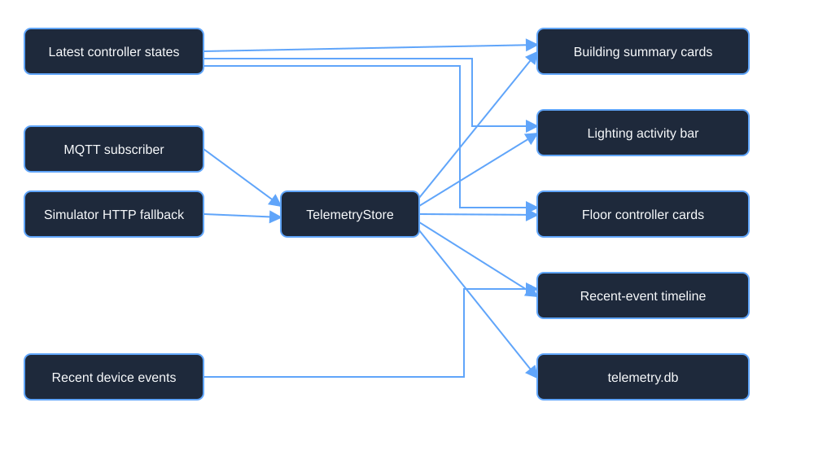
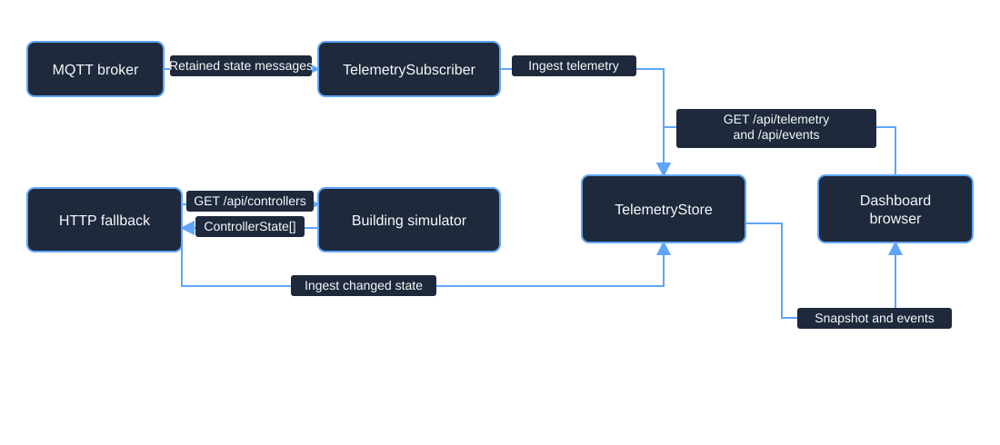
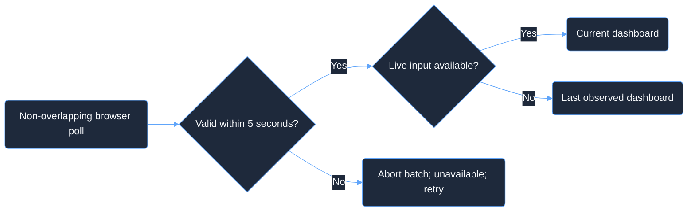
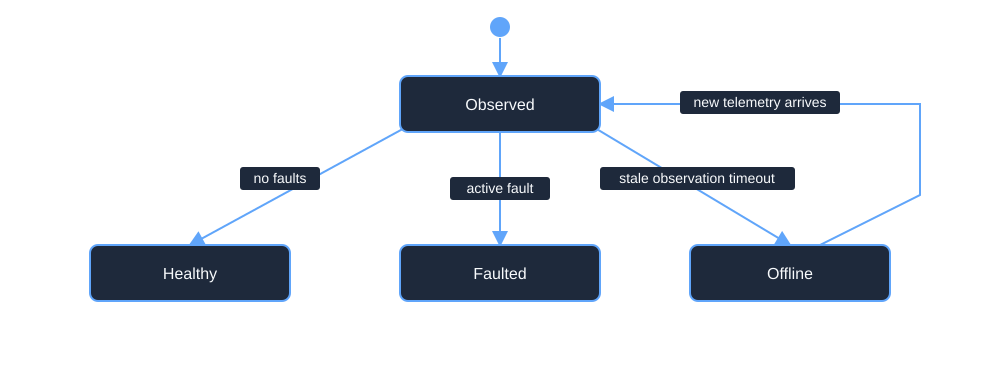

# Lighting Instrumentation

## Table of contents

- [Purpose](#purpose)
- [Design](#design)
- [Telemetry architecture](#telemetry-architecture)
- [Dashboard information hierarchy](#dashboard-information-hierarchy)
- [State and offline semantics](#state-and-offline-semantics)
- [MQTT and HTTP inputs](#mqtt-and-http-inputs)
- [Persistence](#persistence)
- [API](#api)
- [Source tree](#source-tree)
- [Configuration](#configuration)
- [Running and testing](#running-and-testing)

## Purpose

The instrumentation application presents the latest building state and recent device events. It is a telemetry consumer: it should not depend on in-process simulator internals.

## Design



The UI prioritizes building-wide health and lighting activity, then floor details, then recent events.

The dashboard is a React application written in strict TypeScript and uses Material UI for its theme and card components. `frontend/main.tsx` mounts `Dashboard.tsx`; `telemetry.ts` owns browser polling and summary calculations, with API types in `types.ts`. The Vite bundle includes the dashboard styles in `frontend/styles.css` and `frontend/base.css`. `wwwroot/index.html` references `/dist/app.js` and `/dist/app.css`, generated by the root build. See the [frontend build and test commands](../README.md#frontend-build-and-tests); Docker builds the bundles before .NET publish.

Build the React bundle rather than loading TypeScript source files directly.

## Telemetry architecture



The service runs an HTTP poller alongside the MQTT subscriber; both can contribute telemetry. The dashboard reports both when available, or HTTP fallback when MQTT is disconnected. It also shows HTTP polling availability and the configured simulator HTTP origin supplied by `/api/status`, without credentials, path, query, or fragment. A missing or null origin is shown as not reported; an API failure makes the source and polling state unavailable. The dashboard remains usable without a broker. If neither input is available, it reports **Live telemetry unavailable** and labels cached values and controller statuses as **last observed**, not current.

The browser refreshes `/api/telemetry`, `/api/events`, and `/api/status` together every second without overlapping batches. Each batch has a five-second deadline covering fetch and JSON response reads. A failure or timeout clears the live dashboard values, shows API-unavailable messages, and retries automatically. Timeout, completion, and unmount abort the batch and clear its deadline timer; unmount also cancels polling. Late results from expired requests cannot replace a recovered snapshot.



## Dashboard information hierarchy

1. Connection/transport status
2. Controllers online
3. Active faults
4. Lights on
5. Occupied rooms
6. Aggregate on/off/fault fixture activity
7. Floor and room details
8. Recent events

Status is conveyed with text and color. The dashboard does not infer unsupported energy, cost, or historical utilization metrics.

Room names and fixture markers wrap when a controller card is too narrow to show them side by side.

Controller cards use the floor as their heading and show the complete controller ID as wrapping secondary detail. Recent events initially show up to 12 items, with a displayed count of shown and available events. When more are in the current snapshot, a button reveals or collapses the remaining available events; it does not fetch older history. The count describes only the snapshot, not all persisted events.

Room fixture summaries expose faulted fixture counts in visible text and accessible names, and list the faulted strip IDs from telemetry. These do not depend on controller fault records or pointer-only marker titles. Lighting legend labels use `1rem` text with `#536176` on white. The page has no fixed minimum width, so a vertical scrollbar at a 320px viewport does not force page-level horizontal scrolling.

The instrumentation APIs and simulator mutation APIs are unauthenticated. Compose publishes both application ports on host loopback and disables simulator HTTP mutations, including from Compose-network peers; do not expose the services through proxies or non-loopback bindings. For direct local development, simulator mutation requests also have Host, Origin and fetch-metadata checks described in the [simulator guide](building-light-simulator.md#building-editor), but these do not authenticate callers or protect instrumentation. Local users and processes share access; MQTT brokers need separate access controls.

Browser interface text is in [localization.en.ts](../../src/Devices.Instrumentation.Web/frontend/localization.en.ts). Static markup retains matching English fallback text and labels; update both when changing them. Only English is provided; there is no language selector or automatic culture negotiation. Room names arrive in telemetry from the simulator.

The **Active faults** summary counts active device faults, including sensor faults. The **Lighting activity** legend's **Faulted** count includes only faulted light fixtures. Therefore, a sensor fault can produce 1 active fault while the fixture legend reports 0 faulted lights.

## State and offline semantics



- A controller is online only when its status is `Healthy` or `Faulted`; unknown statuses do not count as online.
- `Faulted` controllers remain online.
- Fixtures count as on only if `IsOn` is true and `IsFaulted` is false.
- Faulted fixtures are shown separately from off fixtures.
- `Telemetry:StaleAfterSeconds` controls when an unobserved controller becomes offline.
- Older revisioned MQTT telemetry does not replace a newer controller state. Changed HTTP states retain the existing fallback behavior and can replace a state with a higher controller revision, for example after a simulator restart.

## MQTT and HTTP inputs

The subscriber listens to:

```text
building/controllers/+/telemetry
```

For each MQTT message, the topic must have exactly the form `building/controllers/{controllerId}/telemetry`; its nonempty controller ID must match both the telemetry `ControllerId` and `State.Id`. Malformed topics, invalid IDs, mismatches, malformed JSON, and structurally invalid controller, room, light-strip, or fault data are rejected. Fault scope and target semantics are not validated. Validation does not authenticate publishers or limit message and collection sizes; broker access controls and packet limits are still required. Persisted event history has no automatic size limit or retention policy, so monitor storage and restrict who can publish.

Once per second, including while MQTT is connected, the HTTP poller first requests:

```text
GET http://localhost:5080/api/controller-snapshot
```

The agreed response is a `BuildingControllerSnapshot` with a persistent, monotonically increasing design `revision` and an authoritative, atomic `controllers` array of `ControllerState` objects. Instrumentation applies the snapshot only if its revision is not older than the last accepted revision. The same revision must have the same controller membership, and a retired ID cannot reappear. Changed HTTP states become events; unchanged states refresh their observation timestamps.

Only a `404` from the snapshot endpoint triggers a request to `GET http://localhost:5080/api/controllers` for compatibility with older simulators. A timeout, connection failure, other HTTP error, malformed response, stale revision, or invalid snapshot does not trigger this fallback or remove controllers; the poll is reported as unavailable. A legacy controller list is not authoritative for removals. After a snapshot has established membership, legacy polling and MQTT cannot add IDs outside that membership, and tombstoned IDs remain rejected.

```mermaid
---
config:
  theme: base
  themeVariables:
    darkMode: true
    actorBkg: '#1E293B'
    actorBorder: '#60A5FA'
    actorTextColor: '#F8FAFC'
    actorLineColor: '#60A5FA'
    signalColor: '#60A5FA'
    signalTextColor: '#F8FAFC'
    labelBoxBkgColor: '#1E293B'
    labelBoxBorderColor: '#60A5FA'
    labelTextColor: '#F8FAFC'
    loopTextColor: '#F8FAFC'
    noteBkgColor: '#1E293B'
    noteBorderColor: '#60A5FA'
    noteTextColor: '#F8FAFC'
    activationBkgColor: '#1E293B'
    activationBorderColor: '#60A5FA'
---
sequenceDiagram
    participant Poller as Instrumentation poller
    participant Simulator
    participant Store as Telemetry store and SQLite
    rect rgb(30, 41, 59)
    Poller->>Simulator: GET /api/controller-snapshot
    alt Valid authoritative snapshot
        Simulator-->>Poller: revision and controllers
        Poller->>Store: Reconcile membership and states transactionally
    else Endpoint returns 404
        Simulator-->>Poller: 404
        Poller->>Simulator: GET /api/controllers
        Simulator-->>Poller: Legacy controller list
        Poller->>Store: Update eligible states without removals
    else Other error or invalid snapshot
        Simulator-->>Poller: Failure or invalid response
        Note over Poller,Store: Report HTTP unavailable and retain current state
    end
    end
```



The simulator publishes an authoritative snapshot for the active design and maintains revisioned, non-reused controller identities. A [broker-backed integration test](building-light-simulator.md#running-and-testing) covers publication, instrumentation ingestion, direct snapshot reconciliation and retained-message cleanup; HTTP polling, disconnects and process restarts are not covered by that test. Without authoritative snapshots, instrumentation cannot infer deletions from a legacy list or clear retained MQTT messages.

## Persistence

SQLite stores:

- `telemetry_events` - persisted event history
- `controller_latest` - last controller state
- `controller_observed` - last successful observation timestamp
- `controller_design_revision` and `controller_authoritative` - last accepted design revision and membership
- `controller_tombstones` - retired controller IDs

[TelemetryStore.cs](../../src/Devices.Instrumentation.Web/Persistence/TelemetryStore.cs) creates the tables on startup with this schema:

```sql
CREATE TABLE IF NOT EXISTS telemetry_events (
    event_id TEXT PRIMARY KEY,
    controller_id TEXT NOT NULL,
    event_type TEXT NOT NULL,
    timestamp TEXT NOT NULL,
    payload TEXT NOT NULL
);
CREATE TABLE IF NOT EXISTS controller_latest (
    controller_id TEXT PRIMARY KEY,
    payload TEXT NOT NULL
);
CREATE TABLE IF NOT EXISTS controller_observed (
    controller_id TEXT PRIMARY KEY,
    timestamp TEXT NOT NULL
);
CREATE TABLE IF NOT EXISTS controller_design_revision (
    singleton INTEGER PRIMARY KEY CHECK (singleton = 1),
    revision INTEGER NOT NULL
);
CREATE TABLE IF NOT EXISTS controller_authoritative (controller_id TEXT PRIMARY KEY);
CREATE TABLE IF NOT EXISTS controller_tombstones (controller_id TEXT PRIMARY KEY);
```

`timestamp` columns store ISO 8601 round-trip (`"O"`) values. `telemetry_events.payload` is the camelCase `DeviceTelemetry` JSON and `controller_latest.payload` is the camelCase `ControllerState` JSON, with enum values serialized as strings, both from the shared [Devices.Contracts](../../src/Devices.Contracts/) models. `controller_design_revision` is a single-row table holding the last accepted snapshot revision. The telemetry database has no schema version pragma; missing tables are created idempotently. The separate simulator design database schema is in the [building editor guide](building-editor.md#persistence-and-activation).

An accepted snapshot removes absent known controllers' latest states and observation timestamps from memory and SQLite, while preserving their historical events. Revision, membership, removals, tombstones, and snapshot state updates are committed together; they are restored on restart. Late MQTT messages for tombstoned IDs are rejected, as are messages for IDs outside established authoritative membership. The in-memory store exposes at most 500 recent events; removal does not delete historical event rows.

On startup, malformed persisted states or events are logged and excluded from the in-memory view without deleting the stored rows. A subsequent valid simulator poll can restore an excluded controller's current state.

## API

| Method | Endpoint | Purpose |
|---|---|---|
| `GET` | `/api/telemetry` | Latest controller states |
| `GET` | `/api/telemetry/{controllerId}` | One controller state |
| `GET` | `/api/events` | Recent telemetry events |
| `GET` | `/api/status` | MQTT and HTTP transport status, including optional sanitized `simulatorHttpSource` origin |

## Source tree

```text
src/Devices.Instrumentation.Web/
  Devices.Instrumentation.Web.csproj
  Program.cs                 application setup and HTTP endpoints
  Persistence/
    TelemetryStore.cs        telemetry state and SQLite persistence
  Telemetry/
    TelemetrySubscriber.cs   MQTT subscription and HTTP polling
  appsettings.json
  Properties/launchSettings.json
  wwwroot/
    index.html   dashboard shell and frontend bundle references
    dist/        generated app.js and app.css bundles
  frontend/
    main.tsx       React entry point and Material UI theme
    Dashboard.tsx  dashboard components and rendering
    telemetry.ts   polling, formatting, and dashboard totals
    types.ts       telemetry API types
    localization.en.ts  English browser interface strings
    base.css       dashboard base styles
    styles.css     dashboard-specific layout and responsive styles
```

Shared contracts are in [Devices.Contracts](../../src/Devices.Contracts/).

## Configuration

```json
{
  "Mqtt": {
    "Host": "localhost",
    "Port": 1883
  },
  "Telemetry": {
    "SqlitePath": "telemetry.db",
    "SimulatorBaseUrl": "http://localhost:5080",
    "StaleAfterSeconds": 30
  },
  "Urls": "http://localhost:5081"
}
```

Relative `Telemetry:SqlitePath` values are resolved against the instrumentation web project's content root. The default database is therefore `src/Devices.Instrumentation.Web/telemetry.db`, regardless of the process working directory.

## Running and testing

From the repository root, build the local browser assets before running the application directly; the Dockerfile does this automatically:

```powershell
npm ci
npm run build
```

`npm run build` starts with strict TypeScript typechecking. See the [frontend test commands](../README.md#frontend-build-and-tests) for Node-based browser tests.

```powershell
dotnet run --project src/Devices.Instrumentation.Web/Devices.Instrumentation.Web.csproj --urls http://localhost:5081
dotnet test tests/Devices.Instrumentation.Tests/Devices.Instrumentation.Tests.csproj
node --import tsx --test tests\instrumentation-localization.test.mjs tests\instrumentation-react-telemetry.test.mjs
```
