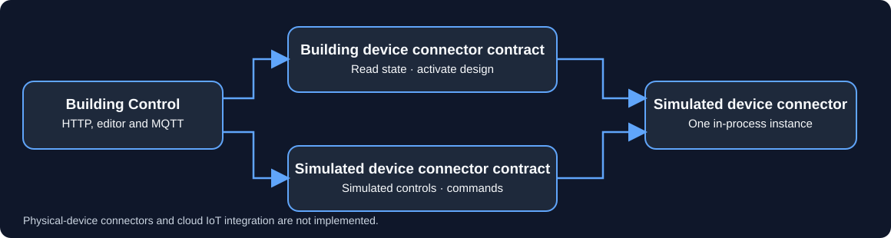

# Simulated device connector

## Table of contents

- [Purpose and boundary](#purpose-and-boundary)
- [State and controls](#state-and-controls)
- [Activation and telemetry](#activation-and-telemetry)
- [Limitations and testing](#limitations-and-testing)

## Purpose and boundary

The [Building Control](building-control.md) application uses `Devices.Connectors.Simulation` as an in-process simulated device connector. It models controllers and devices; it does not connect to physical equipment or AWS or Azure IoT services.

[BuildingDeviceConnector.cs](../../src/Devices.Contracts/BuildingDeviceConnector.cs) defines the building read and design-activation contract and a separate simulation-control contract. The web application registers both contracts against the same `BuildingSimulator` instance.

## State and controls

[BuildingSimulator.cs](../../src/Devices.Connectors.Simulation/BuildingSimulator.cs) owns the in-memory controller state and simulation operations: triggering and resetting sensors, injecting and clearing faults, and running reset and occupancy scenarios. Its lock protects state transitions and snapshots. Runtime presence, faults and lights are lost on restart; these values are not physical-device observations.

[BuildingSimulator.Design.cs](../../src/Devices.Connectors.Simulation/BuildingSimulator.Design.cs) reconciles activated designs and retained device state. The shared [design records and validation](../../src/Devices.Contracts/BuildingDesign.cs) describe the building; Building Control's PostgreSQL store persists designs separately from the simulator's runtime state.

## Activation and telemetry

The Building Control editor activates a saved design through `IBuildingDeviceConnector`. The simulated connector executes the persistence callback before replacing its live state, preserving the existing activation and revision-fencing behavior. Building Control also uses `ISimulatedDeviceConnector` for local HTTP simulation controls and incoming MQTT commands; its MQTT publisher queues state publication without delaying HTTP mutations.

The [Building Control guide](building-control.md#http-api) documents HTTP behavior, and its [MQTT protocol section](building-control.md#mqtt-protocol) describes topics, acknowledgements, cleanup and current limitations.

## Limitations and testing

The simulation-control contract is not a production physical-device command API. Real connectors, identity, authorization, command replay protection and durable physical-device state remain future work; see the [production proposal](../infrastructure/production-iot-architecture.md). Local access restrictions and the [deployment warning](building-control.md#building-editor) still apply.

Run the simulator project tests and full solution checks described in [running and testing](building-control.md#running-and-testing). The API tests cover a simulation mutation followed by reads through the building connector, protecting shared instance wiring.
