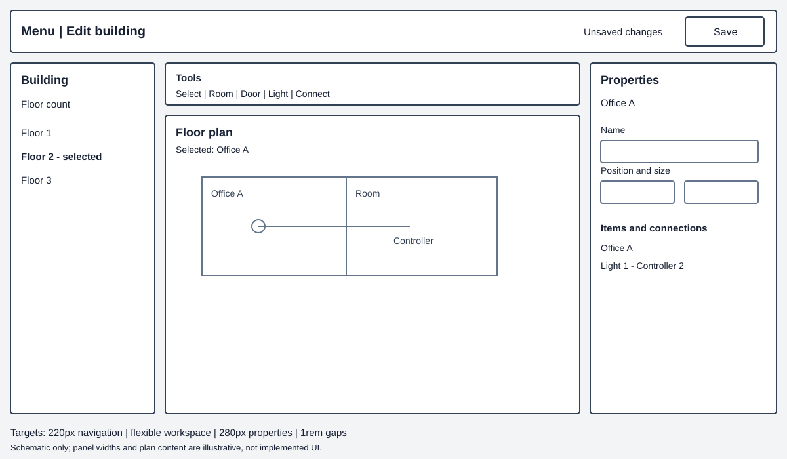
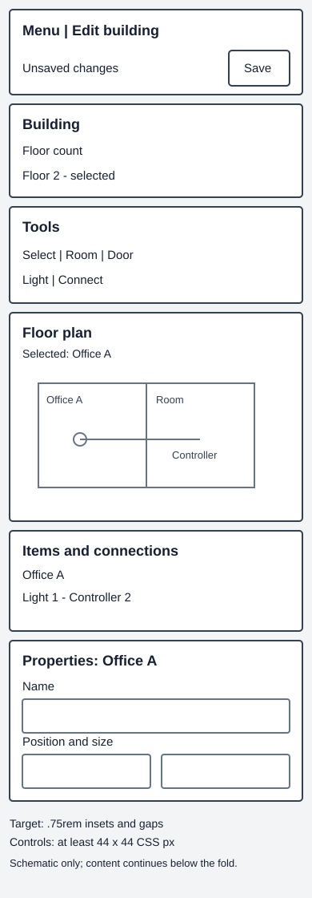
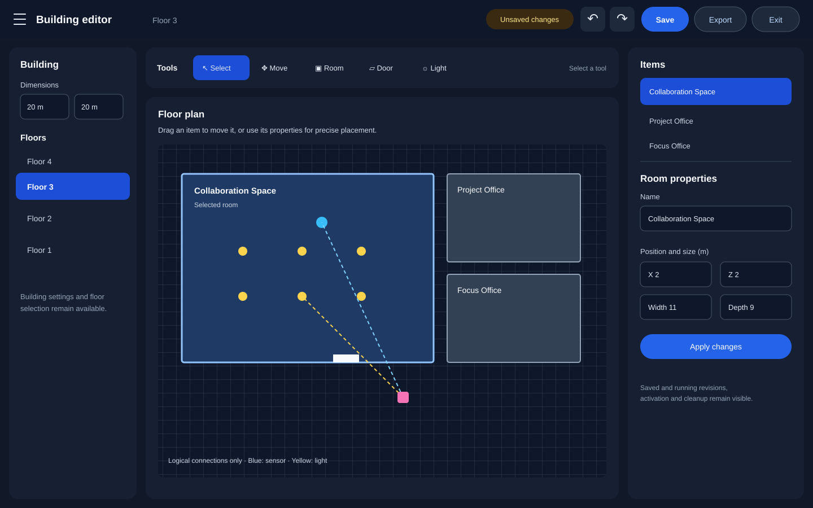
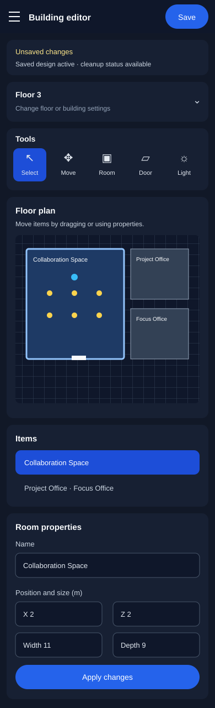

# Building editor UI

The editor uses the simulator's dark theme, an SVG floor plan and forms. The illustrations below are design targets, not screenshots; see the [editor specification](../../../plans/building-editor-spec.md) and [UX flow](ux.md) for implemented behavior and limitations.

## Table of contents

- [Visual direction](#visual-direction)
- [Layout wireframes](#layout-wireframes)
- [Proposed high-fidelity designs](#proposed-high-fidelity-designs)
- [Dimensions and components](#dimensions-and-components)
- [States and accessibility](#states-and-accessibility)
- [Validation and remaining work](#validation-and-remaining-work)

## Visual direction

The React and strict TypeScript editor component uses Material UI controls and follows the simulator's dark theme. Its current styles are part of the simulator's [frontend stylesheet](../../../../src/Devices.BuildingControl.Web/frontend/simulator.css). The plan is schematic: connections represent logical associations, not verified cable routes or electrical compliance. See the [shared design language](../../design-language.md) and [main simulator design guide](../main/design-language.md) for broader visual and accessibility targets.

## Layout wireframes

These static illustrations are not current browser captures or fixed measurements. Desktop is illustrated at `1200px` and mobile at `390px`; controls and workflow can differ from the wireframes.

## Proposed high-fidelity designs

These illustrations are design targets, not screenshots. The editor uses a Material UI icon-only toolbar for select, move, room, door, light, walkway and stairs tools; save remains prominent and secondary actions remain accessible. The current three-column editor stacks on smaller screens and retains its forms.

Existing items can be dragged in select or move mode, with a snapped preview, Escape cancellation and one undoable edit. An invalid drop stays in the editor with a validation message. Click-to-place and labelled item-list and property-form paths remain available; dragging new items from a palette is not implemented. Icons have accessible names and tooltips, with the active tool also shown in text. Selected state is indicated, and status and errors remain textual.

## Dimensions and components

| Element | Current implementation |
|---|---|
| Entry | **Building menu** opens a menu containing **Edit building** on an eligible local Development host. At narrow widths the trigger is an overflow button named **Open building menu**; unavailable access is explained in text. |
| Layout | Three columns at wider widths: building/floor controls, plan, and item list/properties. Regions stack at `900px` and below. |
| Spacing | The editor uses Material UI spacing of `1` below the `sm` breakpoint and `2` from `sm` upward (normally `8px` and `16px`); the layout gap is spacing `2` at all widths. |
| Controls | The plan has named icon toggle buttons for select, move and placement tools, zoom and pan controls, and a selected-item label and delete action. Actions wrap and include icons; editor buttons, selects and inputs have a `44px` minimum height. Undo/redo use session history. |
| Plan | An SVG plan shows rooms, fixtures, rectangular doors, box-shaped controller and connections. Room labels are clipped to their rooms; full names remain in the item list and selection label. Select or move mode supports dragging existing items; plan tools supplement the item list and property forms. |
| Properties | Labelled forms edit building and item properties; an item list exposes selection without relying on the plan. |
| Status | Text reports unsaved changes and highlights pending or failed cleanup; expandable details provide activation, saved/running revisions and cleanup counts. The simulator header also summarizes activation and cleanup with expandable details. |

These CSS values describe the implementation, not a guarantee of responsive or accessibility conformance. Walkways and stairs are editable illustrative objects; they do not guarantee routes from interior doors.

## States and accessibility

The editor displays loading, persistence, invalid-save, conflict, activation and cleanup feedback in text. A conflict disables edits and offers recovery or export; unavailable undo/redo actions are disabled. Invalid pending values are included in a marked recovery export rather than silently discarded.

The intended standard remains semantic controls, visible focus, meaningful labels, keyboard-operable list and forms, and non-color status indicators. Precise placement must not depend solely on pointer or 3D interaction. Verify actual focus, contrast, announcements, field-error correction and interaction parity rather than inferring compliance from the palette or wireframes.

## Validation and remaining work

Continue accessibility and responsive verification, including both sides of the layout breakpoint, zoom, keyboard operation and error/confirmation states. Authentication and non-loopback editor access are not implemented.
