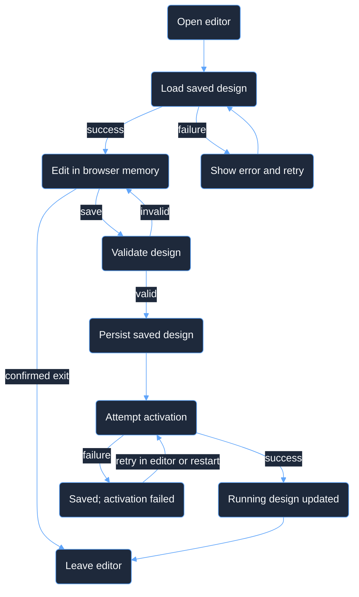

# Building editor UX

The local editor is implemented; this guide distinguishes current behavior from remaining verification targets. The [editor specification](../../../plans/building-editor-spec.md) describes validation, persistence and access limits.

## Table of contents

- [Goals](#goals)
- [Entry and navigation](#entry-and-navigation)
- [Editing tasks](#editing-tasks)
- [Save and exit](#save-and-exit)
- [Feedback and accessibility](#feedback-and-accessibility)
- [Responsive behavior](#responsive-behavior)
- [Editing experience](#editing-experience)
- [Remaining work](#remaining-work)

## Goals

- Separate editing a building design from live presence and fault controls.
- Make floor, tool, selection, unsaved edits, activation and cleanup understandable.
- Provide both a visual plan and a keyboard-operable item list and forms for essential tasks.

## Entry and navigation

Choose **Building menu**, then **Edit building** to open the editor. At narrow widths the menu trigger is an overflow button named **Open building menu**. The editor is available only through the direct loopback Development host described in the [specification](../../../plans/building-editor-spec.md#access-and-api); Compose and non-loopback deployments cannot use editor endpoints. While access is being checked, unavailable or view-only, the edit menu item is disabled and the access explanation is displayed beside the trigger and in the menu; viewing, floor and scenario controls remain available. Opening loads the saved design; loading failure is shown with retry and return controls. Multiple editors can work concurrently.

Building dimensions and floor selection, an SVG floor plan and icon tool selector, and an item list and properties forms share the current in-memory design. The plan is illustrative and does not change the live building. The simulator header shows a brief building status, with saved and running revisions, activation and cleanup counts in expandable details, including when the editor is closed.

## Editing tasks

| Task | Current interaction |
|---|---|
| Change floors and dimensions | Apply the building form; reducing floors requests confirmation with affected item counts. |
| Add a room | Use the room tool or the add-room form; a sensor and stable IDs are created. |
| Start a building | Choose **Start blank** for one empty floor or **Start with default building** for the original four floors. Confirm replacement; the saved building is unchanged until saved. |
| Add a door or light | Use the plan tool with a selected room, or add from the selected room's properties and adjust position. |
| Add a walkway or stairs | Use a plan tool, or add at the origin from the item panel and edit properties. Stairs start on the lower floor and connect to the next floor. |
| Select, move or resize | Drag an existing item in select or move mode, or select it and use its properties; the move tool also places a selected item. Resize rooms with properties. |
| Connect devices | Use sensor or light properties to connect to the floor controller or leave it disconnected. The plan displays logical connections, not physical cable routes. |
| Delete an item | Select a room, door, light, walkway or stairs and use **Delete selected item** beside the plan. Confirm removal; room removal includes its dependent devices. Sensors and controllers are required by the current model. |
| Inspect the plan | Zoom in or out, pan when zoomed and use **Fit all** to return to the whole plan. Room labels are clipped to their rooms; full names remain in the item list and selection. |
| Undo or redo | Use session history. Undoing a saved edit creates unsaved changes and requires another save; history does not survive editor exit or restart. |

The default four-floor building is 10 × 8 m; **Start blank** creates a 20 × 20 m building. Existing designs retain their saved dimensions. The plan and 3D view use the same geometry when they show the same design; local edits do not affect the running view until activated. The plan includes extra space around the footprint for exterior access. Grid, bounds, names, wiring and save validation are detailed in [building design and validation](../../../plans/building-editor-spec.md#building-design-and-validation). Invalid intermediate changes remain in the open editor until corrected or discarded. Existing generated access is represented as editable objects. The baseline seed approximates the original room layout; access objects do not guarantee routes from interior doors.

Starting over discards unapplied form values, but the design replacement can be undone. Replacement objects receive new IDs; saving replaces the previous devices and queues controller cleanup. Doors are rectangles aligned with room walls, and controllers are boxes. The selected item and delete action appear above the plan, while **Items and connections** is right of the plan on desktop and below it on narrow screens.

## Save and exit

Save reports validation or persistence errors and keeps the editor open. A successful save updates the persisted design but may still report failed activation; the UI identifies saved and running revisions in expandable details and offers activation retry. Restart restores the active design and retries a different saved revision. There is no periodic activation retry. Pending or failed cleanup is highlighted in the brief status; expandable details show pending, failed, completed or cancelled counts in the editor, and pending, failed and completed counts in the header. Failed cleanup is retried in the background when MQTT is connected, with an editor retry control.

**Exit editor** confirms before discarding unsaved changes, including unapplied form values. Other actions that replace unapplied form changes request their own confirmation. Unsaved changes do not survive exit or reload.

## Feedback and accessibility

The menu supports keyboard navigation and Escape dismissal, returning focus to its trigger. Activating the edit item closes the menu and moves focus to the editor heading after the menu closes; exiting returns focus to the trigger even if access has since changed. The editor uses labelled controls, headings, an item list, forms and text status in addition to the visual plan. The selected item is highlighted in both the list and plan, and its name appears in the properties heading. It reports loading, persistence errors, conflicts and activation/cleanup state. If saving succeeds but refreshing the live simulator fails, the editor explicitly distinguishes the saved design from the stale live view. A revision conflict disables edits; local JSON export remains available, and the user can explicitly discard local changes and load the current saved design. If pending form values cannot form a valid design, export produces a clearly marked recovery JSON file containing the unchanged design and raw form values rather than a valid design export.

The editor panel is a React and strict TypeScript component using Material UI controls and the simulator's shared dark theme. The SVG plan and item-list/form paths are composed in `frontend/editor/BuildingEditor.tsx`; validation and session history remain in the existing browser helper modules. The complete app is bundled locally with Vite before publish.

The plan is not the only selection and placement path: item-list buttons and forms support non-pointer editing. Selection and validation feedback, focus management, live announcements, keyboard operation and the parity of all editing paths require continued verification. Follow the [shared design language](../../design-language.md) and [simulator design language](../main/design-language.md).

## Responsive behavior

The current editor uses a three-column layout at wider widths and stacks its regions at 900px and below. Actions wrap, inputs fit their containers, and the page does not impose a 320px minimum width that would overflow a narrower content viewport. The [UI wireframes](ui.md#layout-wireframes) remain illustrative targets, not proof of rendered behavior.

## Editing experience

The [desktop and mobile concepts](ui.md#proposed-high-fidelity-designs) explore a compact icon toolbar and a larger plan workspace. The named icon toolbar and dragging existing items are implemented; creation tools retain click-to-place. Dragging new items from a palette is not in the agreed scope. Selection and precise positioning remain available through the item list and labelled forms without a pointer, as do undo, validation, conflict recovery and saving.

A drag shows a grid-snapped preview; Escape cancels it. Room fixtures move with their room, and a completed move is one history entry. Pending form changes require confirmation before a move replaces them. Invalid drops remain editable and report a validation issue before save.

## Remaining work

- Continue verifying desktop, narrow-mobile and keyboard workflows, zoom, focus, errors and confirmations.
- Authentication and editor access beyond a direct loopback Development host remain unimplemented; see [remaining gaps](../../../plans/building-editor-spec.md#remaining-gaps).
