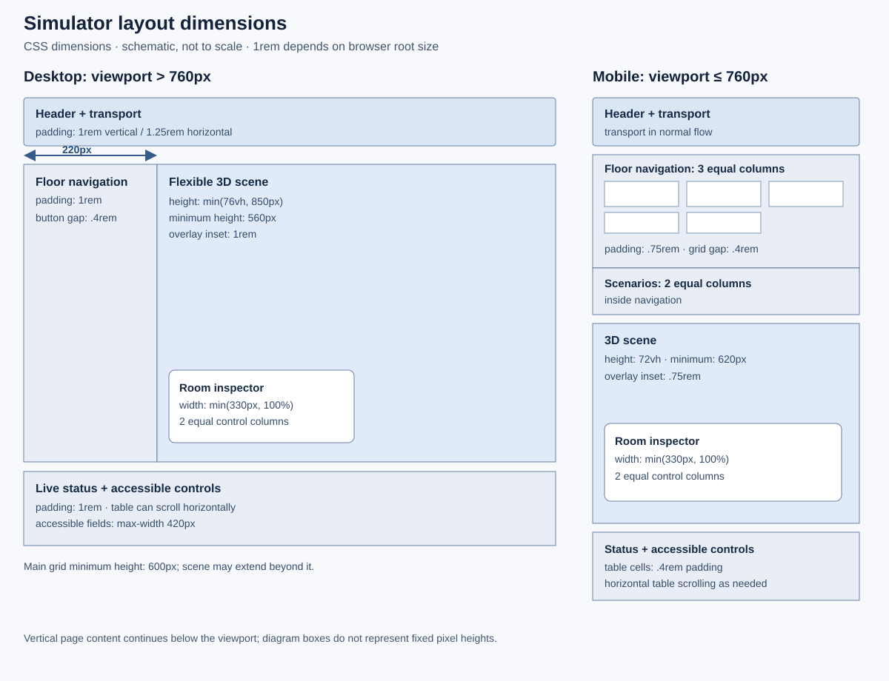

# Building Control design language

## Table of contents

- [Scope and units](#scope-and-units)
- [Implementation](#implementation)
- [Color and meaning](#color-and-meaning)
- [Typography](#typography)
- [Layout and responsive dimensions](#layout-and-responsive-dimensions)
- [Layout diagram](#layout-diagram)
- [Components and spacing](#components-and-spacing)
- [Interaction and accessibility](#interaction-and-accessibility)
- [Reference dimensions](#reference-dimensions)
- [Proposed modernization](#proposed-modernization)

## Scope and units

This is a reference for the current simulator UI, not a new token system or a specification of the illustrative mobile drawing. Current styling comes from the theme and components in [SimulatorApp.tsx](../../../../src/Devices.BuildingControl.Web/frontend/SimulatorApp.tsx), the editor's component styles in [BuildingEditor.tsx](../../../../src/Devices.BuildingControl.Web/frontend/editor/BuildingEditor.tsx), and [simulator.css](../../../../src/Devices.BuildingControl.Web/frontend/simulator.css). Scene content and interactions are described in the [simulator guide](../../../technical/building-control.md#user-interactions).

Dimensions below are CSS values. `rem` depends on the browser's root font size; for example, `1rem` is 16px only when the root font size is 16px. Viewport-height units (`vh`) depend on the viewport, and percentages depend on their container.

## Implementation

The simulator and editor are React components written in strict TypeScript and use Material UI. The [entry point](../../../../src/Devices.BuildingControl.Web/frontend/main.tsx) mounts the app; the [simulator](../../../../src/Devices.BuildingControl.Web/frontend/SimulatorApp.tsx), [3D scene](../../../../src/Devices.BuildingControl.Web/frontend/scene/SceneCanvas.tsx), and [editor](../../../../src/Devices.BuildingControl.Web/frontend/editor/BuildingEditor.tsx) compose the current UI. The simulator component defines the MUI theme; component `sx` styles and [simulator.css](../../../../src/Devices.BuildingControl.Web/frontend/simulator.css) supply additional styling, including MUI overrides. Three.js remains responsible for the interactive scene rather than rendering through MUI. See the [editor UX guide](../editor/ux.md) for editor tasks and remaining verification.

## Color and meaning

| Use | CSS color |
|---|---|
| Page background / main text | `#111827` / `#e9eef7` |
| Navigation and status panel | `#172033` |
| Control surface / border | `#1e293b` / `#475569` |
| Dividers | `#334155` |
| Selected floor | `#1d3558` with `#38bdf8` inset accent |
| Primary button | `#1d4ed8`; hover `#1e40af` |
| Transport connected / unavailable | `#86efac` / `#fca5a5` |
| Sensor / faulted sensor / light wiring legend | `#7dd3fc` / `#fca5a5` / `#fcd34d` |
| Error text / background | `#fecaca` / `#7f1d1d` |
| MUI checkbox / checked checkbox | `#93c5fd` / `#60a5fa` |

The scene panel uses a radial gradient from `#273449` to `#0d1320`. In the 3D scene, sensor presence is green and a sensor fault is red. A faulted sensor's route is red and dashed, indicating the sensor's state rather than a wire fault; selected rooms use light outlines. Status and faults are also communicated in text or with an icon; do not rely on color alone.

## Typography

The interface uses `system-ui, sans-serif`. Representative explicit sizes:

| Element | Size / weight |
|---|---|
| Main page heading | Material UI `h6`; `1rem` at widths up to `599px` |
| Section headings | Material UI `h6` or `subtitle1` |
| Floor status and occupancy | `.95rem` |
| Body and form labels | Material UI body typography |
| Buttons | Material UI button typography |

## Layout and responsive dimensions

| Viewport | Layout |
|---|---|
| Above `760px` | Main grid: `260px` navigation and a flexible scene column; minimum main height `600px`. Scene height is `min(76vh, 850px)` with a `560px` minimum. |
| At or below `760px` | A hamburger opens the floor and scenario navigation drawer, opposite the right-aligned building menu. Transport status appears on the next row. Scene height is `72vh` with a `620px` minimum. |

Navigation and status-panel padding is `1rem`, reduced to `.75rem` for the status panel at narrow widths. Scene overlays are inset `1rem`, or `.75rem` at the narrow breakpoint. The status panel permits horizontal scrolling for its table.

## Layout diagram

The diagram is an earlier schematic and does not reflect the current drawer or column width. The inspector appears within the scene when a room is selected.

## Components and spacing

| Component | Current dimensions |
|---|---|
| Floor and scenario button gaps | `.4rem` |
| Controls | Material UI controls use the dark theme and a `12px` base shape radius |
| Room inspector | Width `min(350px, 100%)`; two control columns |
| Inspector close button | Minimum `44px × 44px` |
| Inspector controls | Material UI checkboxes and labels |
| Live-status table | Minimum width `620px`; locally horizontally scrollable |
| Accessible-control fields | Maximum width `420px` |
| Buttons | Minimum height `44px` |

## Interaction and accessibility

- Buttons expose selected floor state and have a visible `2px` focus outline with a `2px` offset. Disabled actions use separate muted colors and remain unavailable until mutation access is confirmed.
- The toolbar shows **Building Control** with **Connection: Simulated** beneath it. The connector label describes the simulated source, separately from MQTT/HTTP transport status. The **Building menu** is right-aligned on desktop, with a label and overflow icon, and provides **Edit building** without replacing floor or scenario controls. Below the MUI `sm` breakpoint it becomes an overflow button named **Open building menu**. At `760px` and below a separate hamburger opens floor and scenario navigation, opposite the menu. When editor access is unavailable, the disabled edit item has an associated explanation, also shown by the trigger. Escape closes menus and the drawer; editor exit returns focus to its trigger.
- The selected room inspector exposes presence and sensor-fault controls. Accessible controls also allow choosing a room to trigger or reset its sensor, selecting a floor, and injecting or clearing faults without 3D hit testing.
- Initial labels show "Loading floors..." and "Checking MQTT...". An empty successful building view reports that no controllers are configured. Transport status reports "MQTT connected", "MQTT unavailable · HTTP active", or "Transport status unavailable". A failed initial load reports that the floor list is unavailable and displays a building-state error.
- The controller view refreshes every five seconds. Successful mutations use their returned controller state directly; when a later full refresh fails, a warning identifies the last full snapshot time and notes that successful local changes may be newer.
- Scenario controls announce when an update is in progress and when it completes. If the 3D renderer or scene fails, a persistent warning includes a retry action and directs users to the accessible controls.
- Errors and stale-snapshot warnings are textual; the scene has a descriptive accessible label. Sensor fault animation respects reduced-motion preferences, and multi-touch orbit/pan gestures do not select a room.
- These values describe existing styling, not a claim that every control or color combination meets a particular accessibility standard.

## Reference dimensions

These are intrinsic asset canvas sizes, not viewport requirements or CSS breakpoints:

| Reference | Width × height |
|---|---|
| [Desktop wireframe](wireframe-web.svg) | `1200 × 960` SVG units |
| [Mobile wireframe](wireframe-mobile.svg) | `390 × 1630` SVG units |
| [Current desktop screenshot](hidef-web.png) | `1399 × 870` pixels |
| [Proposed desktop high fidelity](hidef-web.svg) | `1400 × 900` SVG units |
| [Proposed mobile high fidelity](hidef-mobile.svg) | `390 × 1960` SVG units |

The proposed images are illustrative designs, not browser captures. The mobile image includes a separate drawer-open example.

## Proposed modernization

The proposed direction borrows the simple navigation, rounded surfaces and clear hierarchy of social applications while keeping the simulator's dark theme and scene as the focus. The simulator now has a Material UI toolbar, textual connection and design status, a desktop sidebar and a hamburger-opened mobile drawer. The images remain illustrative: visual details, status placement and other elements can differ from the implementation.

Floor status, scene errors, stale data and mutation feedback remain readable in text; the non-3D controls remain available. Actual status details, icon labels, keyboard access and contrast require continued verification.
