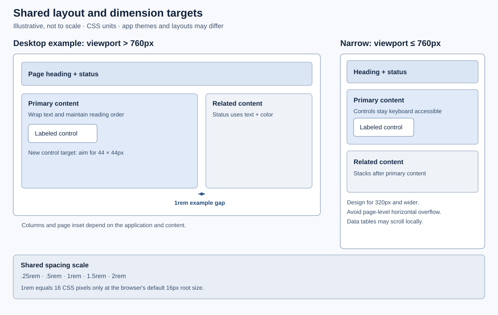

# Shared design language

## Table of contents

- [Purpose and scope](#purpose-and-scope)
- [Foundations](#foundations)
- [Layout and responsive behavior](#layout-and-responsive-behavior)
- [Dimensioned layout example](#dimensioned-layout-example)
- [Status and feedback](#status-and-feedback)
- [Interaction and accessibility](#interaction-and-accessibility)
- [Application-specific designs](#application-specific-designs)
- [Review checklist](#review-checklist)

## Purpose and scope

Use this baseline for new or changed interfaces in both applications. It defines shared design targets; it does **not** assert that existing screens already meet every target or require an immediate redesign. The application-specific guides describe what the current CSS actually implements.

Preserve the simulator's dark, scene-focused presentation and instrumentation's light, dashboard-focused presentation. Use the same interaction and accessibility principles across both without forcing the same palette, font stack, or component geometry.

## Foundations

### Typography

- Use the application's existing legible font stack; provide a sans-serif fallback.
- Use `1rem` as the target body-text size and build a clear hierarchy from body text to section headings and page title. Avoid making essential status or control text depend on small decorative labels.
- Use relative text sizes and allow wrapping and browser zoom. `1rem` is normally 16 CSS pixels at the browser default, but changes with the user's root font size.
- Use meaningful headings and concise labels rather than typography or capitalization alone to communicate structure.

### Spacing and dimensions

For new layouts, use a small relative spacing scale as a starting point:

| Token | Size | Typical use |
|---|---|---|
| Extra small | `.25rem` | Icon-to-label or tightly related content |
| Small | `.5rem` | Controls and related inline items |
| Medium | `1rem` | Card padding or related groups |
| Large | `1.5rem` | Sections and larger groups |
| Extra large | `2rem` | Major page separation |

These are design values, not CSS variables currently supplied by the apps. Adapt spacing when content or available width requires it. For new interactive targets, aim for at least `44 × 44` CSS pixels without shrinking visible content; existing controls may be smaller and should be assessed when changed.

### Color and contrast

- Choose colors from the relevant application's theme; do not assume a single hex value works on both light and dark surfaces.
- Pair color with a text label or meaningful icon. Do not rely on red, green, or any other color alone for status or actions.
- For new or changed content, target at least `4.5:1` contrast for normal text and `3:1` for large text and graphical information needed to identify controls and states. Check the actual foreground against its adjacent background, including hover, focus, disabled, and overlay states where applicable.
- Color meanings are contextual: for example, instrumentation uses amber for lights on, while simulator wiring uses blue for sensors and yellow for lights. Do not interpret every amber or blue element as a warning or status.

## Layout and responsive behavior

- Design for a `320px`-wide viewport through desktop widths. Keep essential content and actions usable at narrow widths, browser zoom, and when text wraps.
- Use `760px` as the existing shared narrow-layout breakpoint; test immediately above and below it. Instrumentation also has `420px` and `1050px` breakpoints; app-specific layout needs may justify additional breakpoints.
- Prefer fluid columns and wrapping over fixed-width content. Avoid page-level horizontal overflow; where a data table needs more space, provide a discoverable, locally scrollable table region without clipping its content.
- Maintain reading and keyboard order when columns stack. Keep related controls and status messages together and ensure overlays do not obscure important content.
- Use the app guides for implemented dimensions; the shared spacing scale and target sizes are not a claim that existing layouts already use them.

## Dimensioned layout example

The diagram is schematic and not to scale. Its spacing and target sizes are design targets, not measurements of current screens. The number of columns and exact page insets remain application-specific.

## Status and feedback

- Make loading, waiting, empty, healthy, faulted, offline or unknown, and error states distinct in text. Show what failed and a next step when one is available.
- Keep state labels aligned with the authoritative simulator or telemetry data. Do not invent energy, cost, trends, or other unsupported metrics.
- Distinguish device faults from faulted light fixtures; do not treat an online faulted controller as offline. Display connection or transport limitations without implying the whole application is unavailable.
- Preserve visible feedback after actions, including when a mutation succeeds but its subsequent refresh fails. Do not present an error or stale value as a successful current state.

## Interaction and accessibility

- Use semantic headings, buttons, labels, and form controls with accessible names. Provide keyboard access and a visible focus indicator; do not rely on pointer-only or 3D-only interactions.
- Respect `prefers-reduced-motion` for nonessential motion and provide equivalent information without animation.
- Describe visualizations and expose status information as text. Use live announcements appropriately for important changes without repeatedly interrupting the user.
- Use the application's localization resources for new or changed interface text; preserve stable IDs and protocol values.
- Contrast ratios and target sizes above are design targets, not a claim of full WCAG conformance. Verify actual rendered combinations, keyboard behavior, and assistive-technology semantics.

## Application-specific designs

| Application | Current reference | Intentional emphasis |
|---|---|---|
| Simulator | [Simulator design language](simulator/design-language.md) | Dark 3D scene, floor navigation, room controls, and a non-3D control path |
| Instrumentation | [Instrumentation design language](instrumentation/design-language.md) | Light summary dashboard, controller cards, lighting activity, and events |

Where existing styles differ from this baseline, the application guides describe the current behavior. Treat alignment with the shared targets as work for relevant future changes, not as already implemented behavior.

## Review checklist

- Check desktop and narrow-mobile layouts, including applicable breakpoint boundaries, wrapping, zoom, and local overflow.
- Check keyboard access, focus, accessible names, reduced motion, and the contrast of actual rendered states.
- Check loading, empty, error, healthy, faulted, offline, and waiting states where applicable.
- Confirm controls and telemetry reflect their real source, and that app-specific themes and accessible alternatives remain intact.
- Record any unverified states and known deviations rather than claiming conformance.
