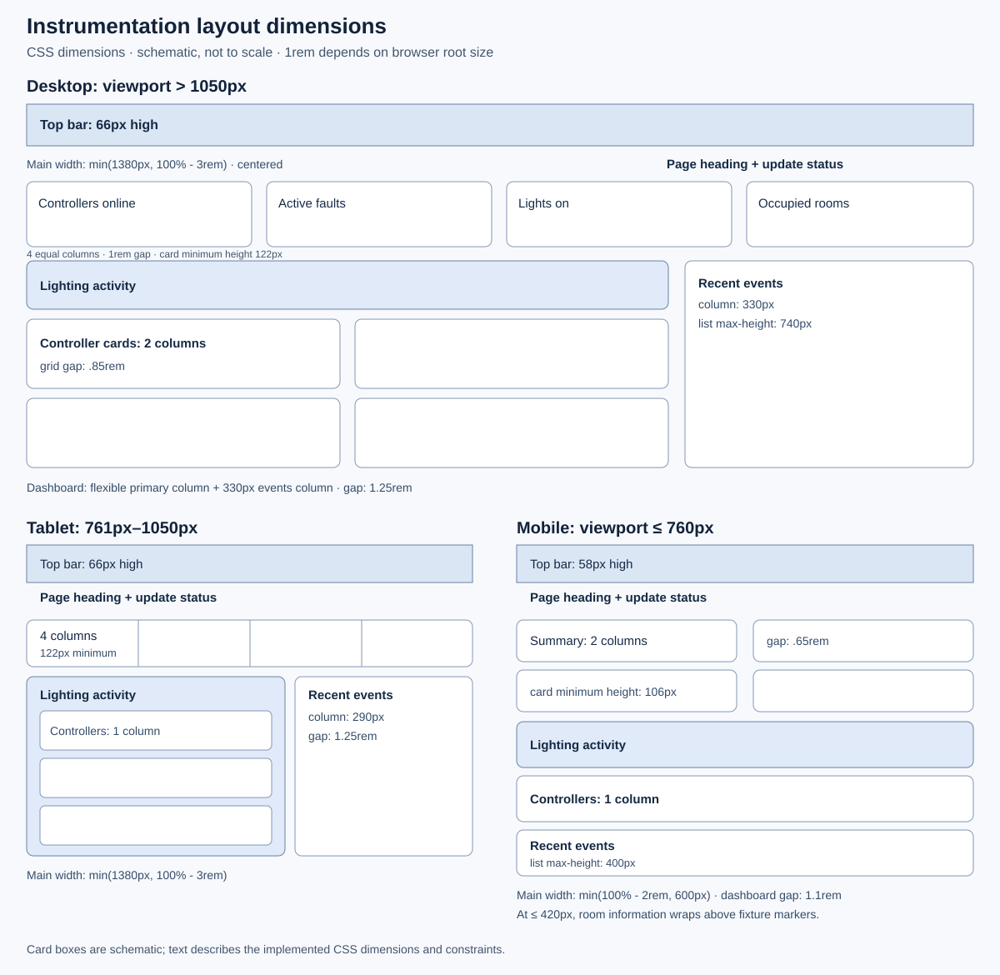

# Lighting Instrumentation design language

## Table of contents

- [Scope and units](#scope-and-units)
- [Implementation](#implementation)
- [Color and meaning](#color-and-meaning)
- [Typography](#typography)
- [Layout and responsive dimensions](#layout-and-responsive-dimensions)
- [Layout diagram](#layout-diagram)
- [Components and spacing](#components-and-spacing)
- [Interaction and accessibility](#interaction-and-accessibility)
- [Reference dimensions](#reference-dimensions)

## Scope and units

This is a reference for the current instrumentation UI, not a new token system or a specification of the illustrative mobile drawing. The authoritative values are in [base.css](../../../src/Devices.Instrumentation.Web/frontend/base.css); telemetry and state semantics are described in the [instrumentation guide](../../technical/lighting-instrumentation.md#dashboard-information-hierarchy).

Dimensions below are CSS values. `rem` depends on the browser's root font size; for example, `1rem` is 16px only when the root font size is 16px. Percentages depend on the containing element.

## Implementation

The dashboard is a React application written in strict TypeScript and uses Material UI for its theme and Paper surfaces. The [entry point](../../../src/Devices.Instrumentation.Web/frontend/main.tsx) mounts [Dashboard.tsx](../../../src/Devices.Instrumentation.Web/frontend/Dashboard.tsx). The current layout and responsive styles are split between the [base stylesheet](../../../src/Devices.Instrumentation.Web/frontend/base.css) and [dashboard stylesheet](../../../src/Devices.Instrumentation.Web/frontend/styles.css); the Vite bundle includes both. These CSS values describe the current screen rather than a new MUI design-token system.

## Color and meaning

| Use | CSS color |
|---|---|
| Page background / primary text | `#f5f7fb` / `#17243a` |
| Cards / border | `#fff` / `#e9edf3` |
| Muted text / line token | `#748197` / `#e7ebf2` |
| Teal / green accent | `#139b88` / `#2a9d77` |
| Red / amber / blue accent | `#df5d64` / `#e6a739` / `#6386d9` |
| Lighting activity on / off / faulted | `#e9b64e` / `#64748b` / `#df5d64` |
| Healthy status pill text / background | `#17684d` / `#eaf6f0` |
| Faulted status pill text / background | `#a3313a` / `#fff0f0` |
| Offline or unknown pill text / background | `#536176` / `#f0f2f6` |

Summary-card accents map to controllers online (teal), active faults (red when nonzero, green when zero), lights on (amber), and occupied rooms (blue). Fault and health states also have text. The fixture fault count is distinct from the total device-fault count.

## Typography

Body text uses `"DM Sans", "Segoe UI", sans-serif`; headings use `Manrope, "Segoe UI", sans-serif`. These are font stacks: appearance depends on fonts available to the browser. The summary value and floor badge use `Manrope, sans-serif`.

| Element | Size / weight |
|---|---|
| Page title | `clamp(1.65rem, 3vw, 2rem)` |
| Section heading | `1.06rem` |
| Eyebrow | `.8rem`, `700`, `.12em` letter spacing |
| Summary label / value / note | `.875rem` / `1.82rem` / `.875rem`; value weight `800` |
| Floor heading / controller ID / room name | `1rem` / `.875rem` / `.875rem`; the full ID wraps |
| Status pill | `.875rem`, weight `700` |
| Event title / time / controller ID | `.875rem` |
| Mobile summary value at or below `760px` | `1.55rem` |

## Layout and responsive dimensions

| Viewport | Layout |
|---|---|
| Above `1050px` | Main width `min(1380px, calc(100% - 3rem))`; four summary columns; two controller columns; dashboard has a flexible primary column and `330px` events column. |
| At or below `1050px` | Events column becomes `290px`; controllers stack into one column. |
| At or below `760px` | Main width `min(100% - 2rem, 600px)`; two summary columns; dashboard and controllers stack; events lose sticky positioning. |
| At or below `420px` | Parent brand text is hidden; activity heading stacks; room information takes a full row so names and fixture markers can wrap. |

The page has no fixed minimum width; its layout accommodates a `320px` viewport even when a vertical scrollbar reduces the available content width. The top bar is `66px` high, or `58px` at or below `760px`. The desktop dashboard gap is `1.25rem`; the mobile single-column gap is `1.1rem`.

## Layout diagram

The diagram is schematic, not to scale. Dimensions are CSS values, not fixed screenshot measurements.

## Components and spacing

| Component | Current dimensions |
|---|---|
| Summary cards, panels, controller cards | `14px` radius, `1px` border |
| Summary card | Minimum height `122px`, padding `1.05rem 1.2rem`, accent stripe `3px` |
| Mobile summary card | Minimum height `106px`, padding `.85rem .95rem` |
| Panel | Padding `1.25rem 1.4rem` |
| Controller cards | Padding `1rem 1.05rem .95rem`; `.85rem` at or below `420px` |
| Controller grid gap | `.85rem` |
| Floor badge | `39px × 39px`, `11px` radius |
| Lighting activity bar | `13px` high, `99px` radius |
| Room row | Minimum height `38px` |
| Fixture marker | `13px × 5px`, `3px` radius, `3px` gap |
| Events list | Maximum height `740px`, or `400px` at or below `760px`; scrolls vertically |

## Interaction and accessibility

- Healthy, faulted, offline, and unknown controller states use labels as well as color. Empty-state panels have their own dashed border and text.
- Before data arrives, the connection status says "Waiting for telemetry". A successful refresh with no controllers shows "Waiting for simulator telemetry" and a controller waiting message. If the instrumentation API cannot be loaded, the connection status displays "Instrumentation API unavailable" with a red dot, and the summary, activity, controllers, and events show textual unavailable messages.
- Browser refresh batches time out after five seconds, including response-body reads, without overlapping polls. API errors and timeouts clear live values and announce automatic retries. If neither MQTT nor HTTP fallback is available, the connection status is unavailable rather than green/reporting; a notice identifies all cached values as last observed and controller pills use neutral last-observed labels.
- The dashboard separately shows HTTP polling availability and the configured, sanitized simulator origin when reported. Missing or null origins are labelled not reported, and an API failure marks the source and polling state unavailable. MQTT and HTTP polling can both contribute.
- Fixture fault counts and strip IDs appear as visible text and in each fixture summary's accessible name, independently of controller fault records. The lighting legend uses `1rem` labels in `#536176` against white (contrast approximately 6.3:1).
- Off-state lighting segments and legend dots use `#64748b`, distinguishing them from the pale track and white background; counts and labels also identify each state.
- Controller cards give the floor the heading and show the full, wrapping controller ID beneath it. The recent-events count states how many of the current snapshot are shown; a keyboard-accessible button reveals or collapses additional available events without requesting older history.
- Room names can wrap; fixture markers wrap beneath room information at narrow widths. The dashboard does not invent energy, cost, or historical-utilization metrics.
- The activity-bar width and controller-card hover use transitions; the reduced-motion media query reduces transition duration and disables smooth scrolling.
- These values describe existing styling, not a claim that every control or color combination meets a particular accessibility standard.

## Reference dimensions

These are intrinsic asset canvas sizes, not viewport requirements or CSS breakpoints:

| Reference | Width × height |
|---|---|
| [Desktop wireframe](wireframe-web.svg) | `1200 × 800` SVG units |
| [Mobile wireframe](wireframe-mobile.svg) | `390 × 1450` SVG units |
| [Desktop high fidelity](hidef-web.png) | `1380 × 1458` pixels |
| [Mobile high fidelity](hidef-mobile.svg) | `390 × 1680` SVG units |

The mobile image is an illustrative, full-page rendering and may simplify content or differ visually from the running UI.
