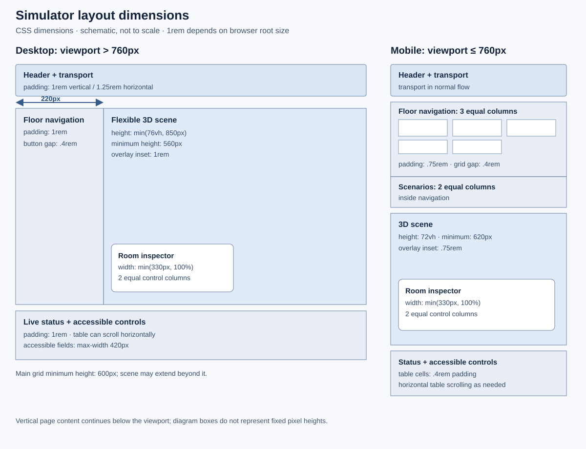

# Building Light Simulator design language

## Table of contents

- [Scope and units](#scope-and-units)
- [Color and meaning](#color-and-meaning)
- [Typography](#typography)
- [Layout and responsive dimensions](#layout-and-responsive-dimensions)
- [Layout diagram](#layout-diagram)
- [Components and spacing](#components-and-spacing)
- [Interaction and accessibility](#interaction-and-accessibility)
- [Reference dimensions](#reference-dimensions)

## Scope and units

This is a reference for the current simulator UI, not a new token system or a specification of the illustrative mobile drawing. The authoritative values are in [styles.css](../../../src/Devices.Simulator.Web/wwwroot/styles.css); scene content and interactions are described in the [simulator guide](../../building-light-simulator.md#user-interactions).

Dimensions below are CSS values. `rem` depends on the browser's root font size; for example, `1rem` is 16px only when the root font size is 16px. Viewport-height units (`vh`) depend on the viewport, and percentages depend on their container.

## Color and meaning

| Use | CSS color |
|---|---|
| Page background / main text | `#111827` / `#e9eef7` |
| Navigation and status panel | `#172033` |
| Control surface / border | `#1e293b` / `#475569` |
| Dividers | `#334155` |
| Selected floor | `#1d4ed8` with `#93c5fd` border |
| Primary button | `#2563eb`; hover and focus `#1d4ed8` |
| Transport connected / unavailable | `#86efac` / `#fca5a5` |
| Sensor / light wiring legend | `#7dd3fc` / `#fcd34d` |
| Error text / background | `#fecaca` / `#7f1d1d` |
| Presence / sensor-fault switch accent | `#22c55e` / `#ef4444` |

The scene panel uses a radial gradient from `#273449` to `#0d1320`. Status and faults are also communicated in text or with an icon; do not rely on color alone.

## Typography

The interface uses `system-ui, sans-serif`. The stylesheet leaves several element sizes, including the main heading, to browser defaults. Representative explicit sizes:

| Element | Size / weight |
|---|---|
| Building navigation heading | `1rem` |
| Scenario heading | `.9rem` |
| Floor status and occupancy | `.75rem` |
| Wiring legend and transport status | `.85rem` |
| Room inspector switch labels | `.82rem` |
| Narrow-screen view help / table cells | `.8rem` / `.85rem` |

## Layout and responsive dimensions

| Viewport | Layout |
|---|---|
| Above `760px` | Main grid: `220px` navigation and a flexible scene column; minimum main height `600px`. Scene height is `min(76vh, 850px)` with a `560px` minimum. |
| At or below `760px` | Navigation appears above the scene in three equal columns; scenario buttons use two columns. Scene height is `72vh` with a `620px` minimum. Transport status moves into normal flow. |

Desktop header padding is `1rem 1.25rem`; navigation and status-panel padding is `1rem`. Narrow navigation padding is `.75rem`. Scene overlays are inset `1rem`, or `.75rem` at the narrow breakpoint. The status panel permits horizontal scrolling for its table.

## Layout diagram

The diagram is schematic, not to scale. The inspector appears within the scene when a room is selected. Dimensions are CSS values, not fixed screenshot measurements.

## Components and spacing

| Component | Current dimensions |
|---|---|
| Floor and scenario button gaps | `.4rem` |
| Buttons and selects | `.6rem` padding; `6px` radius |
| Room inspector | Width `min(330px, 100%)`; `10px` radius; two equal control columns |
| Inspector close button | `32px × 32px` |
| Inspector switch | Minimum row height `58px`; input `44px × 24px` |
| Live-status cells | `.55rem` padding; `.4rem` at or below `760px` |
| Accessible-control fields and buttons | Maximum width `420px`; `.35rem` top margin |
| Refresh warning | Maximum width `560px` and height `30vh`; `1rem` from viewport edges |

## Interaction and accessibility

- Floor buttons expose selection and have a `2px` visible focus outline with a `2px` offset. Disabled buttons and selects use `.48` opacity.
- The selected room inspector exposes presence and sensor-fault controls; the accessible controls below the scene provide a non-3D path for floor, sensor, and fault actions.
- Initial labels show "Loading floors..." and "Checking MQTT...". Transport status reports "MQTT connected", "MQTT unavailable · HTTP active", or "Transport status unavailable". A failed initial load reports that the floor list is unavailable and displays a building-state error.
- When an action succeeds but its status refresh fails, a dismissible warning reports that the action was applied but the refresh failed; scenario refresh failures are reported with the scenario controls.
- Errors and refresh warnings are textual; the scene has a descriptive accessible label. Sensor fault animation respects reduced-motion preferences.
- These values describe existing styling, not a claim that every control or color combination meets a particular accessibility standard.

## Reference dimensions

These are intrinsic asset canvas sizes, not viewport requirements or CSS breakpoints:

| Reference | Width × height |
|---|---|
| [Desktop wireframe](wireframe-web.svg) | `1200 × 960` SVG units |
| [Mobile wireframe](wireframe-mobile.svg) | `390 × 1630` SVG units |
| [Desktop high fidelity](hidef-web.png) | `1399 × 870` pixels |
| [Mobile high fidelity](hidef-mobile.svg) | `390 × 1860` SVG units |

The mobile image is an illustrative, full-page rendering and may simplify content or differ visually from the running UI.
