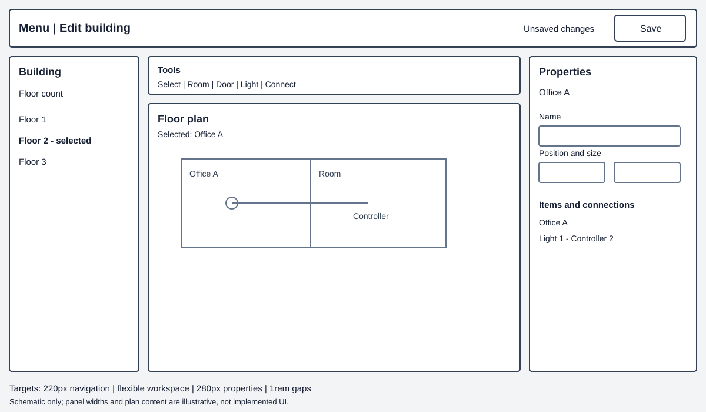
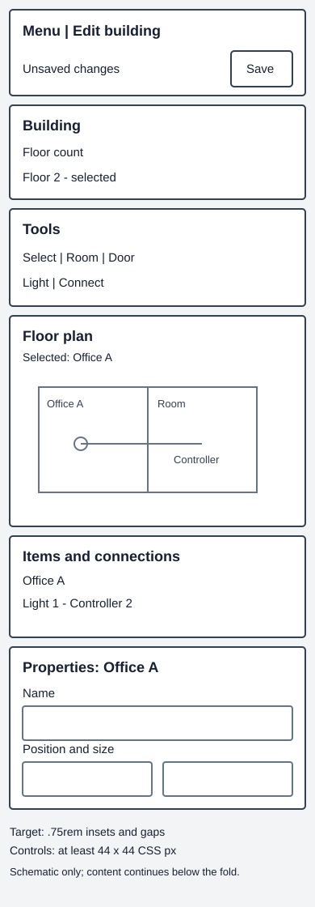

# Building editor UI design

**Status: proposed, not implemented.** These wireframes and dimensions are design targets, not screenshots or current CSS. The [editor specification](../../../plans/building-editor-spec.md) and [UX flow](ux.md) govern behavior; unresolved product decisions remain open.

## Table of contents

- [Visual direction](#visual-direction)
- [Layout wireframes](#layout-wireframes)
- [Dimensions and components](#dimensions-and-components)
- [States and accessibility](#states-and-accessibility)
- [Validation](#validation)

## Visual direction

Retain the simulator's dark theme, typography, and existing meanings for sensor and light wiring. Follow the [shared design language](../../design-language.md) for target contrast, spacing, focus, and minimum interactive target size, and use the [main simulator design guide](../main/design-language.md) as the current-style reference. These are targets for the editor; they do not imply the current interface already meets them.

Use descriptive labels alongside icons and color. The plan is schematic: connections represent the selected design model, not verified cable routes or electrical compliance.

## Layout wireframes

The illustrations are schematic and not to scale. Desktop is illustrated at `1200px` and mobile at `390px`; these are examples, not minimum widths. The labels describe target CSS dimensions. Do not treat the drawn heights or positions as fixed screen measurements.

## Dimensions and components

| Element | Proposed target |
|---|---|
| Breakpoint | Stack primary regions at `760px` and below; use a fluid layout above it. |
| Desktop columns | `220px` floor navigation, flexible plan, and `280px` properties; collapse earlier if content cannot fit without overflow. |
| Outer inset / region gap | `1rem` / `1rem` desktop; `.75rem` / `.75rem` narrow. |
| Toolbar | Wrap labelled tools with `.5rem` gaps; each interactive target at least `44 × 44px`. |
| Undo and redo | Provide labelled, keyboard-operable controls for draft history. They are not shown in the schematic wireframes. |
| Workspace | Flexible width; plan may pan/zoom locally, with equivalent list and form controls outside the plan. |
| Properties and item list | Desktop properties beside the plan; mobile item list and properties below it in reading order. Inputs fill available width without clipping. |
| Save feedback | Saved/unsaved status and Save are adjacent in the header area; allow wrapping on small screens. |

Sizes are CSS targets; `rem` depends on the root font size. At `320px`, around `760px`, and at zoomed text sizes, verify that controls wrap and the page has no horizontal overflow. No fixed minimum plan height should make form controls inaccessible.

## States and accessibility

Show the active tool with a visible label and programmatically exposed selected or pressed state, such as a labelled radio group or appropriately pressed buttons; provide a distinct text label for the selected item. Empty floors prompt users to add a room. Place errors beside relevant fields and provide a summary for errors elsewhere in the plan. Loading, saving, dirty, saved, editor-in-use, lease-lost, draft-not-persisted, failed storage, activation failure, and cleanup pending/failed/complete must be textually distinct. Show activation and cleanup statuses separately in the simulator and editor, with retry controls where local editor access is enabled. When a lease is lost, disable writes and expose local export and lease-recovery actions. Disable unavailable undo/redo actions and explain that history is session-only.

Use semantic controls, keyboard-operable lists and forms, visible focus, and appropriately announced results. Keep pointer placement optional; provide equivalent selection, geometry, and connection controls without requiring the plan. Preserve focus and draft data after validation errors or canceled confirmation. Verify actual rendered contrast and focus behavior rather than inferring compliance from the palette.

## Validation

These are static wireframes, not a running prototype. Before implementation is accepted, inspect real desktop and narrow-mobile layouts, including `320px`, both sides of the breakpoint, keyboard operation, zoom, wrapping, and all relevant error and confirmation states. Conduct independent UX review and record any limitations.
