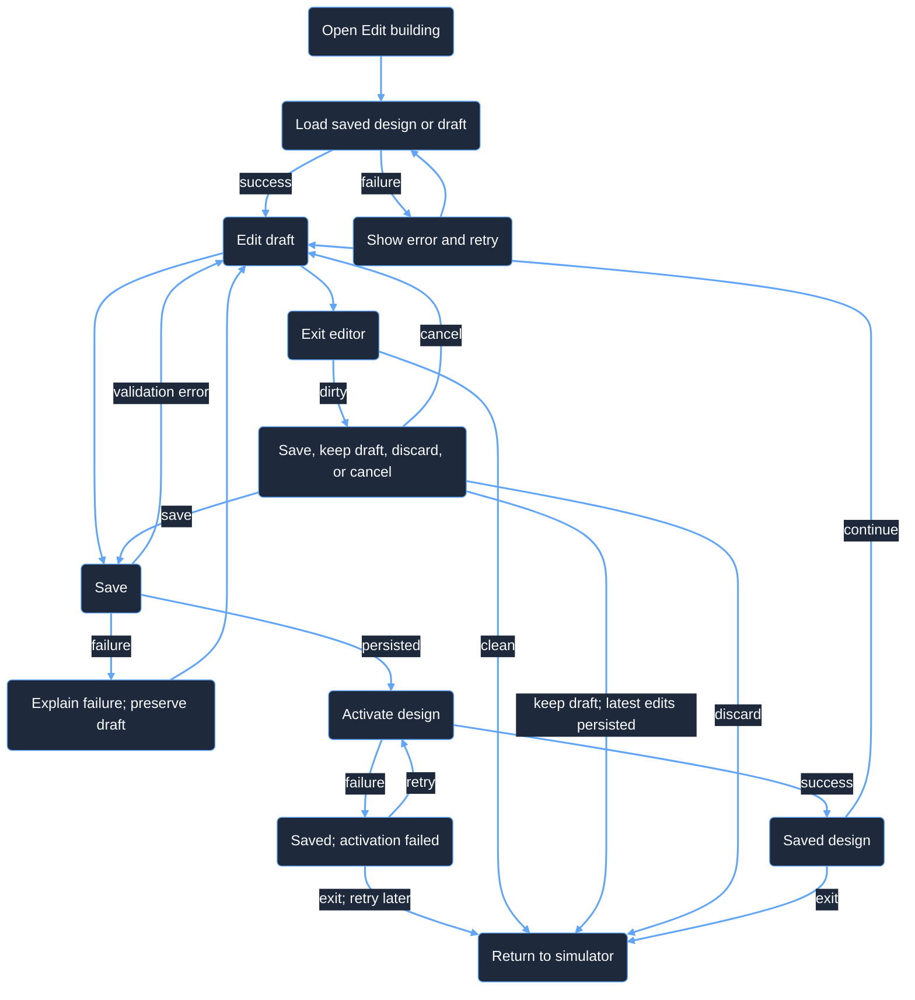

# Building editor UX design

**Status: proposed, not implemented.** This design develops the [building editor specification](../../../plans/building-editor-spec.md). It is not evidence that the simulator currently has an editor.

## Table of contents

- [Goals](#goals)
- [Entry and navigation](#entry-and-navigation)
- [Editing tasks](#editing-tasks)
- [Save and exit](#save-and-exit)
- [Feedback and accessibility](#feedback-and-accessibility)
- [Responsive behavior](#responsive-behavior)
- [Open decisions](#open-decisions)

## Goals

- Make building changes discoverable without confusing them with live presence or fault controls.
- Help users understand the selected floor, active tool, selected item, unsaved changes, and validation status.
- Support both a visual floor plan and a complete keyboard-accessible, form-based path for the same essential tasks.

## Entry and navigation

A labelled menu button in the simulator header opens a menu containing **Edit building**. Its accessible name and expanded state must be exposed, and it must support keyboard operation and focus return. Entering edit mode acquires the single-editor session and loads the saved design or offers to resume a persisted draft; a loading state precedes the editor and a load failure offers retry and return to the simulator. If another editor holds the session, explain that editing is unavailable and offer retry; an expired lease is released automatically and its persisted draft remains available for recovery.

In edit mode, a building/floor area exposes floor count and floor selection. A floor-plan workspace, tool selection, item list, and properties area work together. Selection in the plan and list refers to the same item. The editor labels the design as saved or containing unsaved changes; the simulator's live state remains separate from the draft. If the editor lease is lost, announce the loss, disable writes, and preserve local edits in memory. Offer a local export and a way to reacquire the lease. Compare the local base revision with the current persisted design and draft; if they differ, explain the conflict and offer export, explicitly confirmed discard, or manual reapplication to the current draft. Never silently overwrite newer work or present local-only edits as persisted.

## Editing tasks

| Task | Proposed interaction |
|---|---|
| Change floor count | Set a count from 1–10 and review affected floors before reducing it. Confirm deletion of the affected items together or cancel without changing the draft. |
| Add an office | Select the room tool and place/size a non-overlapping rectangle, or enter its properties in a form. Give it a name and a stable identity; a movable sensor is created automatically. |
| Add a door | Select the door tool and a valid room boundary, or select the room and boundary in the form. Explain invalid placement. |
| Add a light | Select the light tool and place it in a room, or select a room and enter placement using the form. |
| Wire a device | Select the connection tool and the device's floor controller, or choose both from labelled controls. Display logical connections with illustrative automatic routes and an accessible text list. All sensors and lights must be connected before saving. |
| Edit or remove an item | Select it in the plan or item list and use its properties. Before a destructive action, describe dependants and require confirmation to delete them together. |
| Undo or redo | Use labelled controls to reverse or restore draft edits without changing the running simulation. History remains available after save while the editor session is open, but is not restored after exit or restart. Undoing a saved change needs another save to affect the simulator. |

Building width and depth are editable in metres, initially 20 × 20 m; placement snaps to a 0.5 m grid and doors lie on room boundaries. Other constraints remain in the [specification](../../../plans/building-editor-spec.md#open-decisions).

## Save and exit

Saving is explicit and activates the design immediately after persistence. Validation errors identify the item and field, and link or move focus to a usable correction path. A failed save keeps the persisted draft intact. If activation fails, identify the saved and running designs and offer retry now or after leaving. Show persistent activation status in the simulator and editor, with retry available where local editor access is enabled. After restart, restore the last active design and automatically retry the pending activation; if it fails again, retain the previous design and its visible retry path.

Show controller cleanup as a separate pending, failed, or complete status in both simulator and editor. Retry failed cleanup automatically and provide a retry control where local editor access is enabled; preserve the status across leaving and restart. Do not imply activation failure and cleanup failure are the same condition.

The exit confirmation offers save, keep draft and leave, discard, and cancel. A failed save keeps the editor open. If the latest draft edits could not be persisted, explain the risk and do not allow **keep draft and leave** until a retry succeeds; leaving without saving requires explicit confirmation that those edits will be lost. A confirmed discard removes draft changes and restores the last saved design; cancel keeps the editor open. A safely persisted draft can be resumed later.

## Feedback and accessibility

- Use labelled native controls, meaningful headings, visible focus, and logical tab order. An icon-only menu still needs an accessible name; the active tool and selected item need textual indicators.
- Expose plan items, their properties, and controller connections in a keyboard-operable list and forms; do not make precision placement, drag gestures, color, or 3D hit testing the only path.
- Provide loading, empty-floor, dirty, saving, saved, invalid, editor-in-use, lease-lost, draft-not-persisted, storage-error, activation-error, and cleanup pending/failed/complete states in text. Announce important results without repeatedly interrupting the user.
- Label dimensions in metres. Preserve user-entered names and do not use them as IDs.
- Follow the [shared design language](../../design-language.md) and simulator's [main design language](../main/design-language.md). Localize new interface text in the simulator's English resources and matching HTML fallbacks.

## Responsive behavior

On desktop, show navigation, the plan, and properties together when space permits. At `760px` and below, stack the floor controls, toolbar, plan, item list, and properties in reading order. Keep save and unsaved status easy to find, with no obscured content or page-level horizontal overflow. Test at `320px`, around the breakpoint, at desktop width, and with zoom and wrapped text.

See the [dimensioned UI layouts](ui.md#layout-wireframes) for proposed sizing and the distinction between design targets and implemented CSS.

## Open decisions

The spec's [open decisions](../../../plans/building-editor-spec.md#open-decisions) include geometry limits, draft retention, lease timing, and activation/command coordination. Usability testing and actual keyboard and browser verification remain future work.
