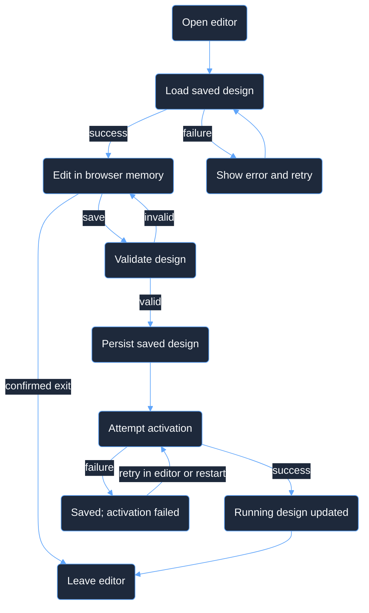

# Building editor UX

The local editor is implemented; this guide distinguishes current behavior from remaining verification targets. The [editor specification](../../../plans/building-editor-spec.md) describes validation, persistence and access limits.

## Table of contents

- [Goals](#goals)
- [Entry and navigation](#entry-and-navigation)
- [Editing tasks](#editing-tasks)
- [Save and exit](#save-and-exit)
- [Feedback and accessibility](#feedback-and-accessibility)
- [Responsive behavior](#responsive-behavior)
- [Remaining work](#remaining-work)

## Goals

- Separate editing a building design from live presence and fault controls.
- Make floor, tool, selection, unsaved edits, activation and cleanup understandable.
- Provide both a visual plan and a keyboard-operable item list and forms for essential tasks.

## Entry and navigation

A labelled **Edit building** button opens the editor. It is available only through the direct loopback Development host described in the [specification](../../../plans/building-editor-spec.md#access-and-api); Compose and non-loopback deployments cannot use editor endpoints. The simulator reports access status and disables mutation controls while access is being checked, unavailable or view-only; viewing remains available. Opening loads the saved design; loading failure is shown with retry and return controls. Multiple editors can work concurrently.

Building dimensions and floor selection, an SVG floor plan and tool selector, and an item list and properties forms share the current in-memory design. The plan is illustrative and does not change the live building. The simulator header separately reports saved and running revisions, activation and cleanup status, including when the editor is closed.

## Editing tasks

| Task | Current interaction |
|---|---|
| Change floors and dimensions | Apply the building form; reducing floors requests confirmation with affected item counts. |
| Add a room | Use the room tool or the add-room form; a sensor and stable IDs are created. |
| Add a door or light | Use the plan tool with a selected room, or add from the selected room's properties and adjust position. |
| Select, move or resize | Select a plan item or item-list button and use its properties; the move tool places a selected item. |
| Connect devices | Use sensor or light properties to connect to the floor controller or leave it disconnected. The plan displays logical connections, not physical cable routes. |
| Delete an item | Confirm removal of a room, door or light; room removal includes its dependent devices. |
| Undo or redo | Use session history. Undoing a saved edit creates unsaved changes and requires another save; history does not survive editor exit or restart. |

Building dimensions initially are 20 × 20 m. Grid, bounds, names, wiring and save validation are detailed in [building design and validation](../../../plans/building-editor-spec.md#building-design-and-validation). Invalid intermediate changes remain in the open editor until corrected or discarded. The baseline seed approximates the original layout; edited-design 3D views include illustrative perimeter walkways, exterior stairs, landings and pillars outside the editable footprint. These do not guarantee routes from interior doors.

## Save and exit

Save reports validation or persistence errors and keeps the editor open. A successful save updates the persisted design but may still report failed activation; the UI identifies saved and running revisions and offers activation retry. Restart restores the active design and retries a different saved revision. There is no periodic activation retry. Cleanup is shown separately as pending, failed, completed or cancelled in the editor; the header shows pending, failed and completed counts. Failed cleanup is retried in the background when MQTT is connected, with an editor retry control.

**Exit editor** confirms before discarding unsaved changes, including unapplied form values. Other actions that replace unapplied form changes request their own confirmation. Unsaved changes do not survive exit or reload.

## Feedback and accessibility

The editor uses labelled native controls, headings, an item list, forms and text status in addition to the visual plan. It reports loading, persistence errors, conflicts and activation/cleanup state. A revision conflict disables edits; local JSON export remains available, and the user can explicitly discard local changes and load the current saved design. If pending form values cannot form a valid design, export produces a clearly marked recovery JSON file containing the unchanged design and raw form values rather than a valid design export.

The plan is not the only selection and placement path: item-list buttons and forms support non-pointer editing. Selection and validation feedback, focus management, live announcements, keyboard operation and the parity of all editing paths require continued verification. Follow the [shared design language](../../design-language.md) and [simulator design language](../main/design-language.md).

## Responsive behavior

The current editor uses a three-column layout at wider widths and stacks its regions at 900px and below. Actions wrap and inputs fit their containers. The [UI wireframes](ui.md#layout-wireframes) remain illustrative targets, not proof of rendered behavior.

## Remaining work

- Continue verifying desktop, narrow-mobile and keyboard workflows, zoom, focus, errors and confirmations.
- Authentication and editor access beyond a direct loopback Development host remain unimplemented; see [remaining gaps](../../../plans/building-editor-spec.md#remaining-gaps).
